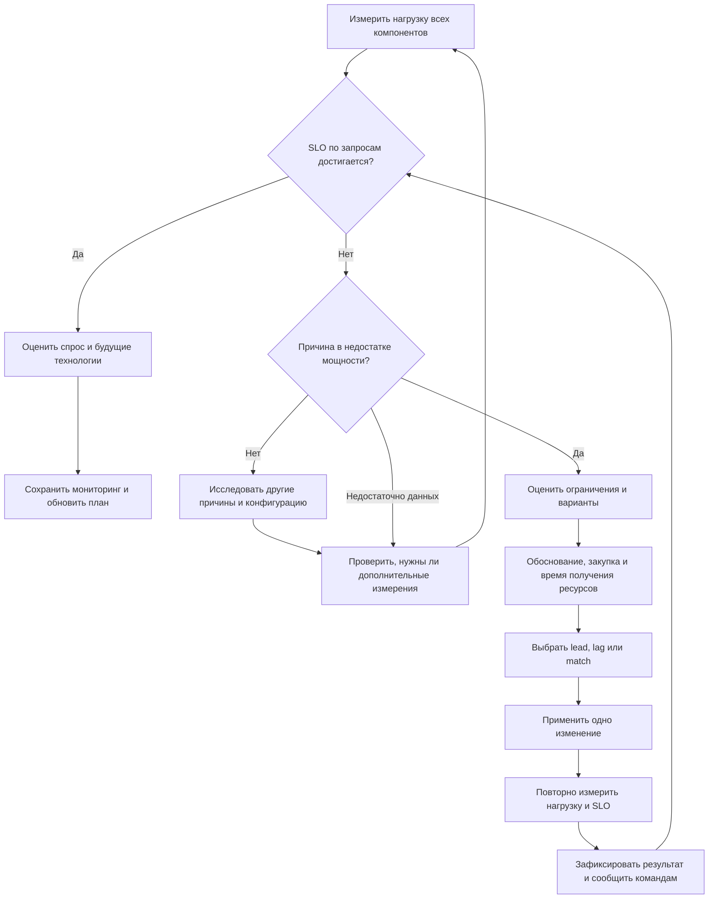

# Схема принятия решения о мощностях — глава 18

**Источник:** canonical RAG PDF 213–225. Концептуальная Mermaid-реконструкция **логики текста шагов на PDF 222–223**, не копия исходного рисунка 18.6.

В оригинальной главе шаги 1–5: измерить нагрузку; оценить SLO; при PASS — будущие потребности; при FAIL — выяснить, является ли проблема capacity; при подтвержденном дефиците — сделать одно изменение и повторить проверку, либо расширить измерения (PDF 222–223). Ветки выбора стратегии и закупок отражают отдельные разделы 215–216, 223. Схема не задаёт значения SLO, права на изменение или механизм отката: **[Needs confirmation]**.
