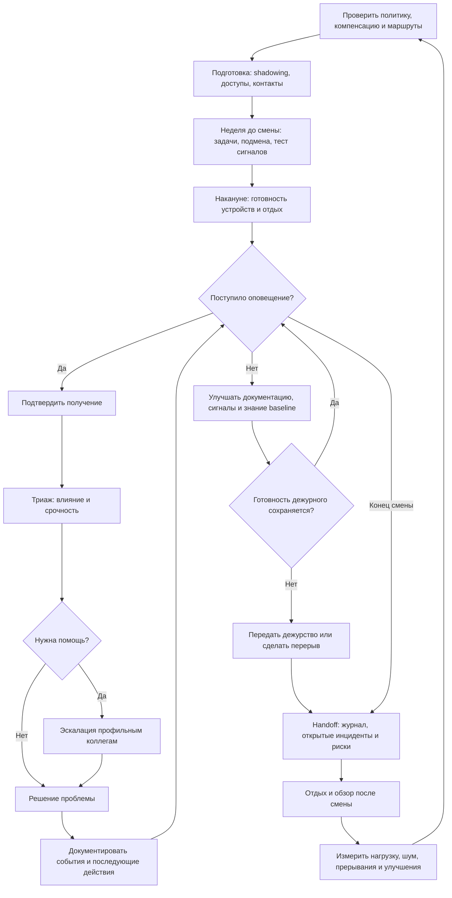

# Mermaid — устойчивый цикл дежурства

**Provenance:** canonical RAG PDF **226–240**, `p0226:c01`–`p0240:c01`. Концептуальная схема **по тексту главы**, не точная копия рис. 19.1.

Политика/эскалации: PDF 227–229; подготовка: 229–232; реакция: 233; передача: 234–235; monitoring/feedback: 237–239. Ветки готовности и отдыха взяты из рекомендаций автора, а не из универсального алгоритма выполнения команд. Реальные SLA и rollback — **[Needs confirmation]**.
