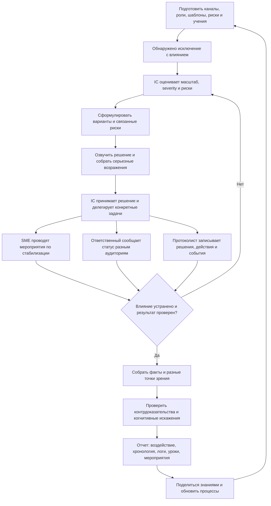

# Схема — цикл управления инцидентом и обучения

**Canonical RAG:** PDF **241–255**, chunks `p0241:c01`–`p0255:c01`. Это **новая Mermaid-схема по тексту** (особенно PDF 242–243, 244–250, 252–254), не дословная копия рис. 20.1/20.2.

**Опора:** определение и цикл PDF 241–243; каналы/командное обучение PDF 244–247; IC, SME, severity PDF 247–249; действия, информирование и повторная оценка PDF 249–250; исследование фактов, искажений и отчёты PDF 250–253; знания и следующий цикл PDF 253–255. Реальный CLI/rollback и численные SLA отсутствуют — **[Needs confirmation]**.
