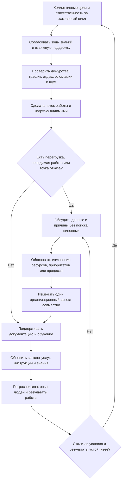

# Mermaid — система устойчивого командного управления

**Provenance:** canonical RAG PDF **256–271**, chunks `p0256:c01`–`p0271:c01`. Схема — текстово обоснованная **концептуальная реконструкция**, не копия рис. 21.1.

Основа: коллективная ответственность PDF 256–259; условия дежурств PDF 259–261; прозрачная работа, обоснование штата и ретроспективы PDF 261–263; каталог услуг/виды работы PDF 264–266; человеческие издержки и документация PDF 266–268; обучение PDF 268–269; адаптация и финальные рекомендации PDF 269–271.

**Важно:** нет источникового алгоритма «изменять строго один аспект» или технических команд. Формулировка «изменить один организационный аспект совместно» — осторожная иллюстрация итеративного подхода, а не норматив автора. Точные KPI и rollback — **[Needs confirmation]**.
