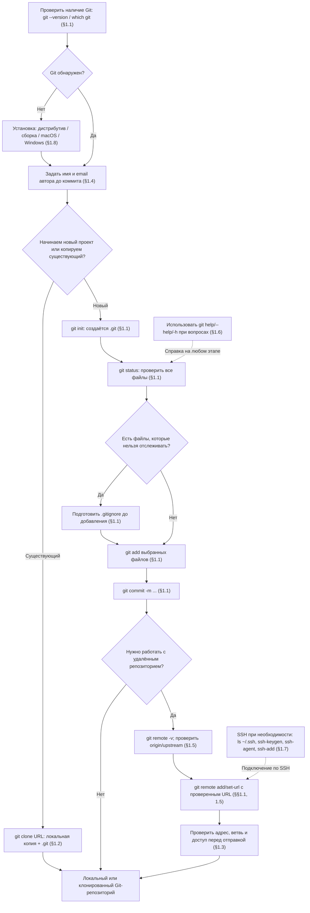

# Глава 1 — схема логики по RAG

Глава 1, PDF 10–16, `professional-git-ru:p0010:c01`–`p0016:c01`. Схема передаёт последовательность, описанную в §§1.1–1.8, и специально отделяет локальные и удалённые действия. Это **не** придуманный процесс CI или восстановления.

**Проверяемые переходы:** после выбора файлов — `git status`; после регистрации remote — `git remote -v`. Устранение ошибок, отмена и подробная верификация сетевого push в этой главе не изложены: **[Needs confirmation]**. Ветвь `master` из §1.3 не должна автоматически переноситься на произвольный пользовательский проект.

**Источники:** [10](../../../rag/chunks/p0001-p0100/p0010-c01.md), [11](../../../rag/chunks/p0001-p0100/p0011-c01.md), [12](../../../rag/chunks/p0001-p0100/p0012-c01.md), [13](../../../rag/chunks/p0001-p0100/p0013-c01.md), [14](../../../rag/chunks/p0001-p0100/p0014-c01.md), [15](../../../rag/chunks/p0001-p0100/p0015-c01.md), [16](../../../rag/chunks/p0001-p0100/p0016-c01.md).

При обнаружении несоответствий текстового слоя не выполнять «исправленную» команду автоматически; использовать [source-findings.md](source-findings.md).