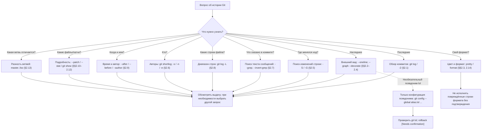

# Глава 2 — карта поиска по Git-истории

Источник: RAG PDF 16–23, §§2.1–2.14. Mermaid показывает **ветви выбора команды по вопросу**, а не модификацию истории.

**Дисциплина действий:** `git log`, `git shortlog`, `git show` в главе предназначены для чтения истории; `git config --global alias.lol` изменяет пользовательскую настройку. Визуализация/фильтрация логов не равна индексированию, хотя название §2.10 содержит слово «Индексация».

**Ограничения:** для `-S`/`-G` сохранить смысл из книги; сложные цветовые формулы и `tree = log ...` повреждены — см. [source-findings.md](source-findings.md). Отмена глобального псевдонима: **[Needs confirmation]**.

**RAG:** [17](../../../rag/chunks/p0001-p0100/p0017-c01.md), [18](../../../rag/chunks/p0001-p0100/p0018-c01.md), [19](../../../rag/chunks/p0001-p0100/p0019-c01.md), [20](../../../rag/chunks/p0001-p0100/p0020-c01.md), [21](../../../rag/chunks/p0001-p0100/p0021-c01.md), [22](../../../rag/chunks/p0001-p0100/p0022-c01.md), [23](../../../rag/chunks/p0001-p0100/p0023-c01.md).