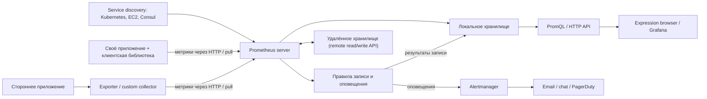
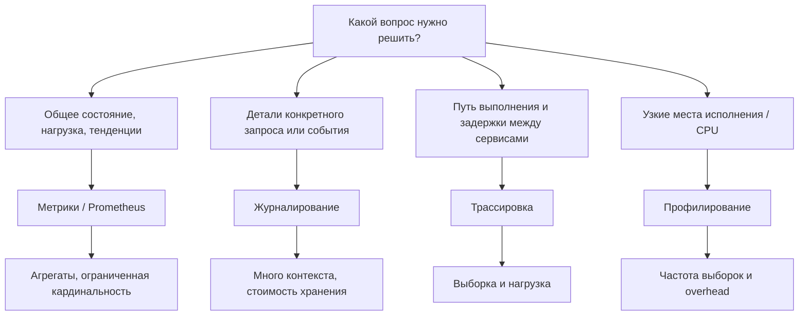

# Схемы главы 1 (концептуальные, RAG-only)

## 1. Архитектура Prometheus

**Уточнение:** discovery даёт список целей; сервер получает данные посредством HTTP pull, типично каждые 10–60 с. Правила задают условия оповещений **в Prometheus**; Alertmanager группирует, маршрутизирует и может временно подавлять доставку. Схема воспроизводит логические связи из текста, а не визуальный макет рис. 1.1. Источники: `p0027:c01, p0028:c01, p0029:c01, p0030:c01, p0031:c01, p0032:c01`.

## 2. Какой уровень детализации нужен?

Это сравнение методов телеметрии по главе, а не универсальная диагностическая процедура. Источники: `p0020:c01, p0023:c01, p0024:c01, p0025:c01, p0026:c01, p0033:c01`.

## Граница применимости

Prometheus не предназначен для журналов, сырых индивидуальных событий и неконтролируемой кардинальности. Операционным метрикам допустимы небольшие неточности; не подменять ими финансовый или биллинговый источник истины. `p0033:c01`.

**Ограничение источника:** RAG не хранит мультимодальную геометрию рисунков 1.1 и 1.2; см. [source-findings.md](source-findings.md).
