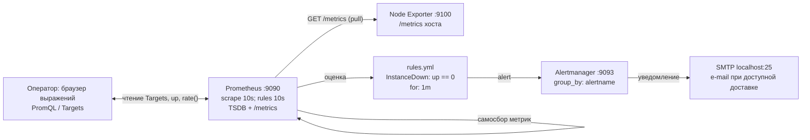
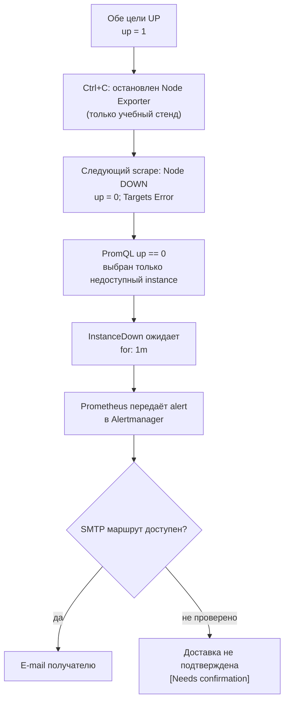

# Глава 2 — диаграммы по RAG

Граница: PDF 34–52; source `p0034:c01`–`p0052:c01`. Диаграммы **не** являются копиями издательских рисунков 2.1–2.19.

## Поток метрик и уведомлений

Источники: PDF 35–38 (`p0035:c01`–`p0038:c01`), 43–46 (`p0043:c01`–`p0046:c01`), 48–52 (`p0048:c01`–`p0052:c01`). Стрелка к Node Exporter обозначает инициирование pull самим Prometheus, **не** push от экспортера.

## Учебная симуляция отказа

Источник: PDF 47–52. Указанные условия описывают конкретный сценарий книги, не все возможные состояния системы. Процедуры восстановления реальной инфраструктуры вне главы: [Needs confirmation].
