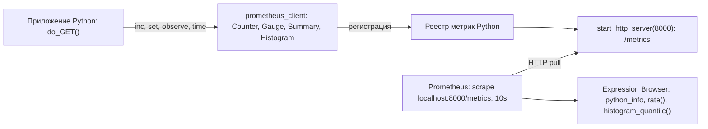
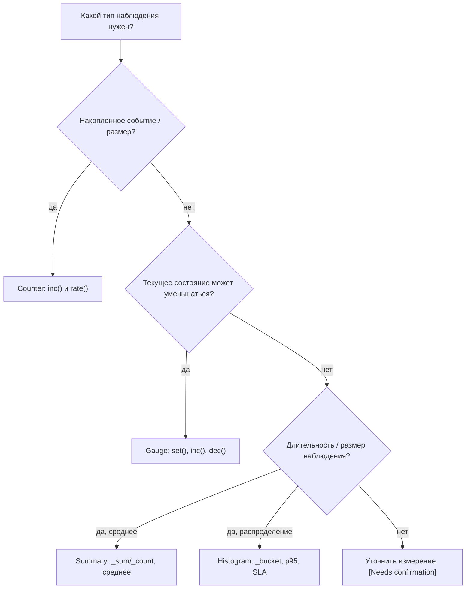
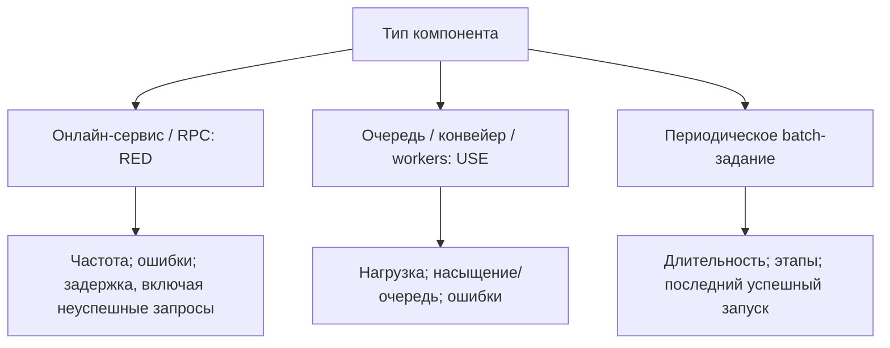

# Диаграммы главы 3 по RAG

**Привязка:** PDF 54–75, `p0054:c01`–`p0075:c01`. Не реконструкция издательских рисунков.

## Прямое инструментирование и запросы

Источник: PDF 54–57, 61–66. Направление HTTP pull — от Prometheus к endpoint; пользовательский обработчик приложения в примере слушает отдельно на порту 8001.

## Выбор метрики для задачи

Источник: PDF 56–68. Histogram использует кумулятивные buckets; квантили вычисляются приближённо. Выбор между Summary/Histogram основан на вопросах главы, не заменяет performance-тест.

## Где инструментировать

Источник: PDF 70–72. У batch упомянуты Pushgateway и textfile collector, но реализация рассматривается в следующих главах.
