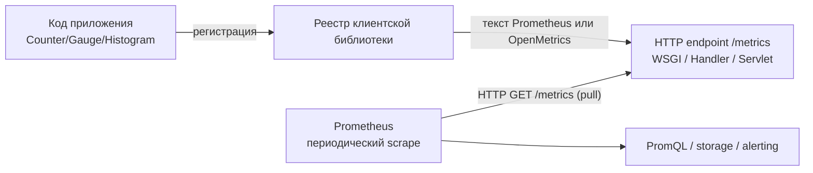
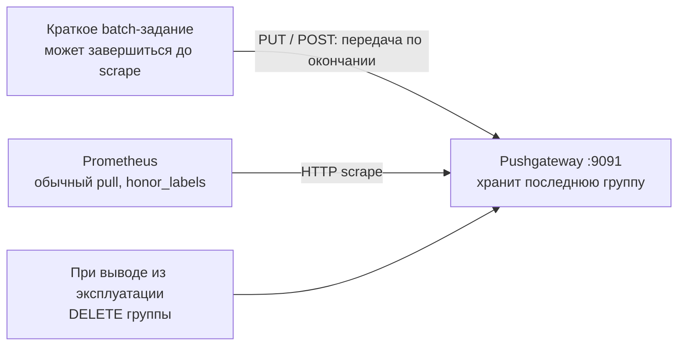
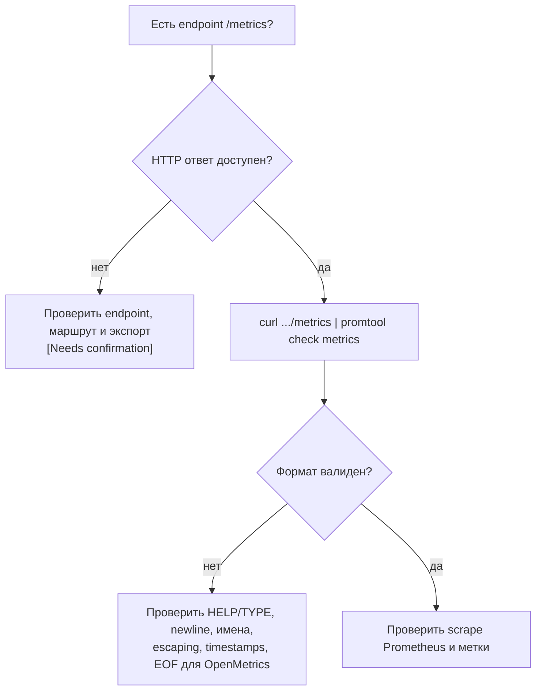

# Глава 4 — диаграммы по RAG

**Источник:** PDF 76–96 (`p0076:c01`–`p0096:c01`). Эти Mermaid-схемы — текстовые конструкции по источнику, не воспроизведение рисунков 4.1–4.2.

## Экспорт из долгоживущего процесса

RAG PDF 76–85. Для многопроцессного Gunicorn используется `MultiProcessCollector` с чтением файлов worker при scrape (PDF 79–82).

## Pushgateway: только cache для service-level batch

RAG PDF 86–89. Pushgateway не превращает Prometheus в push-систему: у клиента временная отправка, у Prometheus постоянный pull. Для привязанных к машине заданий в книге рекомендован textfile collector, разбираемый в главе 7.

## Проверка формата и источник ошибок

RAG PDF 91–96. Последовательность проверок — диагностическая интерпретация утверждений главы; конкретный deployment и rollback не даны: [Needs confirmation].
