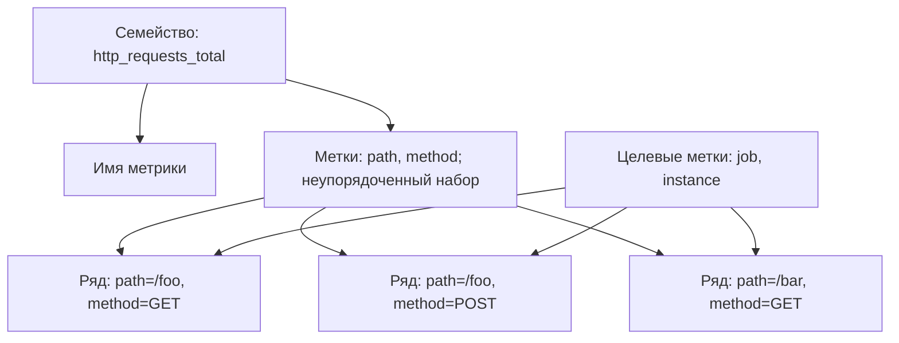
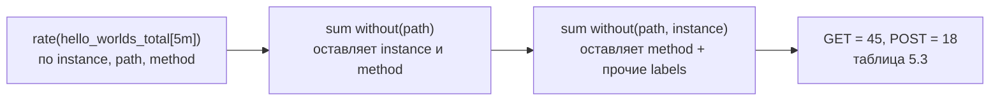
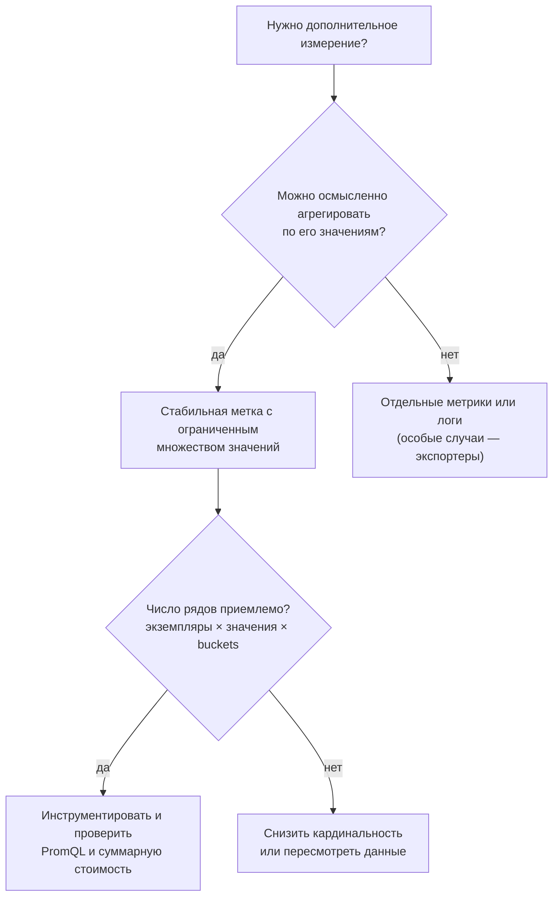

# Глава 5 — RAG-grounded Mermaid

**Источник:** PDF 97–111 (`p0097:c01`–`p0111:c01`). Диаграммы построены по тексту главы.

## Имя, метки и временные ряды

PDF 97–101. В источнике метрики с метками создаются через `labelnames` + `labels`, целевые метки назначаются Prometheus при сборе (PDF 98–100).

## Агрегирование

Источник: PDF 103–104. Таблица 5.4 имеет конфликтующую строку по `sum without(method, instance)` (см. [source-findings.md](source-findings.md)).

## Выбор меток и контроль кардинальности

Источник: PDF 108–111. Эвристика ниже 10 рядов для обычной метрики/экземпляра — рекомендация авторов, не запрет платформы.
