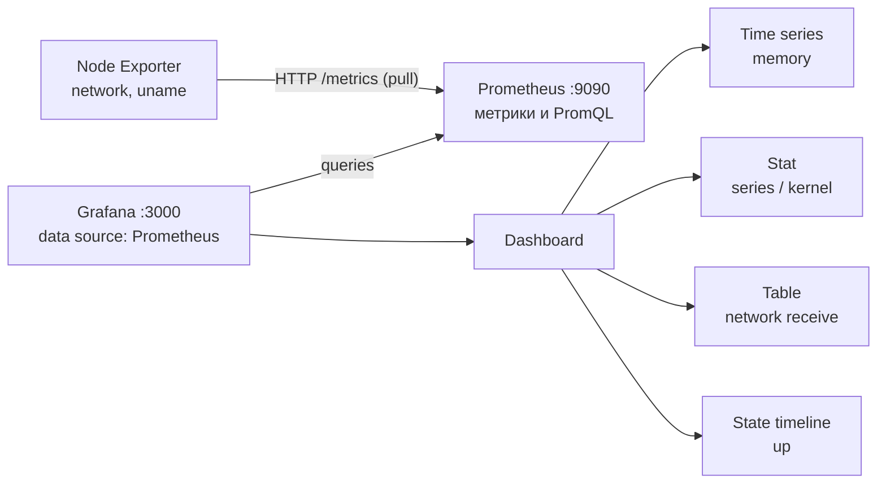
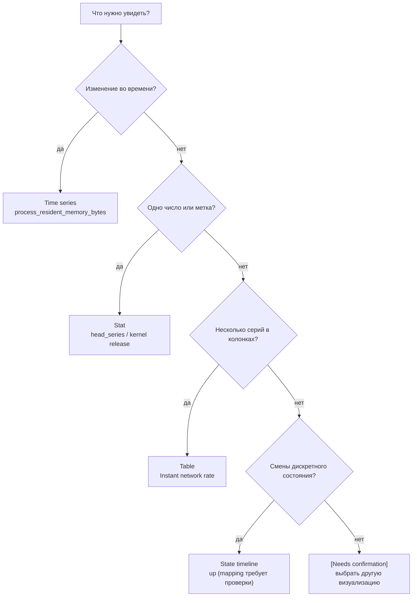
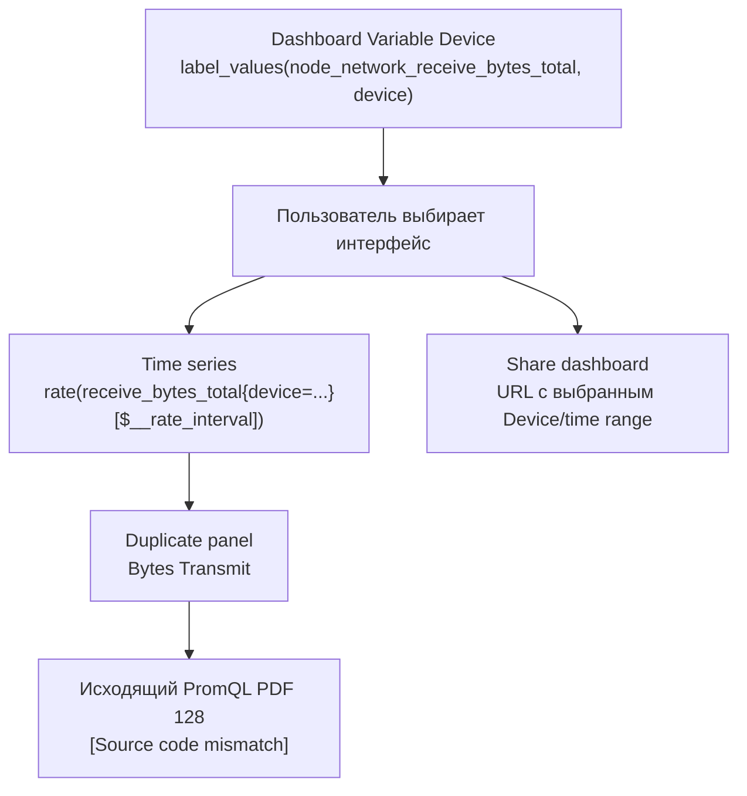

# Mermaid-схемы главы 6

**Источник:** RAG `p0112:c01`–`p0129:c01` (PDF 112–129). Схемы выведены из текста; оригинальные рисунки 6.1–6.19 не воспроизводятся.

## Поток данных и конфигурирование дашборда

Основание: PDF 112–125. Prometheus выполняет pull Node Exporter (глава 2); Grafana выполняет запросы к Prometheus через настроенный источник данных (PDF 115–116).

## Практический выбор панели

Основание: PDF 117–125. Выбор типов панелей следует примерам главы; `DOWN=2` из PDF 125 конфликтует с текстом главы 2.

## Общий дашборд с переменной устройства

Основание: PDF 126–129. Функция `label_values` выполняется в контексте переменных Grafana, а не в PromQL.
