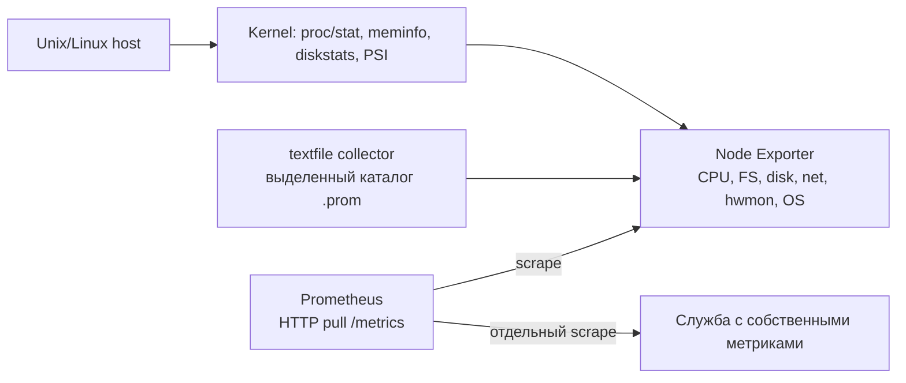
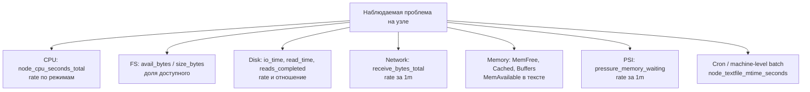
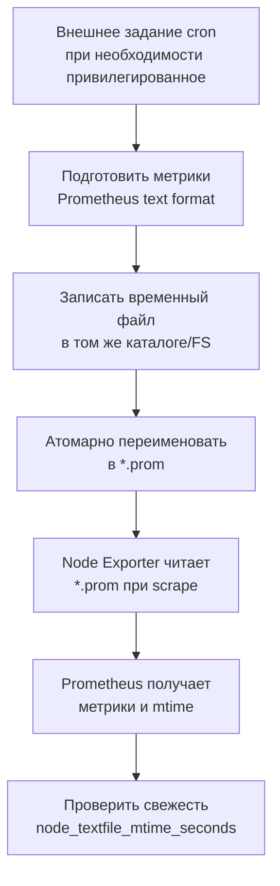

# Диаграммы главы 7 — Node Exporter

**Основание:** PDF 131–143, `p0131:c01`–`p0143:c01`. Mermaid иллюстрирует исходный текст, не перенесённые из PDF изображения.

## Архитектура машинных метрик

RAG PDF 131–132, 140–143. Node Exporter не выполняет shell-команды для сбора привилегированных данных; файлы готовит внешний процесс.

## Какую метрику изучать

Источник PDF 132–143. Формула FS на PDF 134 имеет несогласованное словесное пояснение, см. [source-findings.md](source-findings.md). Это карта выбора, не автоматическая диагностика.

## Безопасная цепочка textfile collector

Источник PDF 140–143. `/etc/shadow` из учебного примера не требуется для этой общей схемы и не является рекомендацией. Pushgateway применяется к batch уровня службы, а не к машинному textfile.
