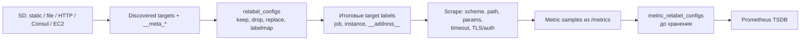
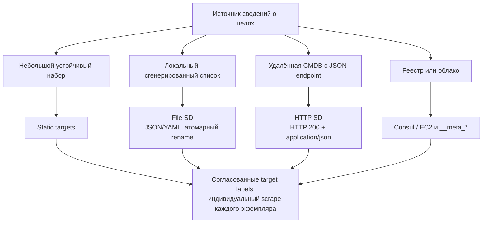
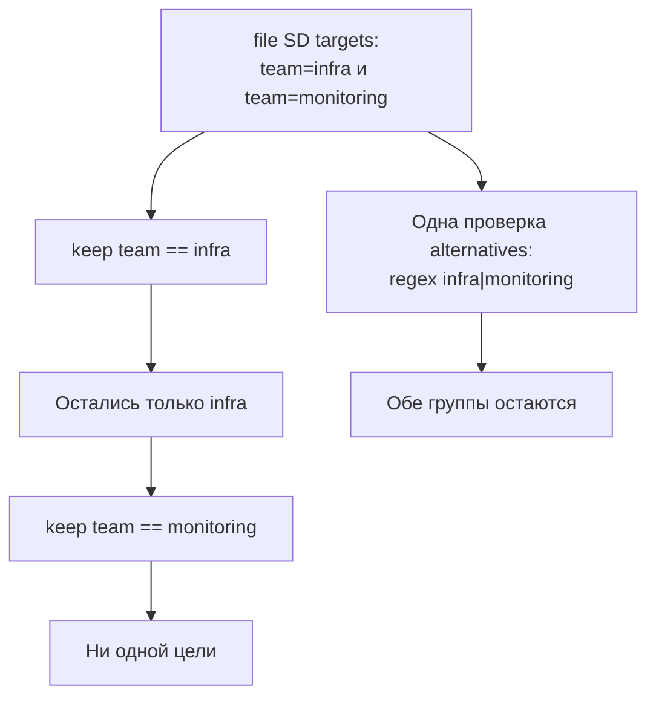
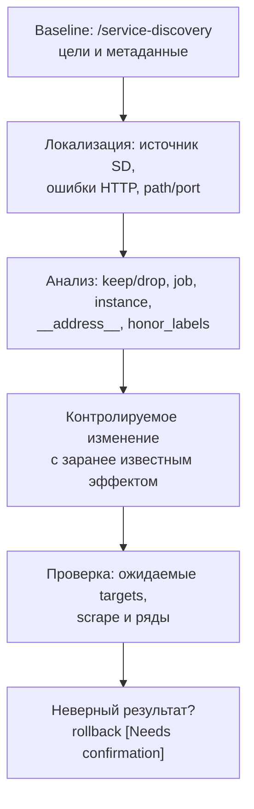

# Глава 8 — схемы Service Discovery (Mermaid)

**Источник:** PDF 144–169 (`p0144:c01`–`p0169:c01`), только canonical RAG. Mermaid-схемы передают логику книги, не изображения рис. 8.1–8.4.

## Цель: от данных SD к успешному scrape

PDF 144–169. Обнаружение списка целей, отбор/изменение target labels и изменение полученных метрик — отдельные стадии. Сгенерированная метрика `up` не проходит `metric_relabel_configs` (PDF 168).

## Выбор источника и его риски

PDF 144–153, 156. Для HTTP SD при недоступности сразу после рестарта список целей может быть пуст. Для файла избегать частичного обновления.

## Чем опасен двойной keep

PDF 154–155. Правила relabel идут последовательно, альтернативы в одном regex не равны двум `keep`.

## Диагностическая последовательность

PDF 148–169. Конкретные команды применения/rollback и инфраструктура пользователя не описаны в книге, поэтому схема не утверждает процедур, которых RAG не содержит.
