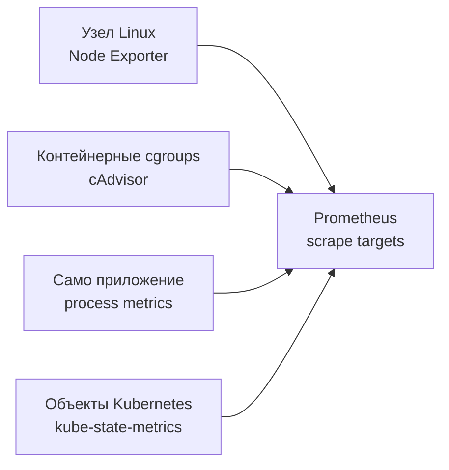
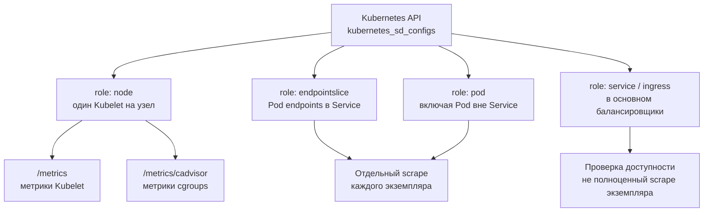
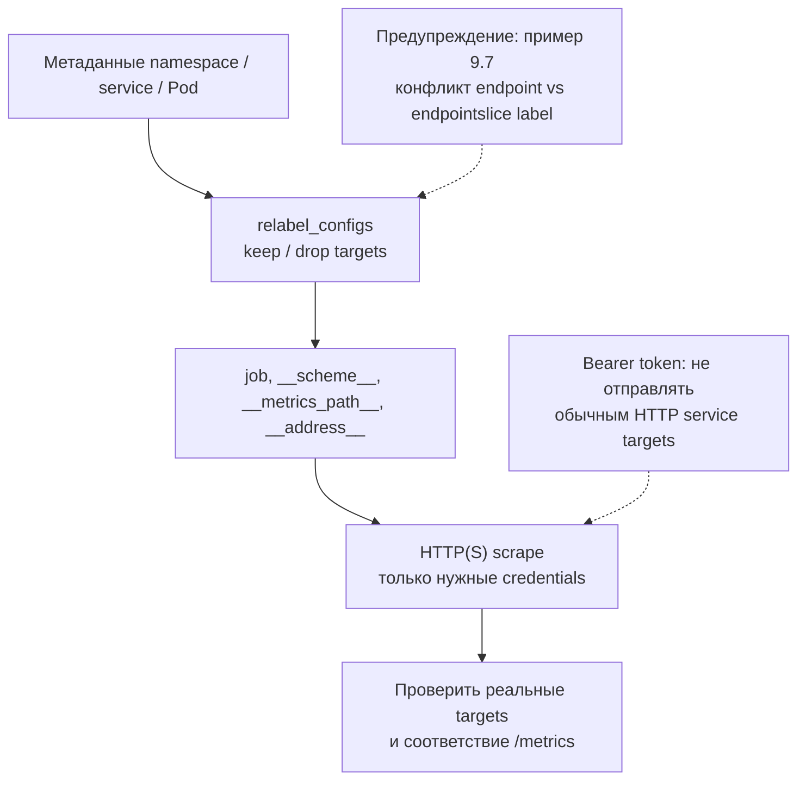
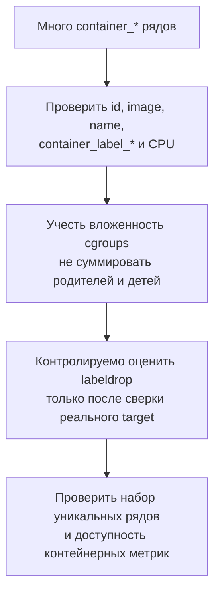

# Mermaid — глава 9 «Контейнеры и Kubernetes»

**Основание:** RAG PDF 170–186 (`p0170:c01`–`p0186:c01`). Диаграммы не являются реконструкцией рисунков 9.1–9.6.

## Четыре уровня метрик

Источник PDF 170–172, 184–185. Классы метрик не взаимозаменяемы.

## Обнаружение целей через Kubernetes API

Источник PDF 175–184. Роль `endpoints` упомянута как устаревающая, вместо неё в книге предлагается `endpointslice`.

## Relabel, метаданные и безопасность

Источник PDF 179–183. Исходный пример 9.8 в RAG пропускает `action: drop` в листинге, но действие названо в пояснении: см. [source-findings.md](source-findings.md).

## Диагностика кардинальности контейнерных метрик

Источник PDF 171–173. В примере `labeldrop` различаются адреса `:9090` и `:8080`; это исходное расхождение, не рекомендация конкретного target.
