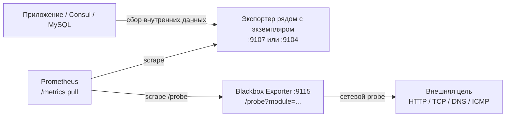
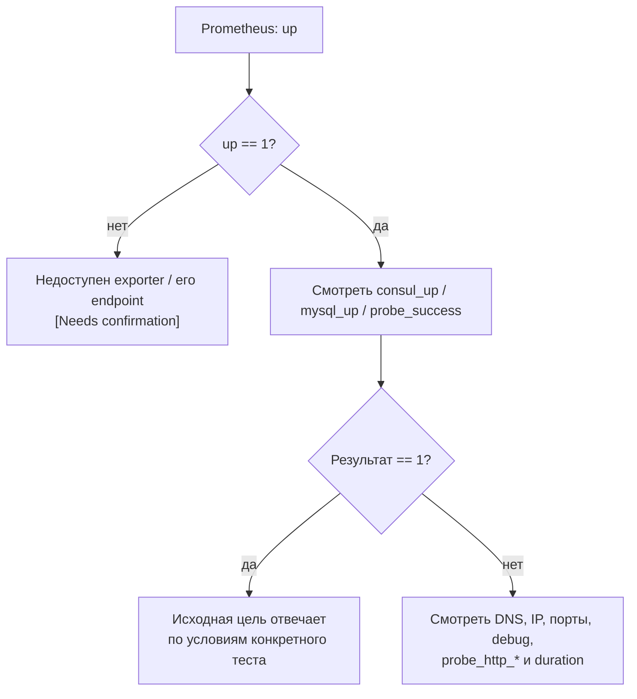
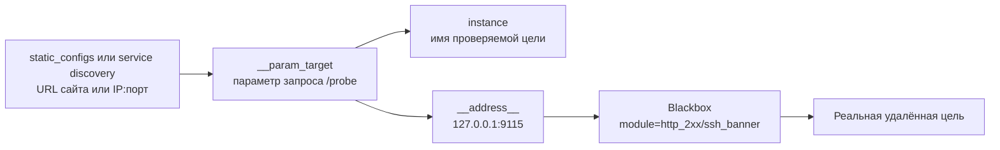
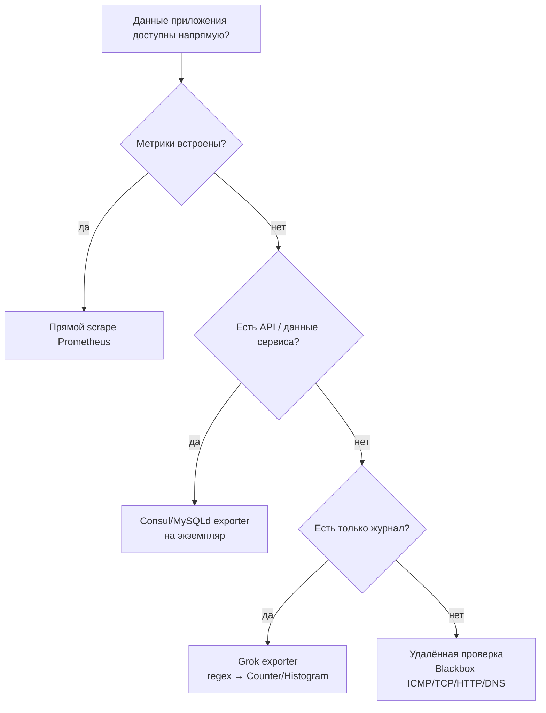

# Глава 10: схемы работы экспортеров (Mermaid)

**Источник:** PDF 187–208, RAG `p0187:c01`–`p0208:c01`. Все схемы выведены из текста, а не из изображений оригинала.

## Стандартный exporter и внешняя проба

PDF 187–194, 205–207. Внешняя проба создаёт сетевое взаимодействие: `up` описывает доступность Blackbox, `probe_success` — результата зонда.

## Диагностика доступности

PDF 188–190, 195–203, 206. Это диагностический flow из главы, а не готовая alert rule.

## Multitarget — как разделить исходную цель и exporter

PDF 205–207. Фактический порядок relabel — копировать первоначальный `__address__` в `__param_target`, затем `instance`, затем заменить `__address__`.

## Какая форма преобразования нужна

PDF 187–194. Последняя ветвь — **одна из обсуждаемых в источнике архитектур**, а не утверждение, что Blackbox покрывает любые форматы/цели.
