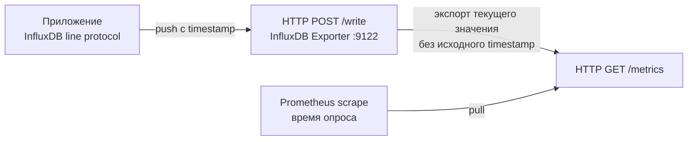
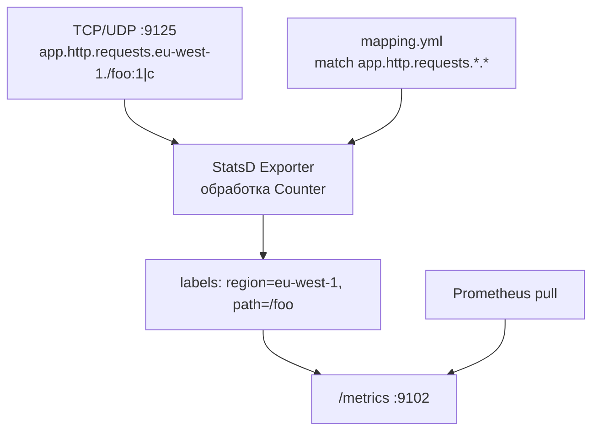
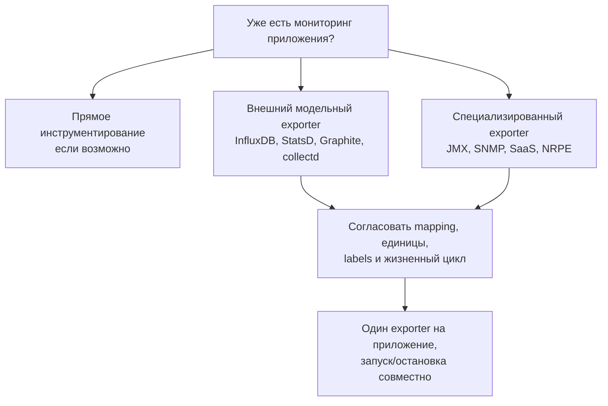

# Mermaid — глава 11: другие системы мониторинга

**Источник:** PDF 209–214 (`p0209:c01`–`p0214:c01`). Строго `rag_only`; диаграммы выведены из текстового описания.

## Push-to-pull без переноса временной истории

Источник PDF 211–212. Наличие отметки времени в payload не делает exporter архивом событий.

## Преобразование StatsD события и dot-separated меток

Источник PDF 212–214. Классы операций различаются: входящие события изменяют агрегаты exporter, Prometheus читает экспозицию.

## Выбор стратегии перехода

PDF 209–214. Авторские рекомендации — переходные варианты, не универсальная автоматическая совместимость форматов.
