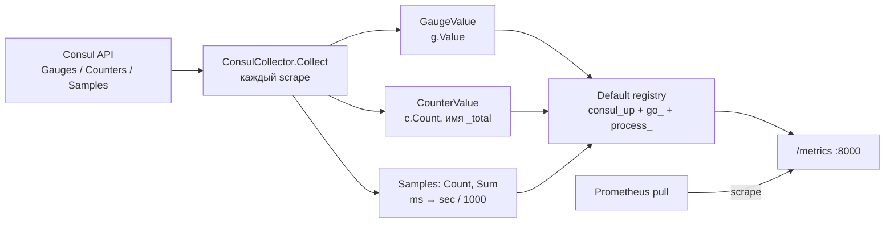
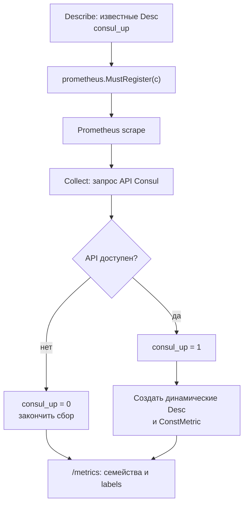
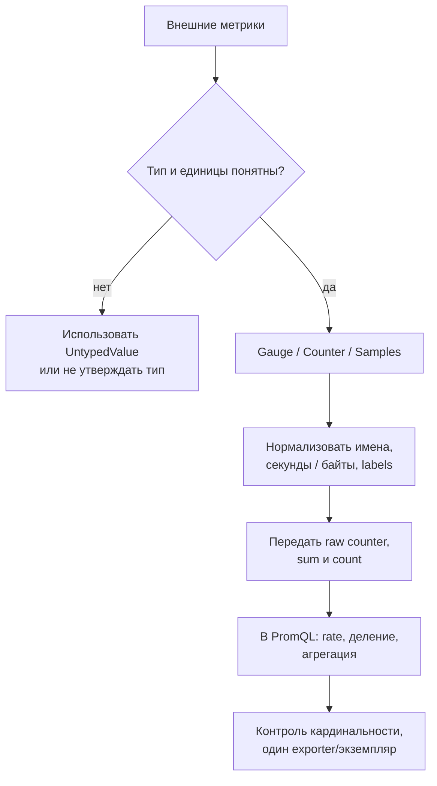

# Mermaid — глава 12 «Разработка экспортеров»

**Источник:** PDF 215–225, `p0215:c01`–`p0225:c01`, только RAG. Схемы — производные от текста, не реконструкция издательских рисунков.

## От чужой семантики до /metrics

PDF 215–222. Go в примере представляет Samples двумя Counter-семействами, Python использует SummaryMetricFamily. Пример published `_seconds_sum` противоречит операции `/1000`, см. [source-findings.md](source-findings.md).

## Методы пользовательского Collector

PDF 217–221. В тексте Go клиент требует минимум один `Desc` в `Describe`; для полностью динамических метрик предложен фиктивный.

## Рекомендации по проектированию

PDF 216, 224–225. Избегать label totals, machine-level метрик в прикладном exporter и ненужного кеширования. Реальный migration/rollback не приведён: [Needs confirmation].
