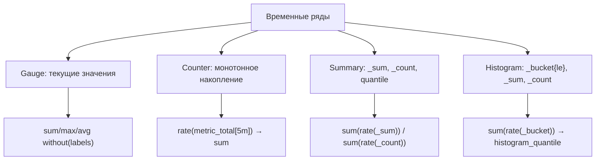
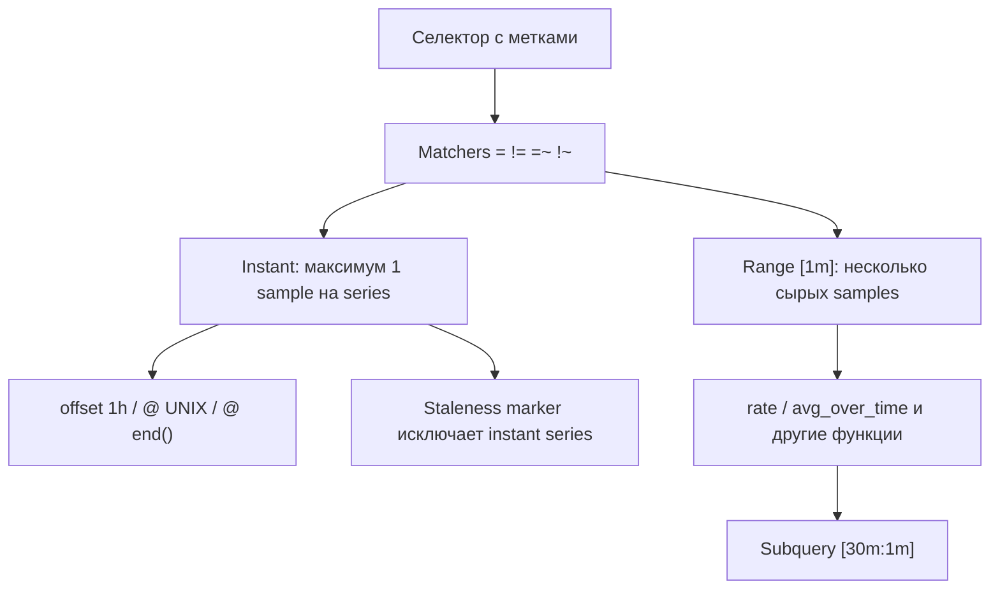
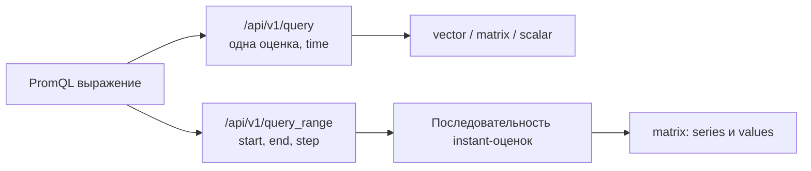

# Mermaid — глава 13 «Введение в PromQL»

**Источник:** PDF 227–245, `p0227:c01`–`p0245:c01`, `rag_only`. Схемы обобщают текст; оригинальный скриншот 13.1 в RAG недоступен как изображение.

## Тип метрики определяет порядок вычислений

Основание PDF 227–233. Не усреднять предварительно вычисленные средние или Summary quantiles. В источнике есть несовпадение имени histogram bucket во втором примере, см. [source-findings.md](source-findings.md).

## Instant vs range и временные модификаторы

Основание PDF 233–240. Range selector сохраняет фактические timestamps, но не выдаёт staleness markers. Для custom sample timestamps есть особенность lookback из PDF 236.

## HTTP API и step

Основание PDF 240–245. У `query_range` конец включается при попадании на шаг; range для `rate` больше шага; лимит 11 000 шагов указан в книге. При пустой выборке нет автоматической дорисовки.
