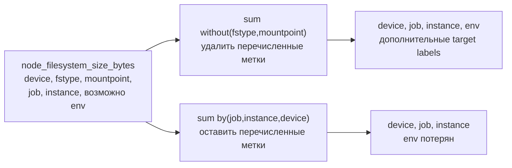
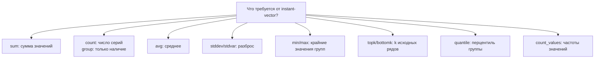
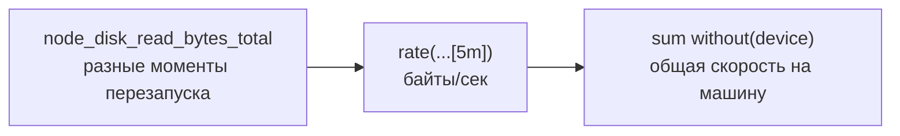
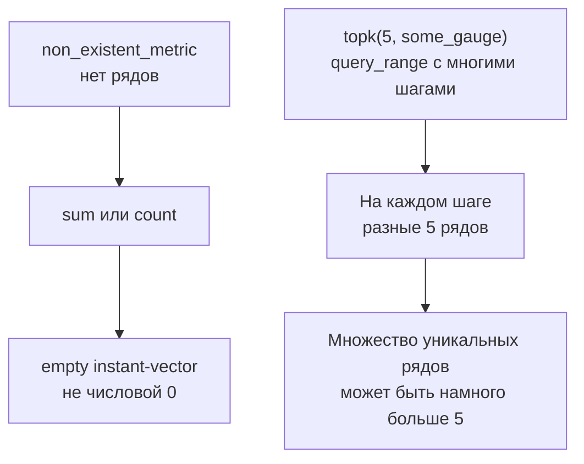

# Mermaid — глава 14: операторы агрегирования

**Источник:** `p0246:c01`–`p0257:c01`, PDF 246–257, `rag_only`. Схемы созданы по тексту главы.

## Группировка: без потери контекста алерта

PDF 246–249. Когда присутствуют только пять labels из примера, результаты одинаковы. Нельзя указать оба модификатора в одной операции.

## Как выбрать агрегатор

PDF 249–257. `topk`/`bottomk` сохраняют полный набор labels исходных рядов; `quantile` не равен `quantile_over_time` или `histogram_quantile`.

## Counter: скорость, затем агрегация

PDF 250. Сумма необработанных счётчиков не интерпретируется как текущая скорость.

## Пустые данные и исторический topk

PDF 249, 254. Для topk фиксированного набора книга предлагает модификатор `@` из главы 13. Реальный план запросов зависит от окружения: [Needs confirmation].
