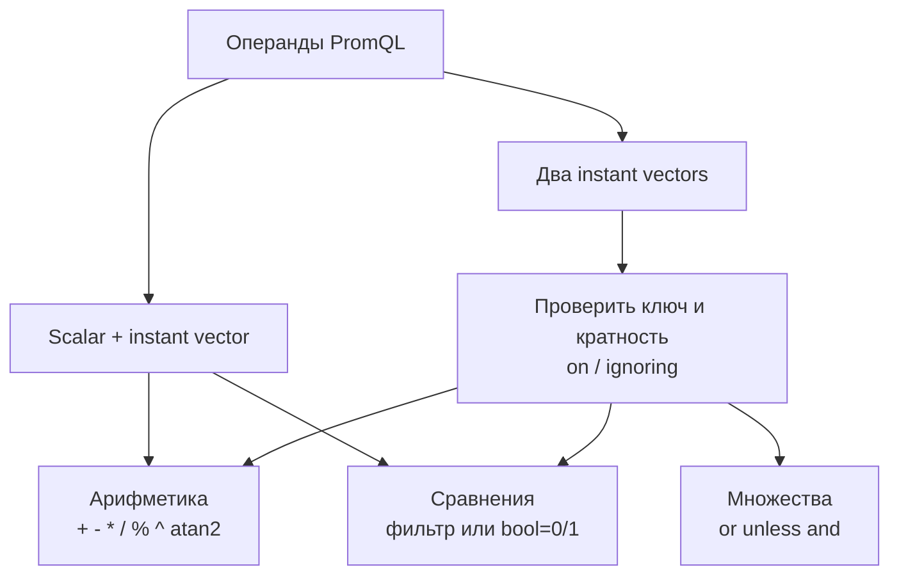
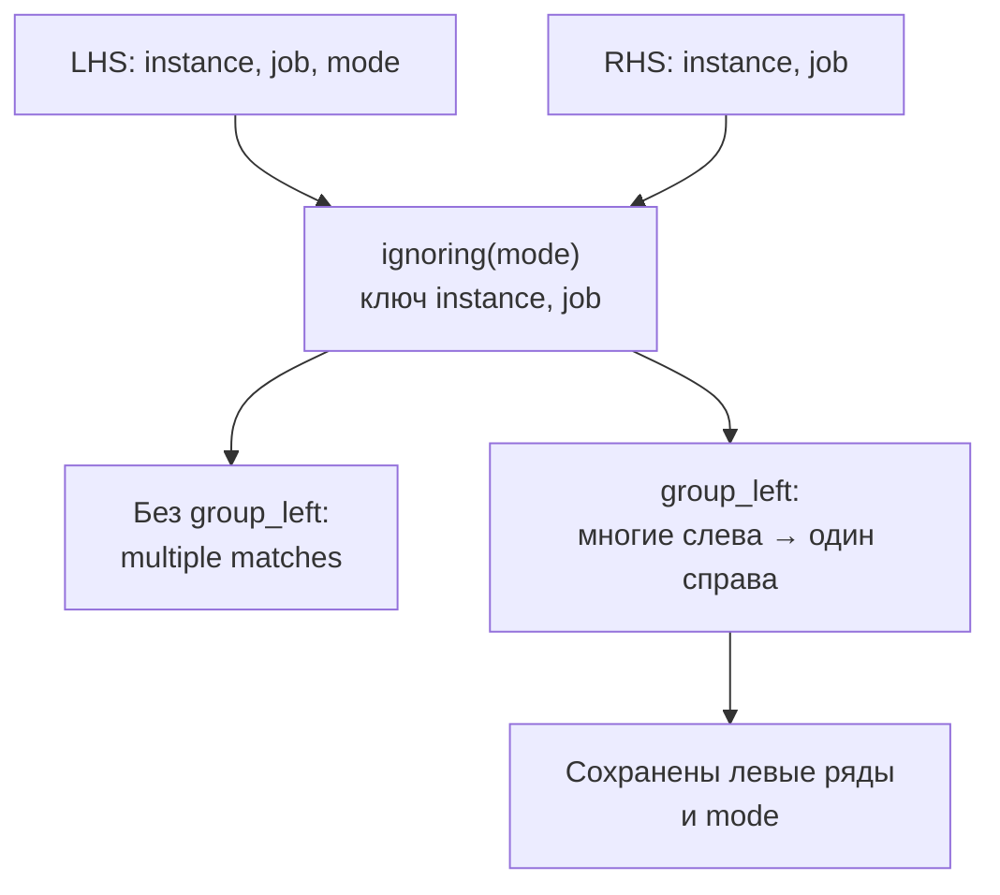
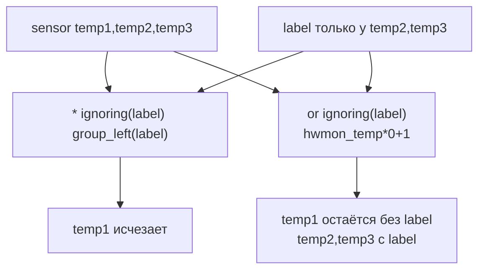
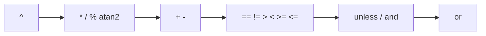

# Mermaid — глава 15 «Двухместные операторы»

**Источник:** канонические RAG `p0258:c01`–`p0272:c01` (PDF 258–272). Визуальные схемы созданы по тексту, не воспроизводят иллюстрации издания.

## Выбор двуоперандной операции

PDF 258–265 и 268. Арифметика удаляет имя метрики, фильтр сравнения сохраняет исходное значение, `bool` возвращает 0/1.

## Matching один к одному и многие к одному

PDF 263–266. `group_left(version)` копирует только заданную информационную метку справа, не допускает many-to-many (PDF 266–267).

## Разреженные серии и булева логика

PDF 267–269. Значение `NaN` не становится 1 при `x*0+1`; `up*0` требует фильтрации по job и успеху scrape (PDF 269–270).

## Приоритет операторов

PDF 272. Стрелка означает снижение приоритета, `^` правоассоциативен.
