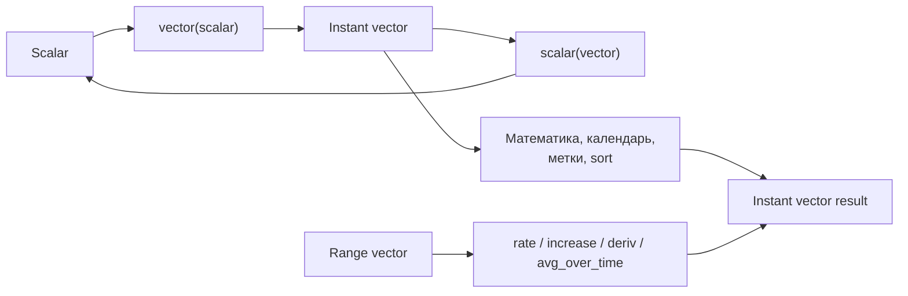
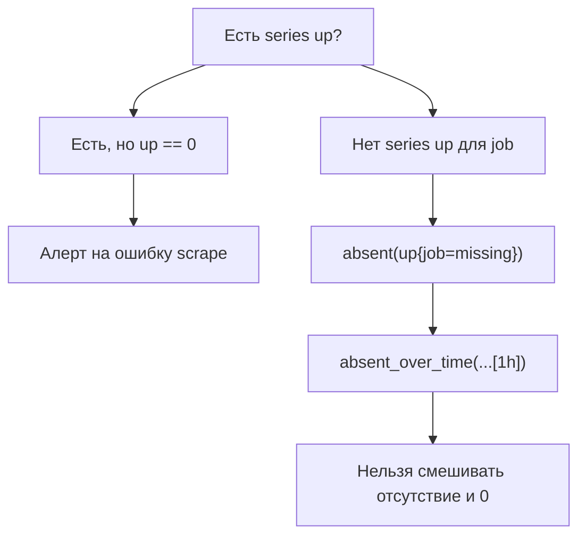
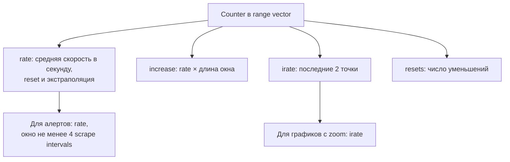
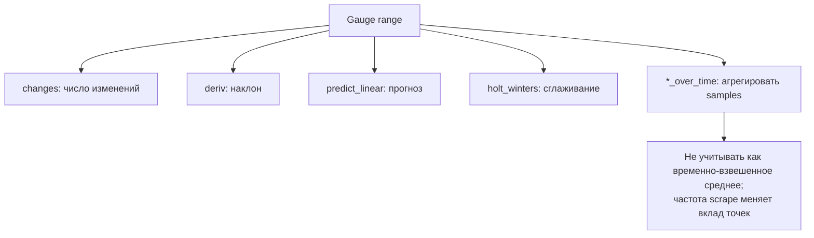

# Mermaid — глава 16 «Функции»

**Источник:** PDF 273–293, чанки `p0273:c01`–`p0293:c01`, строгий `rag_only`. Диаграммы построены по тексту, не копируют рис. 16.1.

## Типы, вход и результат

PDF 273–275, 285–293. `scalar` возвращает NaN, если вектор пуст или содержит более одного sample. `time`, `pi` и `scalar` названы скалярными результатами в контексте издания.

## Отсутствие цели, ошибка scrape и нулевое значение

PDF 274, 283–284. `absent` возвращает 1 только при пустой выборке, иногда восстанавливая labels из equality matcher.

## Counter: скорость, reset и диагностика

PDF 285–289. При недостаточном числе samples ответ по серии может отсутствовать. Не каждый редкий event будет учтён.

## Gauge и временные агрегаты

PDF 289–293. Источник рекомендует проверять линейность и пилообразность тренда для прогноза; `avg_over_time(rate(...)[1h])` без явного subquery step помечен в книге как ошибка типов.
