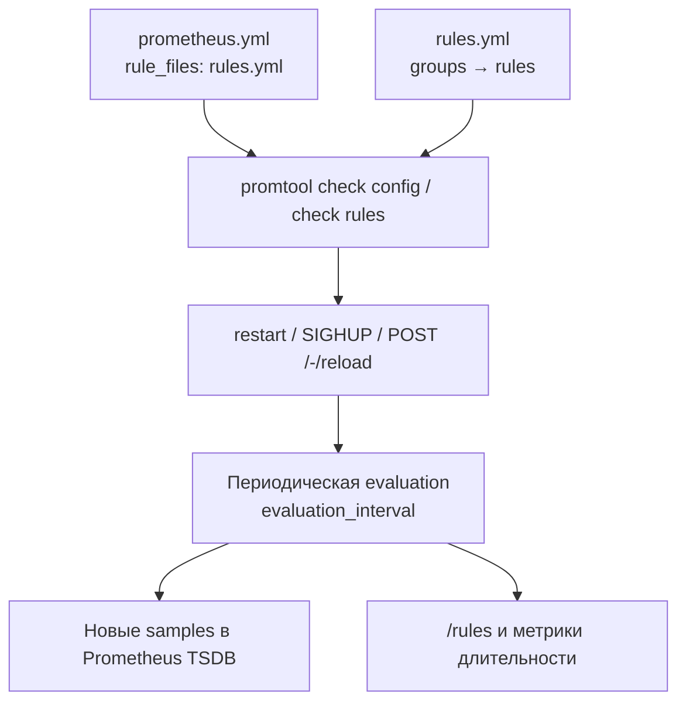
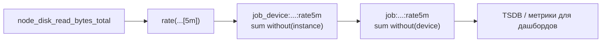
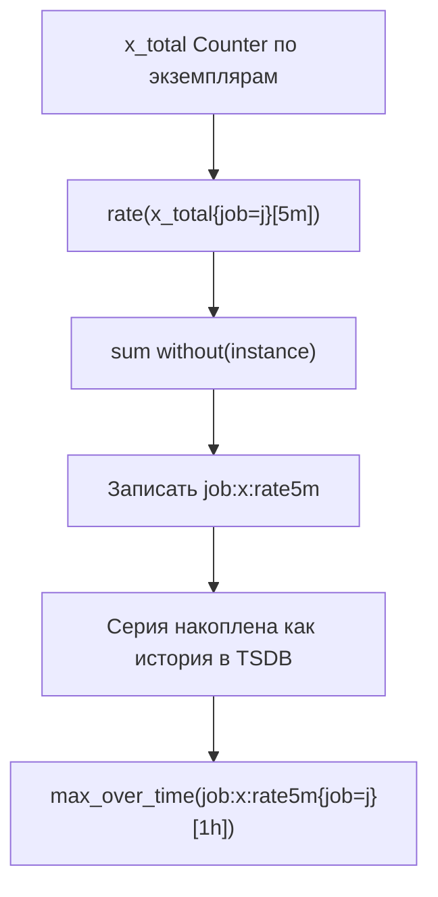
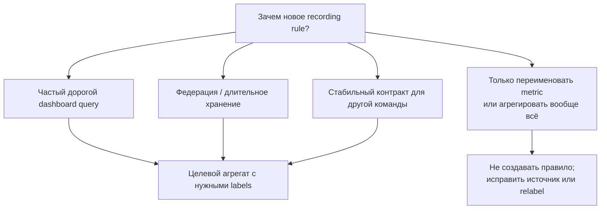

# Mermaid — глава 17 «Правила записи»

**Источник:** PDF 294–305, `p0294:c01`–`p0305:c01`, `rag_only`. Иллюстрации — новые логические схемы по RAG, не копия рис. 17.1.

## Конфигурация и цикл выполнения

PDF 294–296. Проверка файла read-only; reload и evaluation — state-changing. POST `/-/reload` требует `--web.enable-lifecycle`. Не подтверждённый rollback: [Needs confirmation].

## Порядок зависимых правил

PDF 298. Обе записи находятся в **одной группе** и выполняются по очереди с одинаковым evaluation timestamp. Для Counter порядок `sum → rate` не использовать.

## Предварительный агрегат для функции over_time

PDF 299. Не вычислять дорогостоящие исторические диапазоны каждую минуту, если нужен только периодический отчёт.

## Выбор назначения

PDF 297–305. Названия исходных labels и их значения не следует переносить в имена метрик.
