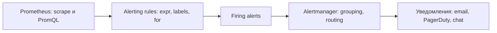
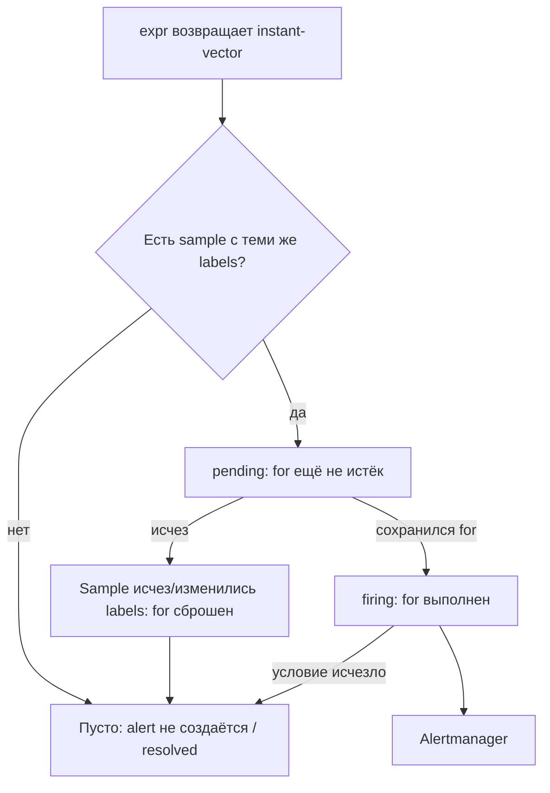
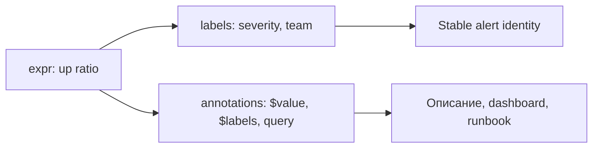
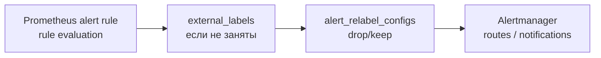
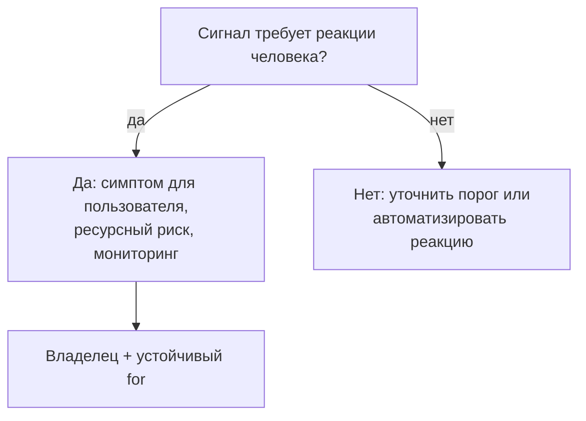

# Mermaid — глава 18 «Оповещение»

**Источник:** PDF 307–320, RAG `p0307:c01`–`p0320:c01`; `rag_only`. Схемы составлены по тексту, а не перерисованы с недоступных в RAG оригинальных рисунков 18.1 и 18.2.

## Архитектура: alert ≠ notification

PDF 307–309. Несколько Prometheus могут отправлять alerts в один Alertmanager. Разделение ответственной логики: Prometheus генерирует alert, Alertmanager отправляет notification.

## Жизненный цикл правила

PDF 308–313. Идентичность alert определяется labels, включая alertname. Изменяющееся `$value` нельзя помещать в label. Prometheus `ALERTS` содержит `alertstate=pending/firing`, `ALERTS_FOR_STATE` хранит начало.

## Stable labels vs dynamic annotations

PDF 312–317. `query` в аннотации может создавать дополнительную нагрузку.

## Порядок внешних меток и маршрутизации

PDF 318–320. Внешние метки недоступны Prometheus annotation templates, но могут использоваться в Alertmanager. Не утверждать, что downstream-политики Alertmanager здесь полностью описаны.

## Критерий полезного alert

PDF 314, 317–318. Рекомендации про 5-минутный `for` и число инцидентов — практический опыт авторов, не автоматические стандарты.
