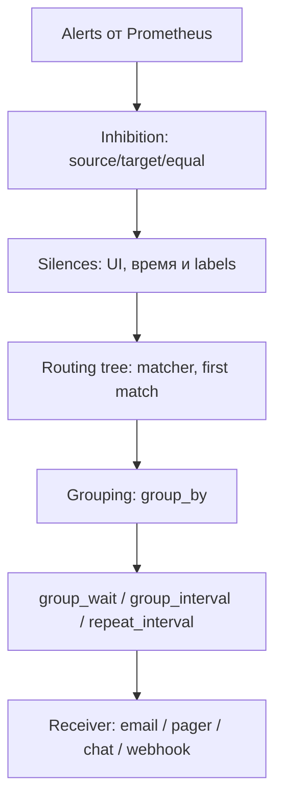
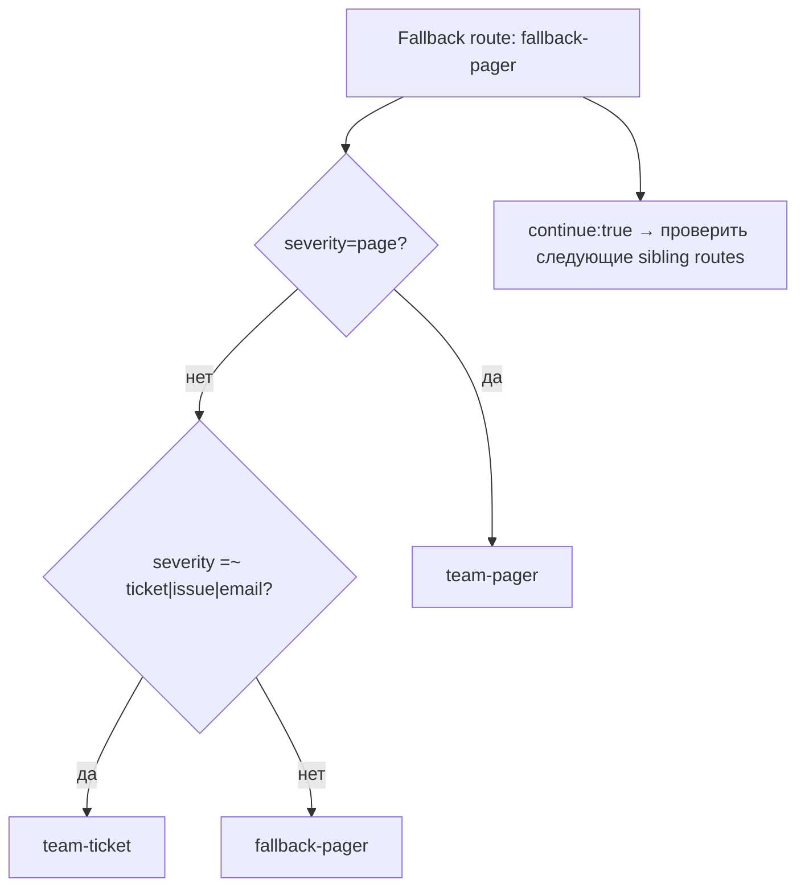
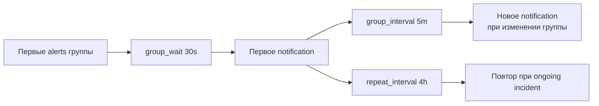
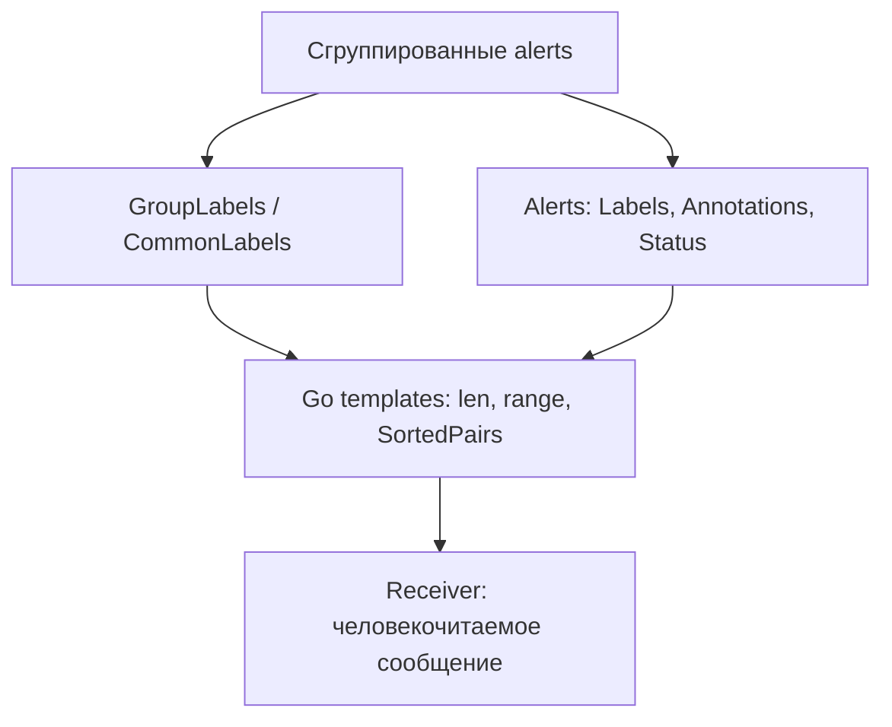
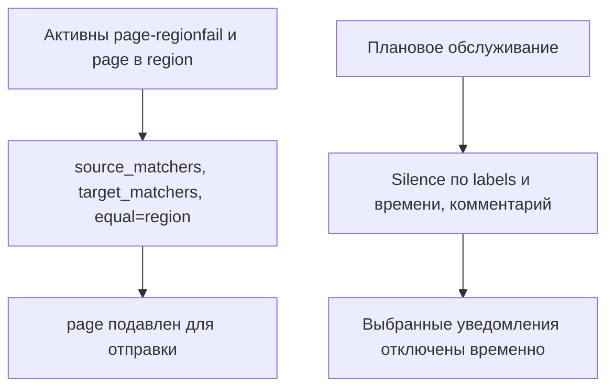

# Mermaid — глава 19 «Alertmanager»

**Источник:** PDF 321–343, RAG `p0321:c01`–`p0343:c01`, strict `rag_only`. Новые схемы из текста; рисунки 19.1–19.5 напрямую не воспроизведены.

## Конвейер и развилка маршрутизации

PDF 321–322. Схема концептуальная: подавление и Silences препятствуют отправке уведомлений, не удаляют инцидент и не доказывают, что исходный alert исчез.

## Дерево выбора получателя и continue

PDF 323–326. `continue` меняет только остановку поиска; другие route options наследуются от родителей.

## Отложенная отправка и повторы

PDF 328–330. Интервалы — source defaults конкретного издания. Последующие изменения и повторные отправки не обязаны происходить при каждом тике без соответствующих условий.

## Шаблон уведомления как group data

PDF 333–337. Webhook получает JSON и не проходит через тот же template formatter (PDF 333).

## Inhibition против Silence

PDF 340–343. Настройка любого механизма **state-changing**, а чрезмерный охват способен скрыть важные инциденты.
