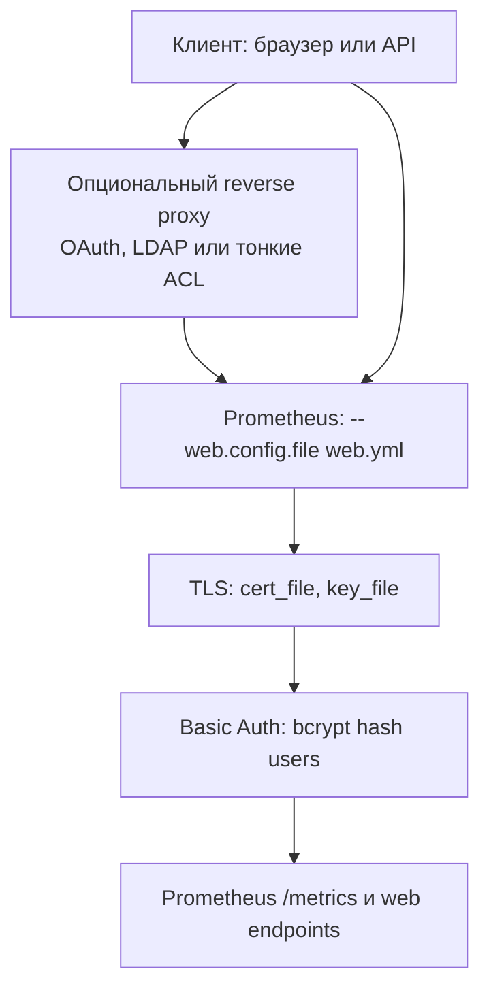
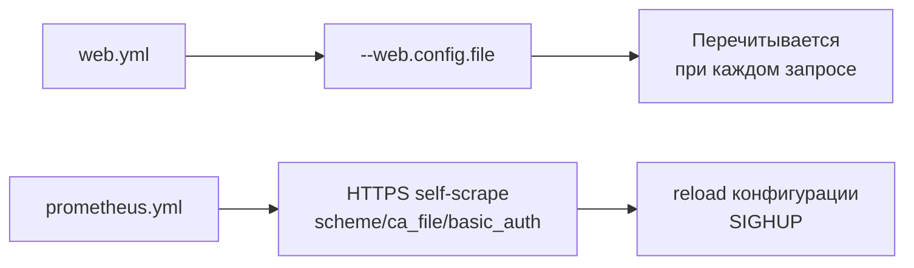
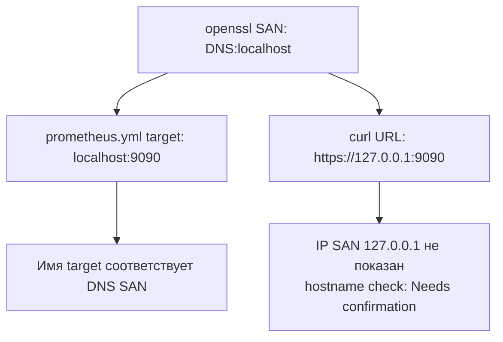
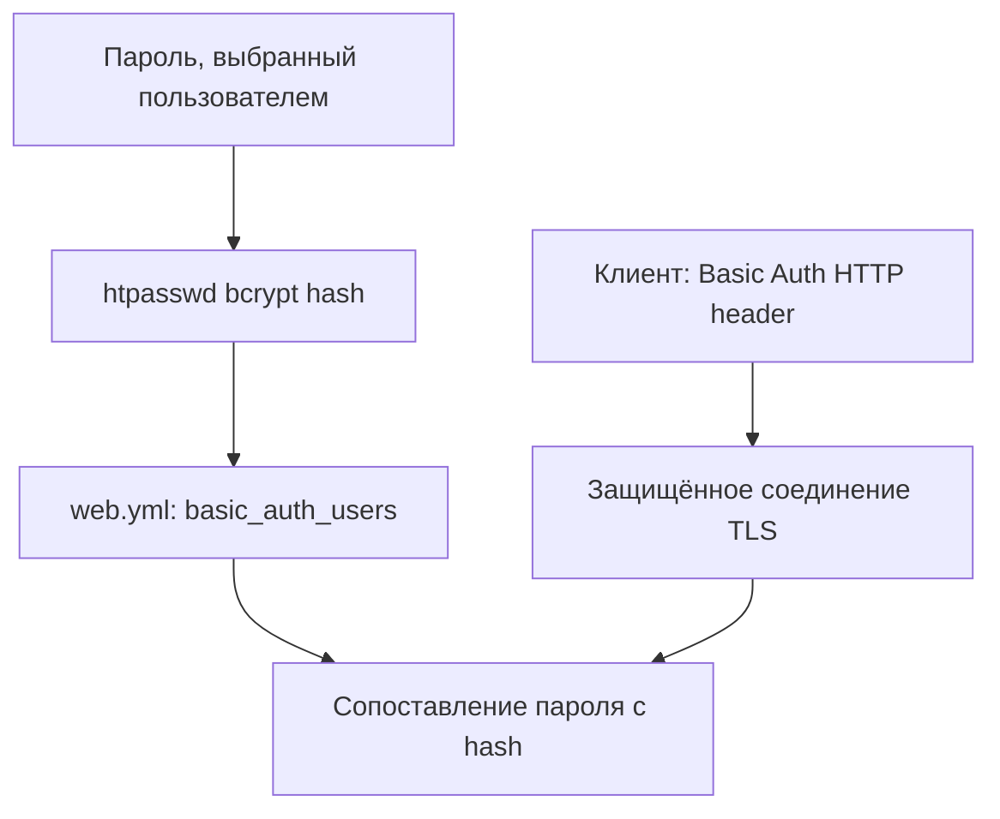
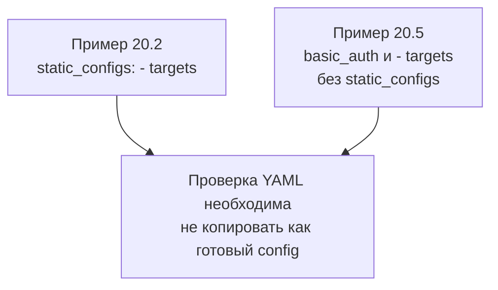

# Mermaid — глава 20 «Безопасность на стороне сервера»

**Источник:** PDF 345–349, `p0345:c01`–`p0349:c01`, strict `rag_only`. Диаграммы синтезированы по тексту, не являются проверенной схемой сети конкретного deployment.

## Контур доступа

PDF 345, 347–348. Не означает, что Basic Auth всегда обязательно включена при TLS: главы описывают эти функции отдельно и затем вместе. Клиентская TLS-аутентификация — дополнительный вариант.

## Разделение файлов и reload

PDF 345–349. Изменение `prometheus.yml` не тождественно обновлению `web.yml`. Операции конфигурации и HUP — **state-changing**, здесь не выполнялись.

## Контроль TLS hostname

PDF 346–347. Схема показывает буквальную несогласованность source; не утверждает о фактическом результате выполнения curl.

## Basic Auth и пределы доверия

PDF 347–349. Учебный `demo` в исходнике публичен. Нельзя переносить его как настоящий секрет.

## Разрыв исходного self-scrape YAML

PDF 346–349. Извлечённый код и ожидаемый runtime не проверялись; подробности — [source-findings.md](source-findings.md).
