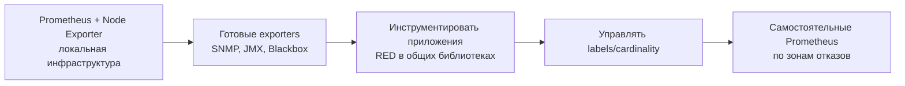
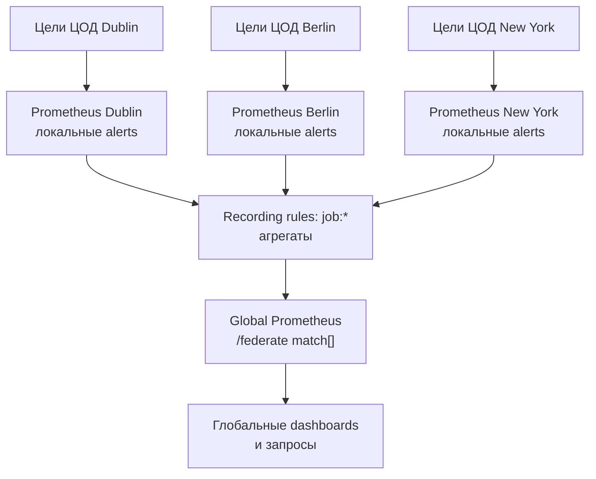
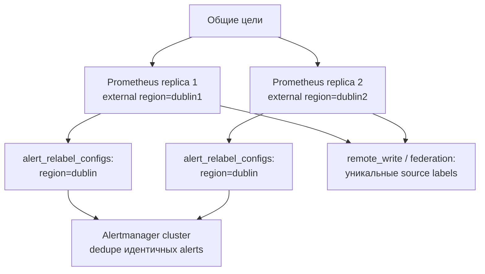
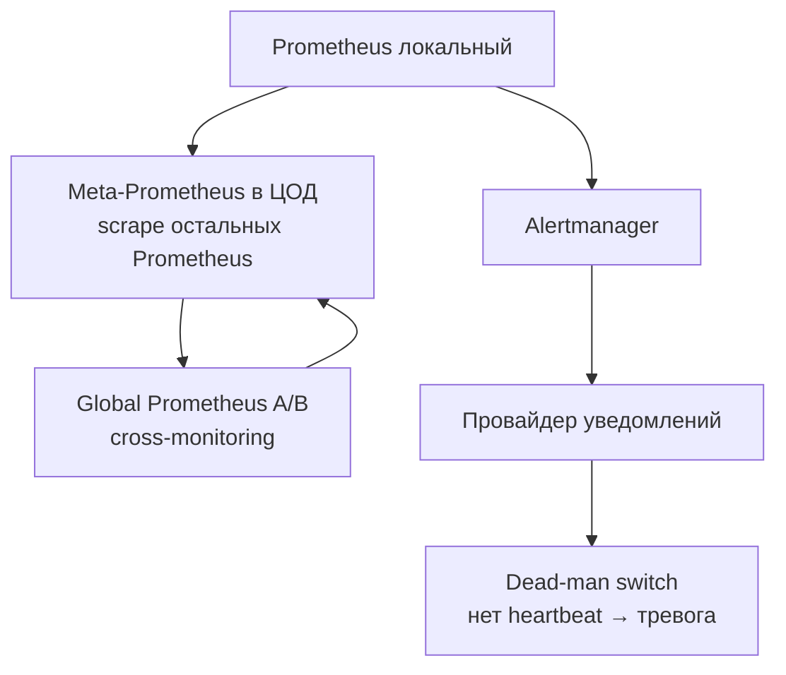
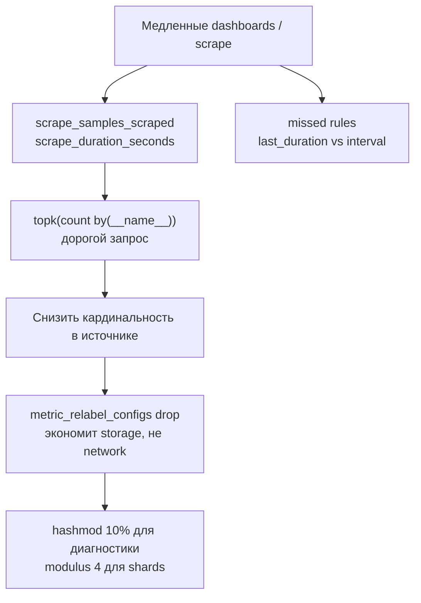
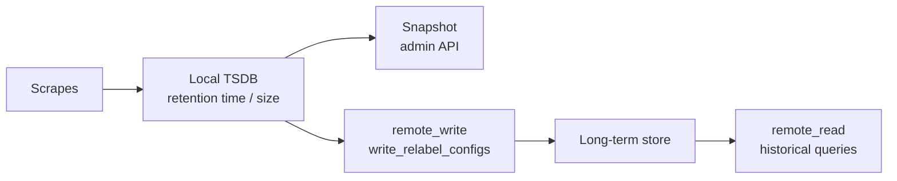

# Mermaid — глава 21 «Собираем все вместе»

**Источник:** PDF 350–374, RAG `p0350:c01`–`p0374:c01`, strict `rag_only`. Схемы построены по тексту; не воспроизводят графические оригиналы рис. 21.1, 21.2.

## Последовательность внедрения

PDF 350–353. Для Windows источником указан Windows Exporter. Порядок адаптируется под зрелость/масштаб организации.

## ЦОД и глобальная федерация

PDF 353–356. Логически `AGG` означает агрегаты **на каждом локальном сервере**, а не один общий сервер до federation. Цели/алерты остаются в своих областях отказа; глобальный сервер не собирает все сырые instance series.

## HA оповещений, federation и уникальные внешние метки

PDF 364–367. Alert labels нормализуются **только** перед Alertmanager, не перед записью/федерацией.

## Метамониторинг и сквозная проверка уведомлений

PDF 367–368. Периодические alerts проверяют всю цепочку, включая провайдера; реализация внешнего переключателя в главе не специфицирована.

## Диагностическая последовательность производительности

PDF 368–373. Эта последовательность — карта выбора, не безусловная команда применять drop или отключать 90% целей.

## Локальное хранилище / длительная история

PDF 356–359. Snapshot и delete admin API, remote-write endpoints и retention изменения — **state-changing/destructive**; не выполнять без подтверждённого плана восстановления.
