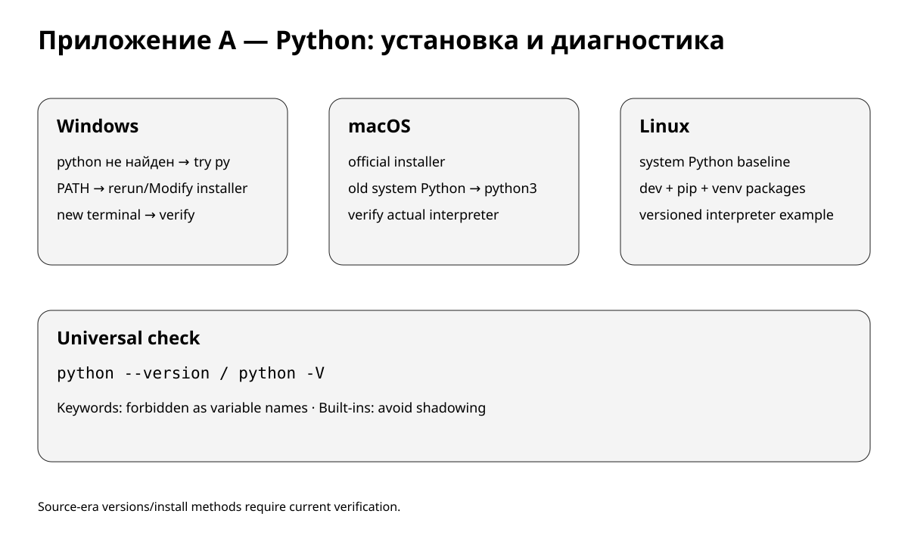
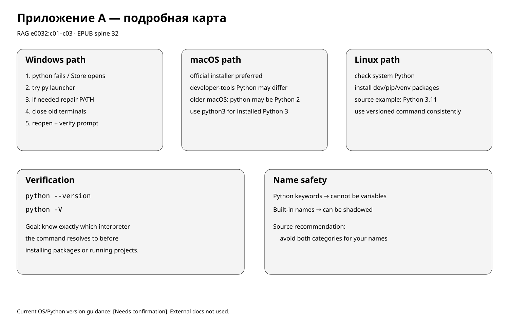

# Приложение А — Установка Python и диагностика проблем

RAG-grounded анализ приложения А.





## Идентификация

- Book ID: `python-crash-course-3e-ru-2024`
- Appendix: А
- Slug: `python-installation-and-troubleshooting`
- Source policy: `rag_only`
- External sources/model memory: запрещены

## Provenance

- RAG chunks: `e0032:c01–e0032:c03`
- EPUB spine item: `32`
- EPUB locator: `OEBPS/Text/978544614112-29.xhtml`
- `e0032:c01` начинается заголовком «А. Установка Python и диагностика проблем».
- `e0033:c01` начинает приложение Б.
- Boundary verified: yes
- Source SHA-256: `a1e5ce950d3f9e2e38be23191250a46313b9b7d28663319970f4897902151f6c`

## Карта приложения

1. Windows: `python`, fallback через `py`, PATH и повторная настройка installer.
2. macOS: официальный installer, Apple/developer-tools Python и старые системы с Python 2.
3. Linux: системный Python, дополнительные dev/pip/venv packages и пример установки более новой версии.
4. Проверка реально вызываемой версии через `python --version` / `python -V`.
5. Граница имен: Python keywords нельзя использовать как variable names; имена built-in functions могут быть затенены.

## Основной принцип

```text
command fails
  → identify OS + invoked executable
  → verify version/path
  → repair installation or use OS-specific launcher
  → verify interpreter starts
  → only then continue with packages/projects
```

## Ограничения

- Конкретные версии Python, package names и installation methods описывают состояние источника; current compatibility: `[Needs confirmation]`.
- External Python/OS documentation не проверялась.
- EPUB chunks `e0032:c02–c03` начинаются с overlap/continuation fragments, но semantic boundary приложения сохраняется.
