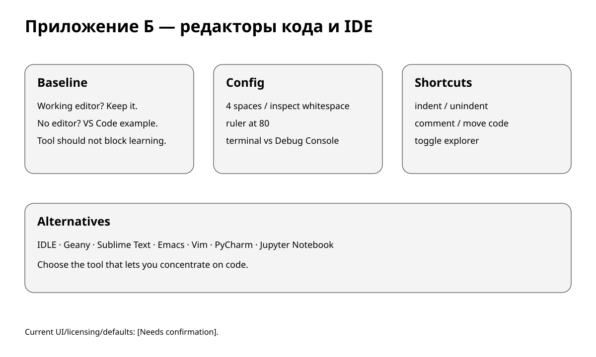

# Приложение Б — Редакторы кода и IDE

RAG-grounded анализ приложения Б.




## Идентификация

- Book ID: `python-crash-course-3e-ru-2024`
- Appendix: Б
- Slug: `code-editors-and-ides`
- Source policy: `rag_only`
- External sources/model memory: запрещены

## Provenance

- RAG chunks: `e0033:c01–e0033:c05`
- EPUB spine item: `33`
- EPUB locator: `OEBPS/Text/978544614112-30.xhtml`
- `e0033:c01` начинается заголовком «Б. Редакторы кода и IDE».
- `e0034:c01` начинает приложение В.
- Boundary verified: yes
- Source SHA-256: `a1e5ce950d3f9e2e38be23191250a46313b9b7d28663319970f4897902151f6c`

## Карта приложения

1. Разница между code editor и IDE постепенно размывается.
2. Source рекомендует не менять привычный рабочий editor без необходимости.
3. Для новичка source рекомендует VS Code как основной пример.
4. Настройки VS Code: tabs/spaces, theme, ruler, terminal/debug console behavior.
5. Keyboard shortcuts: indent/unindent, comment/uncomment, move code, toggle explorer.
6. Alternative tools: IDLE, Geany, Sublime Text, Emacs, Vim, PyCharm, Jupyter Notebook.
7. Главная граница: инструменты должны помогать писать код, а не становиться отдельной причиной задержки обучения.

## Основной принцип

```text
working editor
  → correct Python support
  → minimal useful configuration
  → learn high-frequency shortcuts
  → keep focus on code
```

## Ограничения

- UI paths, product capabilities/licensing и defaults отражают состояние источника: current state `[Needs confirmation]`.
- External editor documentation не проверялась.
- EPUB chunks `e0033:c02–c05` содержат overlap/continuation fragments, но appendix boundary сохраняется.
