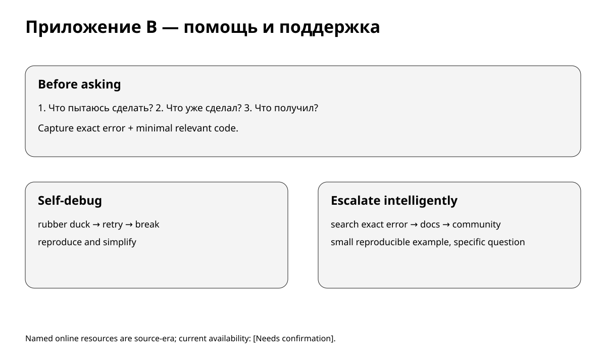
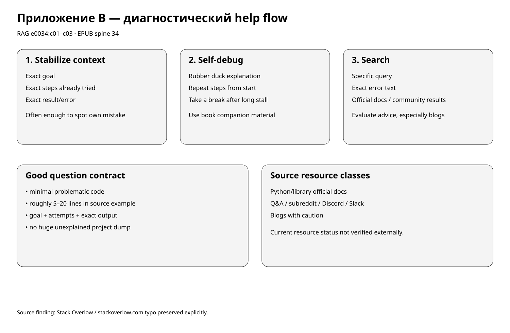

# Приложение В — Помощь и поддержка

RAG-grounded анализ приложения В.





## Идентификация

- Book ID: `python-crash-course-3e-ru-2024`
- Appendix: В
- Slug: `help-and-support`
- Source policy: `rag_only`
- External sources/model memory: запрещены

## Provenance

- RAG chunks: `e0034:c01–e0034:c03`
- EPUB spine item: `34`
- EPUB locator: `OEBPS/Text/978544614112-31.xhtml`
- `e0034:c01` начинается заголовком «В. Помощь и поддержка».
- `e0035:c01` начинает приложение Г.
- Boundary verified: yes
- Source SHA-256: `a1e5ce950d3f9e2e38be23191250a46313b9b7d28663319970f4897902151f6c`

## Карта приложения

1. Перед запросом помощи сформулировать: цель, уже выполненные действия, фактический результат.
2. Сохранять точные сообщения об ошибках.
3. Использовать rubber duck debugging.
4. Повторить шаги с начала, если возможно.
5. Сделать перерыв, если диагностика зашла в тупик.
6. Проверить дополнительные материалы книги.
7. Искать по конкретной проблеме и полному error message.
8. Использовать community/documentation sources осознанно.
9. Для вопросов публиковать минимальный воспроизводимый пример вместо огромного проекта.
10. Source перечисляет Stack Overflow, официальную документацию Python/библиотек, r/learnpython, блоги, Discord и Slack.

## Основной принцип

```text
problem
  → exact goal
  → exact steps already tried
  → exact result/error
  → simplify/reproduce
  → search docs/community
  → ask a specific question
```

## Ограничения

- Availability/current quality of named communities/resources: `[Needs confirmation]`.
- External sites не открывались.
- В source обнаружена опечатка Stack Overlow / stackoverlow.com; см. source-findings.md.
- EPUB chunks `e0034:c02–c03` имеют overlap/continuation fragments, без потери appendix boundary.
