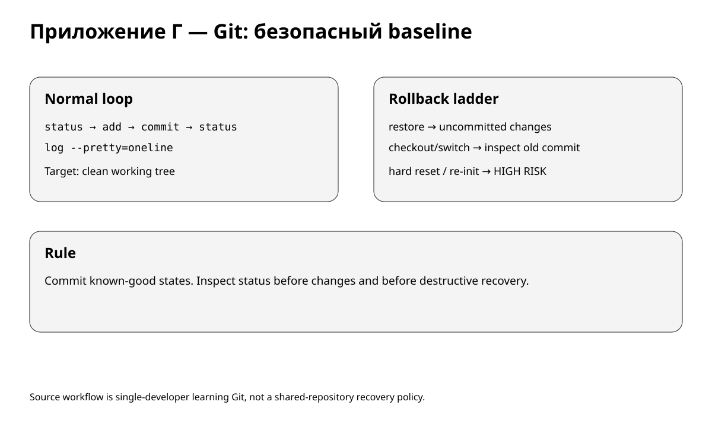
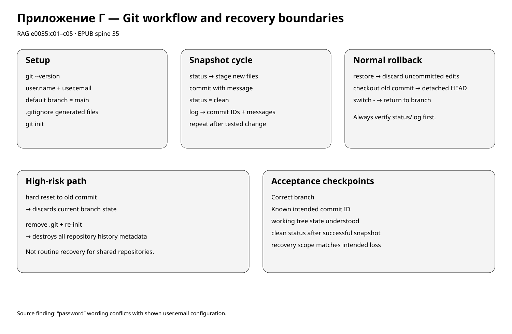

# Приложение Г — Управление версиями с помощью Git

RAG-grounded анализ приложения Г.





## Идентификация

- Book ID: `python-crash-course-3e-ru-2024`
- Appendix: Г
- Slug: `version-control-with-git`
- Source policy: `rag_only`
- External sources/model memory: запрещены

## Provenance

- RAG chunks: `e0035:c01–e0035:c05`
- EPUB spine item: `35`
- EPUB locator: `OEBPS/Text/978544614112-32.xhtml`
- `e0035:c01` начинается заголовком «Г. Управление версиями с помощью Git».
- `e0036:c01` начинает приложение Д.
- Boundary verified: yes
- Source SHA-256: `a1e5ce950d3f9e2e38be23191250a46313b9b7d28663319970f4897902151f6c`

## Карта приложения

1. Git как механизм snapshot/version history для рабочего проекта.
2. Установка и проверка Git.
3. Global identity и default branch `main`.
4. `.gitignore` для generated/non-source files.
5. `git init` → `git status` → `git add .` → initial commit.
6. `git log` и compact log.
7. Subsequent tracked-file commit через `git commit -am`.
8. Uncommitted rollback через `git restore`.
9. Просмотр старой commit через checkout и возврат через switch.
10. Исторический rollback через `git reset --hard`.
11. Полное уничтожение repository history через удаление `.git` и re-init.

## Основной принцип

```text
working state
  → inspect status
  → stage new files
  → commit snapshot
  → change
  → inspect status/log
  → keep or rollback
```

## Security / destructive boundaries

- `git restore .` уничтожает uncommitted changes в tracked files.
- `git reset --hard <commit>` переписывает текущую working/index state до выбранной commit и может удалить более позднюю local history from branch view.
- удаление `.git` уничтожает repository metadata/history, хотя working files остаются.
- Source destructive examples применимы к одиночному учебному repository; перенос в shared/production workflow требует отдельной проверки.

## Ограничения

- Source описывает базовый single-developer Git workflow, не team collaboration.
- Current Git command/version behavior beyond source examples: `[Needs confirmation]`.
- В source обнаружено wording mismatch «имя пользователя и пароль» при последующей настройке user.name/user.email; см. source-findings.md.
- EPUB chunks `e0035:c02–c05` имеют overlap/continuation fragments без потери appendix boundary.
