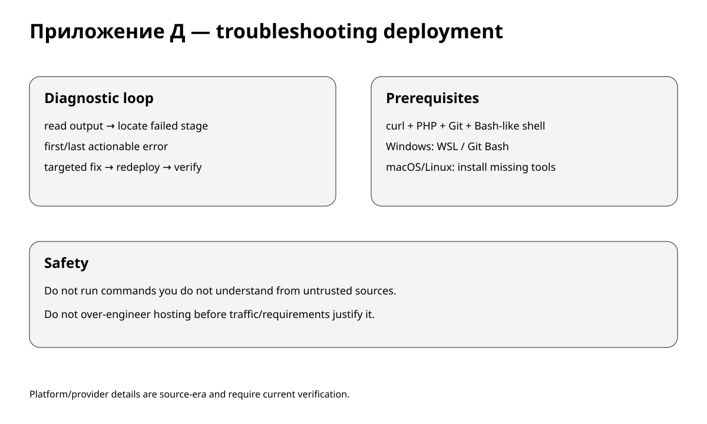
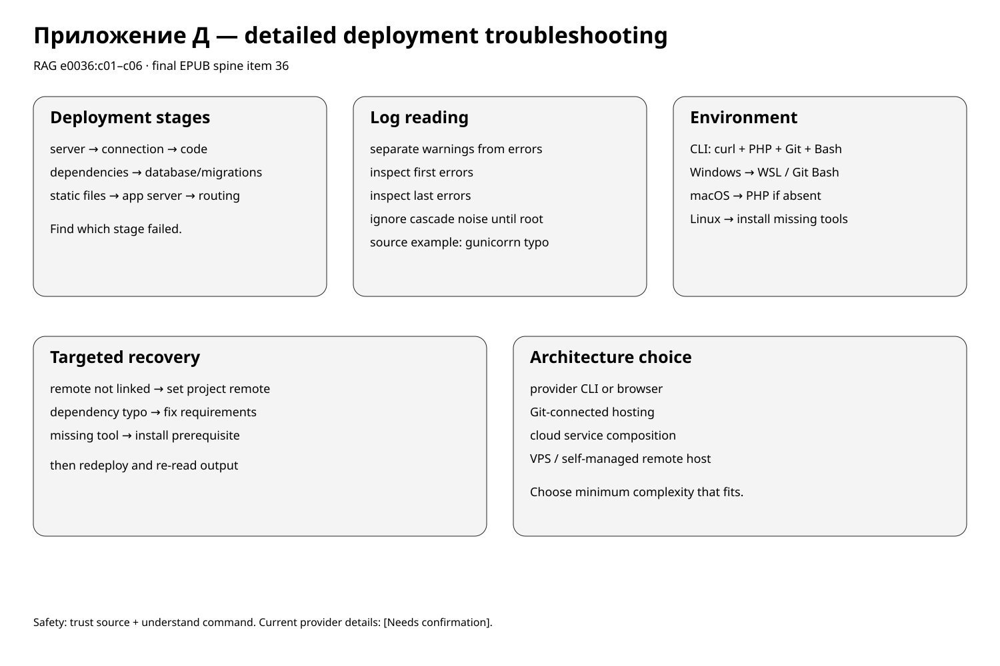

# Приложение Д — Устранение неполадок при развертывании

RAG-grounded анализ приложения Д.





## Идентификация

- Book ID: `python-crash-course-3e-ru-2024`
- Appendix: Д
- Slug: `deployment-troubleshooting`
- Source policy: `rag_only`
- External sources/model memory: запрещены

## Provenance

- RAG chunks: `e0036:c01–e0036:c06`
- EPUB spine item: `36`
- EPUB locator: `OEBPS/Text/978544614112-33.xhtml`
- `e0036:c01` начинается заголовком «Д. Устранение неполадок при развертывании».
- EPUB manifest содержит 36 spine items; это последний source unit книги.
- Boundary verified: yes
- Source SHA-256: `a1e5ce950d3f9e2e38be23191250a46313b9b7d28663319970f4897902151f6c`

## Карта приложения

1. Deployment как цепочка: remote server → connection → code → dependencies → database/migrations → static files → app server → routing.
2. Главный diagnostic source — output/log конкретной deployment attempt.
3. Цель чтения лога: отделить successful steps от failed steps.
4. Следовать explicit CLI recommendations только при понимании scope и доверии к source.
5. Пример: missing Platform.sh remote mapping исправляется через project:set-remote.
6. Ошибки dependencies выявляются по первым/последним значимым errors; source example использует deliberate typo `gunicorrn`.
7. CLI prerequisites: curl, PHP, Git и Bash-like terminal.
8. Windows: WSL или Git Bash route; source отдельно показывает PHP/XAMPP path.
9. macOS: source предлагает установить PHP при необходимости.
10. Linux: source показывает установку curl/php-cli, если installer сообщает, что они отсутствуют.
11. Alternative deployment models: browser UI, connected Git hosting, managed cloud services, VPS.
12. Финальный принцип: не переусложнять infrastructure до появления реальной необходимости.

## Основной принцип

```text
deployment failed
  → read actual output
  → mark successful stages
  → find first/last actionable error
  → verify local/remote prerequisites
  → make one targeted correction
  → redeploy
  → verify
```

## Security / operational boundaries

- Source прямо предупреждает не выполнять непонятные команды из недоверенных источников.
- Remote-installer pipeline и system package installation являются state-changing actions.
- Platform project IDs, provider runtime/OS и installation paths source-specific; переносить их без проверки нельзя.
- Current Platform.sh tooling/provider behavior: `[Needs confirmation]`.

## Source findings

- В example remote project ID есть spelling mismatch между output/command и последующим prose; см. source-findings.md.
- Later chunks имеют overlap/continuation fragments.

## Ограничения

- Внешняя Platform.sh/OS documentation не открывалась.
- Current hosting products, plans, URLs и installation processes: `[Needs confirmation]`.
