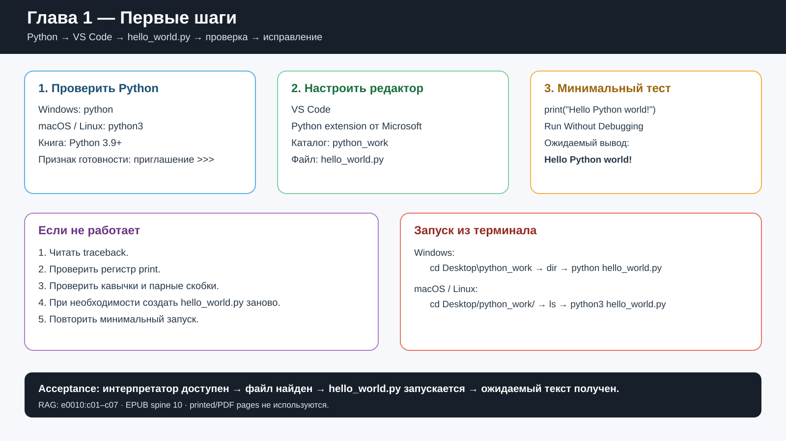
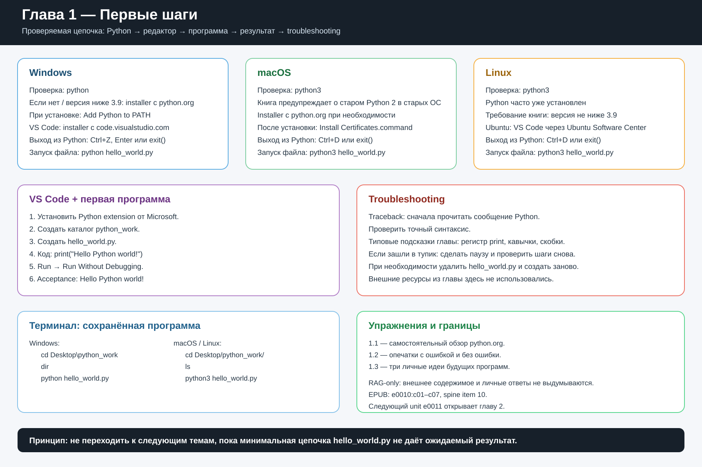

# Глава 1 — Первые шаги

Практические заметки по главе 1 книги «Изучаем Python: программирование игр, визуализация данных, веб-приложения. 3-е изд.».

## Идентификация

- Book ID: `python-crash-course-3e-ru-2024`
- Глава: 1
- Название: «Первые шаги»
- Slug: `first-steps`
- Source policy: `rag_only`
- External sources: запрещены
- Model memory: запрещена
- Прямой доступ к EPUB: не использовался
- Book readiness: `READY` на canonical `main` (workflow run `36751884008`)

## Provenance

- RAG chunks: `e0010:c01`–`e0010:c07`
- EPUB spine item: `10`
- EPUB locator: `OEBPS/Text/978544614112-7.xhtml`
- PDF pages: `[Not applicable]`
- Printed pages: `[Needs confirmation]`
- `e0010:c01` начинается заголовком «1. Первые шаги».
- `e0010:c07` содержит упражнения 1.1–1.3 и отдельный раздел «Резюме».
- Следующий source unit `e0011:c01` начинается главой 2 «Переменные и простые типы данных».
- Chapter boundary verified: yes
- Source SHA-256: `a1e5ce950d3f9e2e38be23191250a46313b9b7d28663319970f4897902151f6c`

## Содержимое

- [cheatsheet.md](cheatsheet.md) — рабочая схема подготовки и проверки среды Python.
- [commands.md](commands.md) — только команды и действия, прямо приведённые в главе.
- [diagram.md](diagram.md) — Mermaid-поток от проверки Python до запуска `hello_world.py` и устранения ошибок.
- [summary.md](summary.md) — отдельное резюме главы, основанное на source section «Резюме».
- [review-questions.md](review-questions.md) — упражнения 1.1–1.3.
- [review-answers.md](review-answers.md) — RAG-grounded разбор упражнений; внешние и личные данные не додумываются.
- [visual-cheatsheet.svg](visual-cheatsheet.svg) — компактный обзор.
- [visual-cheatsheet-detailed.svg](visual-cheatsheet-detailed.svg) — подробный обзор.

## Карта главы

1. Подготовка среды программирования.
2. Требования книги к версии Python: примеры рассчитаны на Python 3.9+; на момент написания книги новой была 3.11.
3. Терминальный сеанс Python и приглашение `>>>`.
4. VS Code как основной редактор главы.
5. Различия подготовки среды в Windows, macOS и Linux.
6. Установка Python и VS Code, где это требуется.
7. Установка Python extension для VS Code.
8. Создание каталога `python_work` и файла `hello_world.py`.
9. Первая программа: `print("Hello Python world!")`.
10. Запуск из VS Code и проверка ожидаемого вывода.
11. Поиск и устранение ошибок: traceback, проверка синтаксиса, повторное создание файла, обращение к инструкциям/помощи.
12. Запуск `hello_world.py` из терминала в Windows и macOS/Linux.
13. Упражнения 1.1–1.3.
14. Резюме главы.

## Краткий анализ главы

Глава строит минимальную рабочую петлю разработки: сначала убедиться, что интерпретатор Python доступен, затем настроить редактор, создать один файл, выполнить его и получить заранее известный результат. Поэтому `hello_world.py` здесь выступает не только учебным примером, но и проверкой всей цепочки «редактор → интерпретатор → программа → вывод».

Автор отдельно разводит способы запуска по операционным системам. В Windows используется команда `python`; в macOS и Linux книга ориентирует на `python3`. Для Windows при установке Python подчёркивается флажок Add Python to PATH. Для macOS после установки Python упоминается `Install Certificates.command`. Для Ubuntu VS Code предлагается устанавливать через Ubuntu Software Center.

Терминальный сеанс Python используется для небольших фрагментов кода. Приглашение `>>>` означает, что пример выполняется непосредственно в интерактивном интерпретаторе. Основной код книги при этом предполагается писать в редакторе и сохранять в файлах `.py`.

Для VS Code глава требует Python extension, разработанное Microsoft. После этого создаётся `python_work/hello_world.py`, содержащий одну строку `print("Hello Python world!")`. Успешный вывод `Hello Python world!` является acceptance signal базовой среды.

Отдельный блок посвящён troubleshooting. Источник советует читать traceback, проверять точность синтаксиса, особенно регистр `print`, кавычки и скобки, при необходимости пересоздать файл и повторить шаги. Если локальная диагностика не помогает, книга отсылает к приложениям и внешним ресурсам, но в этих артефактах такие источники не использовались из-за режима `rag_only`.

В конце показан запуск сохранённой программы из терминала. В Windows используются `cd`, `dir` и `python hello_world.py`; в macOS/Linux — `cd`, `ls` и `python3 hello_world.py`.

## Основной принцип

Сначала добейтесь минимального, однозначно проверяемого результата:

`Python доступен → редактор настроен → hello_world.py запускается → ожидаемый текст выведен`.

Если результат не получен, не расширяйте задачу: сначала локализуйте проблему по traceback и точности синтаксиса, затем повторите минимальный тест.

## Ограничения

- EPUB reflowable: PDF/printed page numbers не используются.
- Текущая фактическая «последняя версия Python» не проверялась: source-only артефакты фиксируют только формулировку книги, где на момент написания новой была 3.11, а примеры рассчитаны на 3.9+.
- URL из главы сохранены как source-confirmed references, но внешние сайты не открывались.
- Скриншот мастера установки Python (рис. 1.1) в текстовом RAG отдельно не воспроизводится.
- Текущие UI/shortcut детали новых версий VS Code или ОС вне текста главы не добавлялись.
