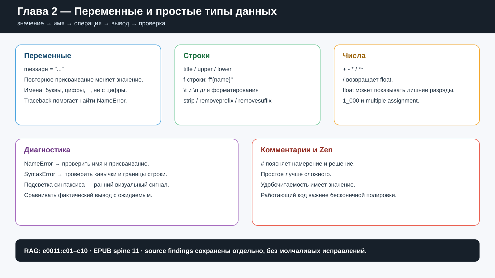
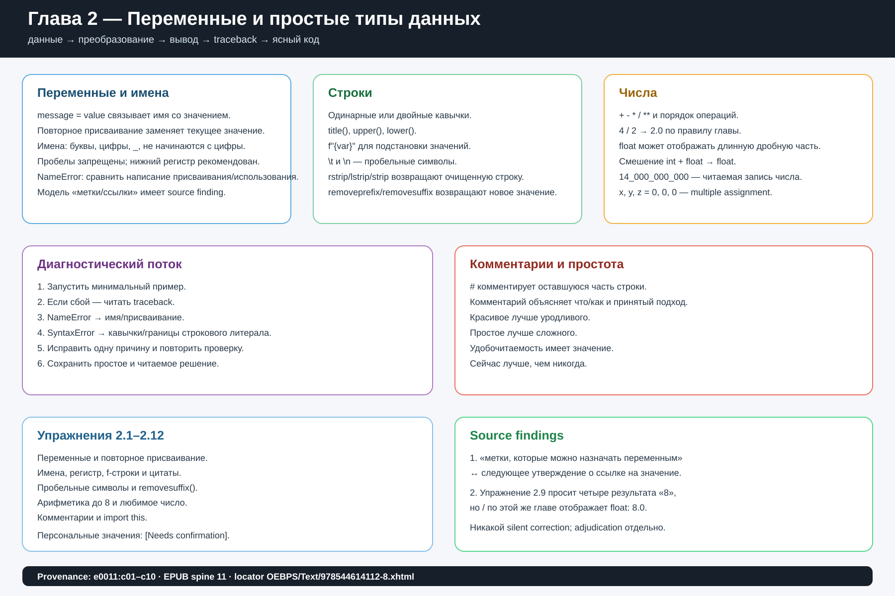

# Глава 2 — Переменные и простые типы данных

RAG-grounded заметки по главе 2 книги «Изучаем Python: программирование игр, визуализация данных, веб-приложения. 3-е изд.».

## Идентификация

- Book ID: `python-crash-course-3e-ru-2024`
- Глава: 2
- Название: «Переменные и простые типы данных»
- Slug: `variables-and-simple-data-types`
- Source policy: `rag_only`
- External sources: запрещены
- Model memory: запрещена
- Прямой доступ к EPUB: не использовался
- Readiness contract: `BIBLIOTEKA-VSP-BOOK-READINESS v1.3`
- Chapter contract: `BIBLIOTEKA-VSP-CHAPTER-ARTIFACT-COLLECTION v1.7`
- Book readiness: `READY` (workflow run `37475588710`)

## Provenance

- RAG chunks: `e0011:c01`–`e0011:c10`
- EPUB spine item: `11`
- EPUB locator: `OEBPS/Text/978544614112-8.xhtml`
- PDF pages: `[Not applicable]`
- Printed pages: `[Needs confirmation]`
- `e0011:c01` начинается заголовком «2. Переменные и простые типы данных».
- `e0011:c10` содержит упражнение 2.12 и отдельный раздел «Резюме».
- Следующий source unit `e0012:c01` начинается главой 3 «Списки».
- Chapter boundary verified: yes
- Source SHA-256: `a1e5ce950d3f9e2e38be23191250a46313b9b7d28663319970f4897902151f6c`

## Содержимое

- [cheatsheet.md](cheatsheet.md) — концептуальная и диагностическая шпаргалка.
- [commands.md](commands.md) — функции, методы, выражения и команды, явно подтверждённые главой.
- [diagram.md](diagram.md) — Mermaid-карта данных и диагностики ошибок.
- [summary.md](summary.md) — chapter-end summary из RAG.
- [review-questions.md](review-questions.md) — упражнения 2.1–2.12.
- [review-answers.md](review-answers.md) — RAG-grounded решения и шаблоны.
- [source-findings.md](source-findings.md) — два выявленных source wording/code finding; источник не исправляется.
- [visual-cheatsheet.svg](visual-cheatsheet.svg) — компактный обзор.
- [visual-cheatsheet-detailed.svg](visual-cheatsheet-detailed.svg) — подробный обзор.

## Карта главы

1. Что делает интерпретатор при запуске `hello_world.py`.
2. Переменные: присваивание, повторное присваивание, именование.
3. Диагностика `NameError` по traceback.
4. Модель переменной как метки/ссылки на значение.
5. Строки и выбор одинарных/двойных кавычек.
6. Методы `title()`, `upper()`, `lower()`.
7. f-строки и подстановка переменных.
8. Пробельные символы `\t` и `\n`.
9. Очистка строк: `rstrip()`, `lstrip()`, `strip()`.
10. Удаление префикса/суффикса: `removeprefix()`, `removesuffix()`.
11. Синтаксические ошибки строк и роль подсветки синтаксиса.
12. Целые числа и операции `+`, `-`, `*`, `/`, `**`.
13. Вещественные числа и видимые эффекты двоичного представления.
14. Смешение целых и вещественных чисел.
15. Подчёркивания в числах, множественное присваивание, соглашение о константах.
16. Комментарии через `#`.
17. «Дзен Python» и ориентация на простоту/читабельность.
18. Упражнения 2.1–2.12 и резюме.

## Краткий анализ главы

Глава переводит читателя от простого запуска программы к базовой модели данных. Переменная вводится как имя, связанное со значением: значение можно заменить новым присваиванием, а интерпретатор использует текущее связывание при дальнейших операциях. Значительная часть материала посвящена тому, чтобы научиться не только писать код, но и понимать его сбои.

На примере опечатки `mesage` источник показывает `NameError`: traceback указывает файл, строку, выражение и тип ошибки. При этом одинаково ошибочно написанное имя может работать, если присваивание и использование совпадают. Вывод главы практический: Python проверяет согласованность идентификаторов, а не английскую орфографию.

Строки рассматриваются как последовательности символов в одинарных или двойных кавычках. Глава показывает методы изменения регистра, f-строки, табуляции и переносы строк, очистку краёв строки и удаление префиксов/суффиксов. Важная граница: методы очистки и `removeprefix()` возвращают новое значение; исходное значение не меняется, пока результат не будет присвоен переменной.

Отдельный пример с апострофом демонстрирует `SyntaxError` при некорректном сочетании кавычек. Подсветка синтаксиса предлагается как ранний визуальный сигнал: если код выглядит как обычный текст или наоборот, возможно, пропущена кавычка.

Числовая часть охватывает арифметику целых чисел, степень через `**`, порядок операций, числа с плавающей точкой, смешанные операции, подчёркивания в числовых литералах и множественное присваивание. Источник прямо показывает, что деление двух целых через `/` возвращает вещественное число, а некоторые операции с дробями могут отображать дополнительные десятичные разряды.

Комментарии вводятся как средство объяснения намерения кода и принятых решений. Завершается глава фрагментом «Дзен Python»: простота, ясность, удобочитаемость и практическое завершение работающего решения ставятся выше попытки сразу написать идеальный код.

## Основной принцип

Связывайте значение с понятным именем, проверяйте фактический результат и используйте traceback/синтаксис для локализации ошибок:

`значение → переменная → операция → вывод → проверка → исправление`.

Простота и читабельность кода являются частью корректной практики, а не только стилевым дополнением.

## Source findings

В ходе cross-check обнаружены два source-level finding. Они сохранены отдельно в [source-findings.md](source-findings.md) и не исправляются молча:

1. формулировка о «метках, которые можно назначать переменным» в `e0011:c03`;
2. упражнение 2.9 требует четыре операции с результатом 8, при этом сама глава показывает, что обычное деление `/` возвращает float, поэтому `16 / 2` отображается как `8.0`.

## Ограничения

- EPUB reflowable: PDF/printed page numbers не используются.
- Текущие версии Python и поведение будущих версий не проверялись; фиксируется только материал главы.
- Полный текст Zen of Python вне строк, присутствующих в RAG, не восстанавливается.
- Пользовательские имя, любимая цитата, любимое число, текущая дата и выбранные личные программы не выдумываются.
- Внешние приложения/сайты, на которые ссылается книга, не использовались.
