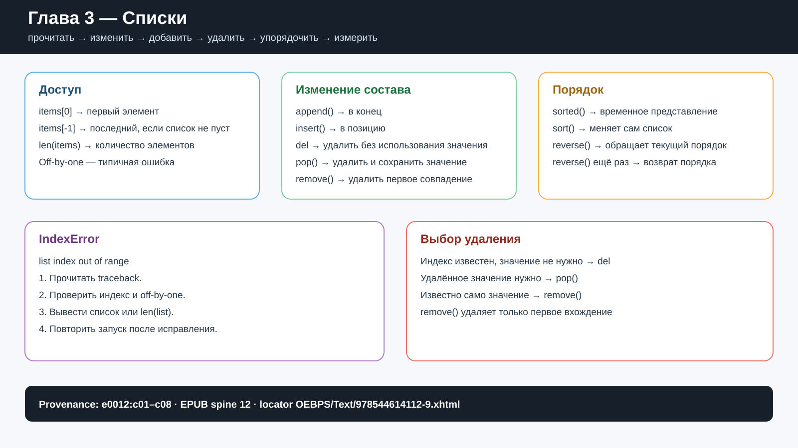
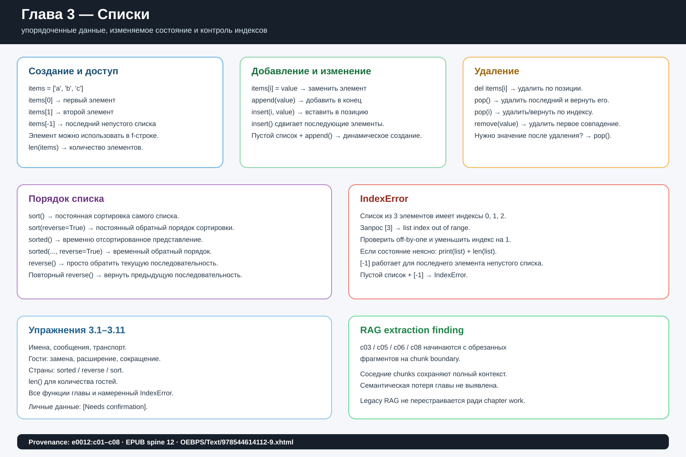

# Глава 3 — Списки

RAG-grounded заметки по главе 3 книги «Изучаем Python: программирование игр, визуализация данных, веб-приложения. 3-е изд.».

## Идентификация

- Book ID: `python-crash-course-3e-ru-2024`
- Глава: 3
- Название: «Списки»
- Slug: `lists`
- Source policy: `rag_only`
- External sources: запрещены
- Model memory: запрещена
- Прямой доступ к EPUB: не использовался
- Readiness contract: `BIBLIOTEKA-VSP-BOOK-READINESS v1.3`
- Chapter contract: `BIBLIOTEKA-VSP-CHAPTER-ARTIFACT-COLLECTION v1.7`
- Book readiness: `READY`
- Readiness evidence: workflow run `37485161334` на ancestor `2a690f342054dbd213cf617486742790880aa416`; последующий delta до стартового `main` `9dd5661704489cfb884073544dcb716ae5fd8611` затрагивал только chapter notes/индексы и не менял readiness inputs.

## Provenance

- RAG chunks: `e0012:c01`–`e0012:c08`
- EPUB spine item: `12`
- EPUB locator: `OEBPS/Text/978544614112-9.xhtml`
- PDF pages: `[Not applicable]`
- Printed pages: `[Needs confirmation]`
- `e0012:c01` начинается заголовком «3. Списки».
- `e0012:c08` содержит упражнение 3.11 и отдельный раздел «Резюме».
- Следующий source unit `e0013:c01` начинается главой 4 «Работа со списками».
- Chapter boundary verified: yes
- Source SHA-256: `a1e5ce950d3f9e2e38be23191250a46313b9b7d28663319970f4897902151f6c`

## Содержимое

- [cheatsheet.md](cheatsheet.md) — выбор операции со списком и диагностика `IndexError`.
- [commands.md](commands.md) — source-confirmed операции и методы списков.
- [diagram.md](diagram.md) — Mermaid-карта доступа/изменения/сортировки и устранения ошибок индекса.
- [summary.md](summary.md) — chapter-end summary из RAG.
- [review-questions.md](review-questions.md) — упражнения 3.1–3.11.
- [review-answers.md](review-answers.md) — RAG-grounded решения и шаблоны.
- [source-findings.md](source-findings.md) — зарегистрированный RAG chunk-boundary extraction issue.
- [visual-cheatsheet.svg](visual-cheatsheet.svg) — компактный обзор.
- [visual-cheatsheet-detailed.svg](visual-cheatsheet-detailed.svg) — подробный обзор.

## Карта главы

1. Список как упорядоченный набор элементов.
2. Литерал списка: квадратные скобки и элементы через запятую.
3. Индексный доступ: первый элемент имеет индекс `0`.
4. Отрицательные индексы: `-1` — последний элемент непустого списка.
5. Использование элемента списка в выражениях и f-строках.
6. Изменение элемента через присваивание по индексу.
7. Добавление через `append()` и `insert()`.
8. Удаление через `del`, `pop()` и `remove()`.
9. Выбор между `del` и `pop()` по необходимости сохранить удалённое значение.
10. Постоянная сортировка через `sort()`.
11. Временное представление через `sorted()`.
12. Изменение порядка через `reverse()`.
13. Длина списка через `len()`.
14. Диагностика `IndexError: list index out of range`.
15. Упражнения 3.1–3.11.
16. Резюме и переход к циклам в главе 4.

## Краткий анализ главы

Глава вводит список как упорядоченную структуру данных и сразу связывает порядок с индексами. Центральная деталь — индексирование начинается с `0`, поэтому человеческая «первая позиция» и индекс Python отличаются на единицу. Отрицательный индекс `-1` используется для последнего элемента, но источник отдельно показывает границу: на пустом списке даже `[-1]` приводит к `IndexError`.

После чтения элементов глава переходит к изменению состояния списка. Присваивание по индексу заменяет существующий элемент. `append()` добавляет в конец и позволяет строить список постепенно из пустого состояния. `insert()` добавляет элемент в выбранную позицию и сдвигает последующие элементы.

Удаление разбито по намерению. `del` используется, когда известен индекс и удалённое значение больше не требуется. `pop()` одновременно удаляет и возвращает значение, причём без аргумента работает с последним элементом, а с индексом — с выбранной позицией. `remove()` удаляет по значению; источник подчёркивает, что удаляется только первое вхождение.

Сортировка также делится по эффекту. `sort()` изменяет порядок самого списка; `sorted()` возвращает временно отсортированное представление без изменения исходного порядка. `reverse()` не сортирует по алфавиту, а просто обращает текущую последовательность; второй вызов `reverse()` возвращает исходный порядок.

Функция `len()` возвращает количество элементов. В диагностической части глава показывает типичный `IndexError`, возникающий при запросе несуществующего индекса. Предлагаемый source workflow: посмотреть traceback, проверить индекс, при необходимости уменьшить его на единицу, затем вывести сам список или его длину, чтобы проверить фактическое состояние.

## Основной принцип

Перед операцией со списком сначала определить намерение:

`прочитать → изменить → добавить → удалить → упорядочить → измерить`.

Для state-changing операций важно различать, требуется ли сохранить удалённое значение и должен ли исходный порядок списка остаться неизменным.

## Source findings

В RAG обнаружен **[Source extraction issue]** на границах некоторых chunks: отдельные chunks начинаются с обрезанного хвоста слова/строки, тогда как соседний предыдущий chunk содержит полный контекст. Семантическая потеря главы не выявлена. Подробности: [source-findings.md](source-findings.md).

## Ограничения

- EPUB reflowable: PDF/printed page numbers не используются.
- Персональные данные для упражнений (имена друзей/гостей, любимый транспорт, страны) не выдумываются.
- Глава ссылается на цикл для удаления всех повторяющихся значений как материал главы 7; этот механизм здесь не реконструируется.
- Поведение сортировки при смешанном регистре источник намеренно откладывает; дополнительные правила не добавляются.
- Rollback для большинства state-changing list operations источник не описывает; там используется `[Needs confirmation]`.
