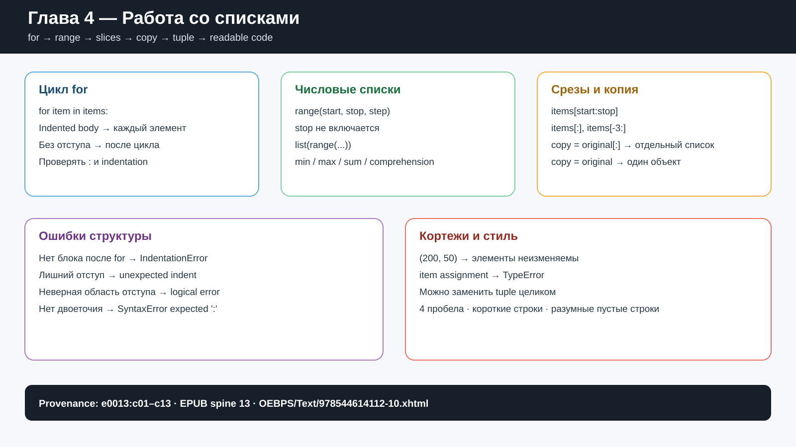
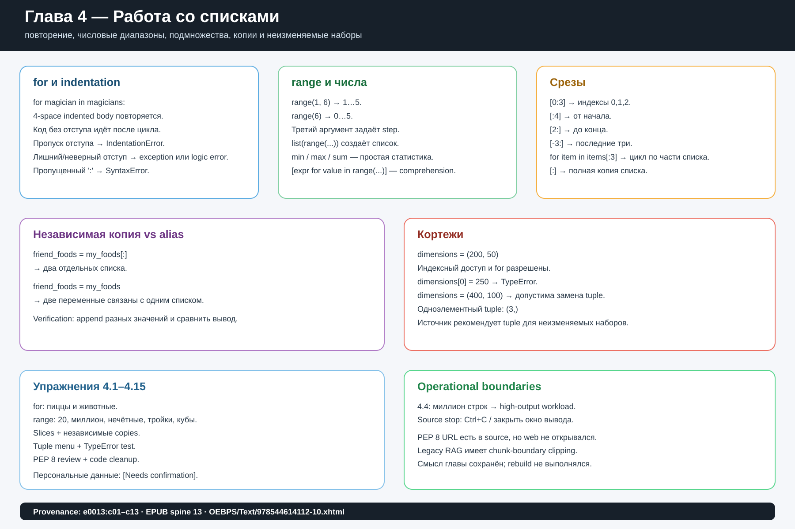

# Глава 4 — Работа со списками

RAG-grounded заметки по главе 4 книги «Изучаем Python: программирование игр, визуализация данных, веб-приложения. 3-е изд.».

## Идентификация

- Book ID: `python-crash-course-3e-ru-2024`
- Глава: 4
- Название: «Работа со списками»
- Slug: `working-with-lists`
- Source policy: `rag_only`
- External sources: запрещены
- Model memory: запрещена
- Прямой доступ к EPUB: не использовался
- Readiness contract: `BIBLIOTEKA-VSP-BOOK-READINESS v1.3`
- Chapter contract: `BIBLIOTEKA-VSP-CHAPTER-ARTIFACT-COLLECTION v1.7`
- Book readiness: `READY`
- Readiness evidence: workflow run `37485161334`; после его HEAD до стартового `main` изменялись только chapter notes/индексы, без source/RAG/contracts.

## Provenance

- RAG chunks: `e0013:c01`–`e0013:c13`
- EPUB spine item: `13`
- EPUB locator: `OEBPS/Text/978544614112-10.xhtml`
- PDF pages: `[Not applicable]`
- Printed pages: `[Needs confirmation]`
- `e0013:c01` начинается заголовком «4. Работа со списками».
- `e0013:c12–c13` содержат упражнения 4.14–4.15 и отдельный раздел «Резюме».
- Следующий source unit `e0014:c01` начинается главой 5 «Оператор if».
- Chapter boundary verified: yes
- Source SHA-256: `a1e5ce950d3f9e2e38be23191250a46313b9b7d28663319970f4897902151f6c`

## Содержимое

- [cheatsheet.md](cheatsheet.md) — рабочая схема циклов, числовых списков, срезов, копирования и кортежей.
- [commands.md](commands.md) — source-confirmed конструкции и действия.
- [diagram.md](diagram.md) — Mermaid-карта логики главы и диагностики отступов.
- [summary.md](summary.md) — chapter-end summary.
- [review-questions.md](review-questions.md) — упражнения 4.1–4.15.
- [review-answers.md](review-answers.md) — RAG-grounded решения и шаблоны.
- [source-findings.md](source-findings.md) — зарегистрированный chunk-boundary extraction issue.
- [visual-cheatsheet.svg](visual-cheatsheet.svg) — компактный обзор.
- [visual-cheatsheet-detailed.svg](visual-cheatsheet-detailed.svg) — подробный обзор.

## Карта главы

1. Перебор всего списка через `for`.
2. Временная переменная цикла и содержательные имена.
3. Несколько действий внутри тела цикла.
4. Код после цикла без отступа.
5. `IndentationError`, логические ошибки отступов и пропущенное двоеточие.
6. `range()` и правило исключительной верхней границы.
7. `list(range(...))` и шаг range.
8. Построение числовых списков в цикле.
9. `min()`, `max()`, `sum()`.
10. List comprehension.
11. Срезы `[start:stop]`, открытые границы и отрицательные индексы.
12. Перебор среза.
13. Копирование списка через `[:]` и отличие от простого присваивания.
14. Кортежи и неизменяемость элементов.
15. Переопределение целого кортежа.
16. Базовые рекомендации PEP 8: отступы, длина строк, пустые строки.
17. Упражнения 4.1–4.15 и резюме.

## Краткий анализ главы

Глава переводит работу со списком от адресации отдельных элементов к обработке всей коллекции. Цикл `for` связывает очередной элемент списка с временной переменной и выполняет тело цикла один раз для каждого элемента. Отступы являются частью структуры программы: строка с отступом после `for` принадлежит циклу, строка без отступа выполняется уже после него.

Источник показывает три класса ошибок вокруг отступов. Отсутствие обязательного отступа даёт `IndentationError`; лишний отступ также может дать `IndentationError`; неверный отступ в синтаксически допустимом месте может привести к логической ошибке без exception. Пропущенное двоеточие после `for` приводит к `SyntaxError`.

Числовая часть строится вокруг `range()`. Верхняя граница не включается: `range(1, 5)` даёт 1–4. Третий аргумент задаёт шаг. `list(range(...))` превращает последовательность в список. Для числовых списков показаны `min()`, `max()`, `sum()`, а list comprehension объединяет выражение и цикл создания элементов в одну строку.

Срезы позволяют работать с частью списка. Вторая граница среза также исключительна; пропущенная левая/правая граница означает начало/конец списка. Полный срез `[:]` создаёт отдельную копию списка. Простое `friend_foods = my_foods` копией не является: обе переменные связываются с одним списком, что источник демонстрирует добавлением разных элементов.

Кортежи вводятся как неизменяемые наборы: обращение по индексу и перебор доступны, но присваивание отдельному элементу вызывает `TypeError`. При необходимости изменить набор допустимо присвоить переменной новый кортеж целиком.

Последняя часть связывает код с читаемостью: четыре пробела на уровень отступа, ограничение длины строк, разумное использование пустых строк. Источник подчёркивает, что код читается чаще, чем пишется.

## Основной принцип

Разделяйте **область повторения** и **область после цикла** по отступам, а при работе с коллекциями явно выбирайте, требуется ли:

`весь список → диапазон чисел → часть списка → независимая копия → неизменяемый набор`.

## Source findings

RAG содержит **[Source extraction issue]**: несколько chunks начинаются с обрезанного хвоста предыдущего текста. Соседние chunks сохраняют полный контекст, chapter boundary и смысл не потеряны. Подробности: [source-findings.md](source-findings.md).

## Ограничения

- EPUB reflowable: PDF/printed page numbers не используются.
- Полный PEP 8 и содержимое внешней страницы не загружались; анализ ограничен тем, что приведено в chapter RAG.
- Упражнения с любимыми пиццами, животными, меню и пользовательскими программами требуют личных данных — они остаются `[Needs confirmation]`.
- Точные результаты производительности для миллиона элементов источник не фиксирует.
- Более сложные правила стиля вне текста главы не добавляются.
