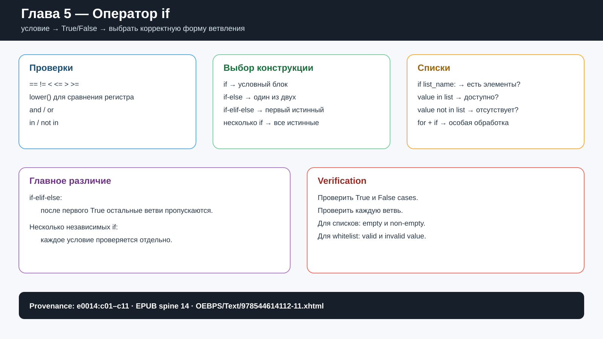
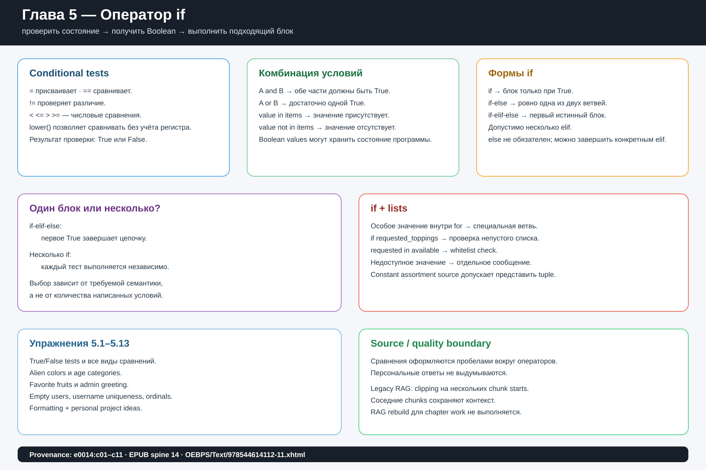

# Глава 5 — Оператор if

RAG-grounded заметки по главе 5 книги «Изучаем Python: программирование игр, визуализация данных, веб-приложения. 3-е изд.».

## Идентификация

- Book ID: `python-crash-course-3e-ru-2024`
- Глава: 5
- Название: «Оператор if»
- Slug: `if-statements`
- Source policy: `rag_only`
- External sources: запрещены
- Model memory: запрещена
- Прямой доступ к EPUB: не использовался
- Readiness contract: `BIBLIOTEKA-VSP-BOOK-READINESS v1.3`
- Chapter contract: `BIBLIOTEKA-VSP-CHAPTER-ARTIFACT-COLLECTION v1.7`
- Book readiness: `READY`
- Readiness evidence: workflow run `37485161334`; последующий delta до стартового `main` затрагивает только chapter notes/индексы.

## Provenance

- RAG chunks: `e0014:c01`–`e0014:c11`
- EPUB spine item: `14`
- EPUB locator: `OEBPS/Text/978544614112-11.xhtml`
- PDF pages: `[Not applicable]`
- Printed pages: `[Needs confirmation]`
- `e0014:c01` начинается заголовком «5. Оператор if».
- `e0014:c11` содержит упражнения 5.12–5.13 и отдельный раздел «Резюме».
- Следующий source unit `e0015:c01` начинается главой 6 «Словари».
- Chapter boundary verified: yes
- Source SHA-256: `a1e5ce950d3f9e2e38be23191250a46313b9b7d28663319970f4897902151f6c`

## Содержимое

- [cheatsheet.md](cheatsheet.md) — выбор условной конструкции и диагностическая схема.
- [commands.md](commands.md) — source-confirmed проверки, операторы и конструкции.
- [diagram.md](diagram.md) — Mermaid-поток принятия решений.
- [summary.md](summary.md) — chapter-end summary.
- [review-questions.md](review-questions.md) — упражнения 5.1–5.13.
- [review-answers.md](review-answers.md) — RAG-grounded решения и шаблоны.
- [source-findings.md](source-findings.md) — зарегистрированный extraction issue.
- [visual-cheatsheet.svg](visual-cheatsheet.svg) — компактный обзор.
- [visual-cheatsheet-detailed.svg](visual-cheatsheet-detailed.svg) — подробный обзор.

## Карта главы

1. Условные выражения и Boolean values `True` / `False`.
2. `=` как присваивание и `==` как проверка равенства.
3. Регистрозависимые сравнения и `lower()`.
4. Неравенство `!=`.
5. Числовые сравнения: `<`, `<=`, `>`, `>=`.
6. Комбинация условий через `and` и `or`.
7. Проверка членства через `in` и отсутствия через `not in`.
8. Простой `if`.
9. `if-else`.
10. Цепочки `if-elif-else`, дополнительные `elif` и отсутствие обязательного `else`.
11. Разница между цепочкой `if-elif-else` и серией независимых `if`.
12. Использование `if` при переборе списков.
13. Проверка пустого/непустого списка.
14. Проверка запрошенных значений по списку доступных.
15. Форматирование сравнений пробелами.
16. Упражнения 5.1–5.13 и резюме.

## Краткий анализ главы

Глава переводит программу от линейного выполнения к выбору действий на основании состояния. Центральная единица — условное выражение, результат которого равен `True` или `False`. Источник последовательно строит проверки от простого равенства до комбинации нескольких условий и членства в списках.

Отдельно подчёркивается разница между присваиванием `=` и проверкой равенства `==`. Сравнение строк учитывает регистр, а `lower()` позволяет выполнить проверку без изменения исходного значения. Для отрицательных проверок используются `!=` и `not in`.

Для двух обязательных условий используется `and`; для ситуации, где достаточно хотя бы одного истинного условия, — `or`. Проверки `in` и `not in` связывают условную логику со списками.

Выбор формы `if` зависит от требуемой семантики. `if-else` выбирает одно из двух действий. `if-elif-else` выбирает только первый подходящий блок и пропускает остальные проверки. Если необходимо обработать все истинные условия независимо, источник требует серии отдельных операторов `if`.

При работе со списками глава показывает три практически разные проверки: особое значение внутри цикла, пустой список перед циклом и проверку пользовательского значения по списку допустимых. Это формирует общий паттерн: сначала проверить состояние/валидность, затем выполнять действие.

## Основной принцип

Сначала определить требуемую семантику решения:

`одно условие → два исхода → один из многих исходов → несколько независимых истинных условий`.

После этого выбрать `if`, `if-else`, `if-elif-else` или несколько независимых `if`.

## Source findings

В RAG зафиксирован **[Source extraction issue]** на границах chunks. Соседние chunks сохраняют полный контекст; chapter boundary, упражнения и summary не потеряны. Подробности: [source-findings.md](source-findings.md).

## Ограничения

- EPUB reflowable: PDF/printed page numbers не используются.
- Личные любимые фрукты, пользовательские идеи и выбранные программы не выдумываются.
- Конкретные реальные аккаунты/имена пользователей не используются; в ответах применяются учебные placeholders.
- Дополнительные правила PEP 8 вне приведённой рекомендации о пробелах вокруг операторов сравнения не добавляются.
