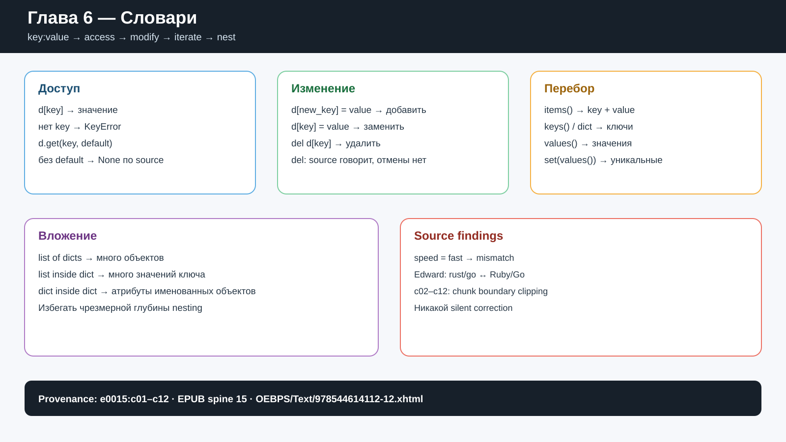
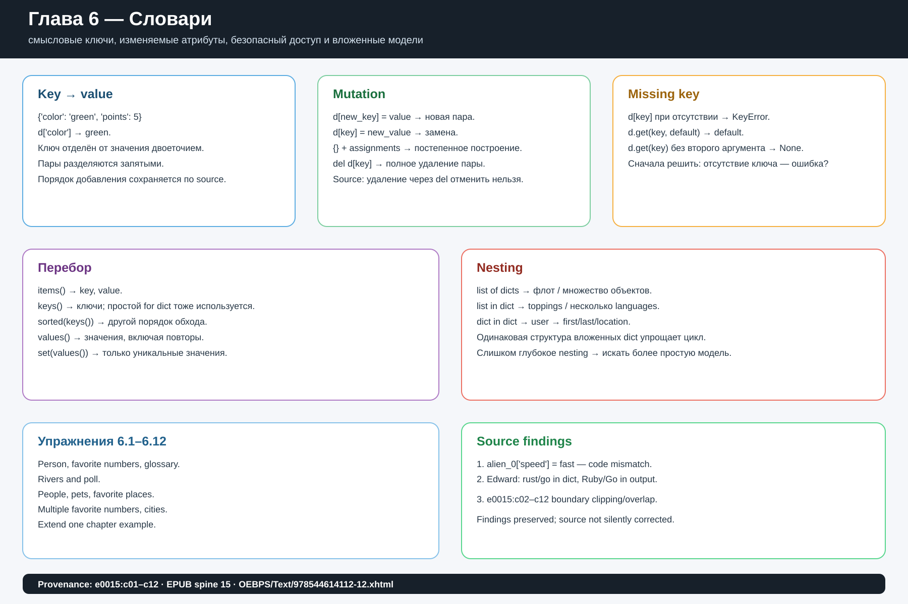

# Глава 6 — Словари

RAG-grounded заметки по главе 6 книги «Изучаем Python: программирование игр, визуализация данных, веб-приложения. 3-е изд.».

## Идентификация

- Book ID: `python-crash-course-3e-ru-2024`
- Глава: 6
- Название: «Словари»
- Slug: `dictionaries`
- Source policy: `rag_only`
- External sources: запрещены
- Model memory: запрещена
- Прямой доступ к EPUB: не использовался
- Readiness contract: `BIBLIOTEKA-VSP-BOOK-READINESS v1.3`
- Chapter contract: `BIBLIOTEKA-VSP-CHAPTER-ARTIFACT-COLLECTION v1.7`
- Book readiness: `READY`
- Readiness evidence: workflow run `37485161334`; последующий delta до стартового `main` затрагивал только chapter notes/индексы.

## Provenance

- RAG chunks: `e0015:c01`–`e0015:c12`
- EPUB spine item: `15`
- EPUB locator: `OEBPS/Text/978544614112-12.xhtml`
- PDF pages: `[Not applicable]`
- Printed pages: `[Needs confirmation]`
- `e0015:c01` начинается заголовком «6. Словари».
- `e0015:c12` содержит упражнения 6.9–6.12 и отдельный раздел «Резюме».
- Следующий source unit `e0016:c01` начинается главой 7 «Ввод данных и циклы while».
- Chapter boundary verified: yes
- Source SHA-256: `a1e5ce950d3f9e2e38be23191250a46313b9b7d28663319970f4897902151f6c`

## Содержимое

- [cheatsheet.md](cheatsheet.md) — рабочая схема доступа, изменения, перебора и вложения словарей.
- [commands.md](commands.md) — source-confirmed операции/методы.
- [diagram.md](diagram.md) — Mermaid-карта словаря и диагностический поток для отсутствующего ключа.
- [summary.md](summary.md) — chapter-end summary.
- [review-questions.md](review-questions.md) — упражнения 6.1–6.12.
- [review-answers.md](review-answers.md) — RAG-grounded решения и шаблоны.
- [source-findings.md](source-findings.md) — extraction issue и два source code/text mismatch.
- [visual-cheatsheet.svg](visual-cheatsheet.svg) — компактный обзор.
- [visual-cheatsheet-detailed.svg](visual-cheatsheet-detailed.svg) — подробный обзор.

## Карта главы

1. Словарь как набор пар «ключ — значение».
2. Доступ по ключу через квадратные скобки.
3. Добавление новых пар.
4. Создание пустого словаря.
5. Изменение значения по существующему ключу.
6. Удаление через `del`.
7. Словари с однотипными объектами.
8. Безопасное обращение через `get()` и значение по умолчанию.
9. `KeyError` при отсутствующем ключе в `dict[key]`.
10. Перебор пар через `items()`.
11. Перебор ключей через `keys()` или непосредственно словарь.
12. Сортировка ключей через `sorted()`.
13. Перебор значений через `values()`.
14. Удаление дубликатов значений через `set()`.
15. Вложение: список словарей.
16. Вложение: список как значение словаря.
17. Вложение: словарь как значение другого словаря.
18. Упражнения 6.1–6.12 и резюме.

## Краткий анализ главы

Глава вводит словарь как структуру для связывания ключа с конкретным значением. В отличие от списка, где основным адресом элемента является позиция, здесь доступ строится через смысловой ключ. Это позволяет моделировать объект с набором атрибутов или хранить один тип данных для многих именованных объектов.

Словарь изменяем: новую пару можно добавить через `dictionary[key] = value`, существующее значение — заменить тем же синтаксисом, а пару удалить через `del dictionary[key]`. Источник отдельно предупреждает, что удаление пары через `del` нельзя отменить.

Два механизма чтения ключа имеют разную failure semantics. Квадратные скобки удобны, когда ключ ожидается обязательно; отсутствующий ключ приводит к `KeyError`. Метод `get()` позволяет вернуть заданное значение по умолчанию, а без второго аргумента — специальное значение `None`, если ключ не найден.

Для полного обхода словаря используются `items()`, `keys()` и `values()`. Источник показывает, что явный `keys()` необязателен при простом переборе словаря, но может улучшать читаемость. Для другого порядка ключей применяется `sorted(...)`. Если нужны уникальные значения, глава показывает `set(dictionary.values())`.

Заключительная часть посвящена вложению. Список словарей удобен для множества объектов с одинаковой структурой атрибутов; список внутри словаря — когда одному ключу соответствует несколько значений; словарь внутри словаря — когда каждый именованный объект сам имеет несколько атрибутов. Источник предупреждает не делать вложенность чрезмерно глубокой.

## Основной принцип

Выбирать структуру по форме связи данных:

`один ключ → одно значение`,
`один объект → несколько атрибутов`,
`много однотипных объектов → список словарей`,
`один ключ → много значений → список внутри словаря`.

При чтении ключа отдельно решить, является ли его отсутствие ошибкой или допустимым состоянием.

## Source findings

Зафиксированы:

1. **[Source code mismatch]** — пример `alien_0['speed'] = fast` использует некавыченный `fast`, хотя значения скорости в том же примере представлены строками.
2. **[Source code mismatch]** — словарь `favorite_languages` содержит для Edward `['rust', 'go']`, но показанный ниже вывод содержит `Ruby / Go`.
3. **[Source extraction issue]** — почти каждый chunk после `c01` начинается с overlap/clipped continuation предыдущего текста.

Подробности: [source-findings.md](source-findings.md). Никакой silent correction источника не выполнялся.

## Ограничения

- EPUB reflowable: PDF/printed page numbers не используются.
- Персональные сведения о знакомых, друзьях, любимых числах, местах, животных и выбранных городах не выдумываются.
- Реальные демографические данные городов для 6.11 не ищутся: это требует пользовательского выбора/внешней проверки.
- Поведение `None` дальше главы 6 не расширяется; источник отсылает к главе 8.
