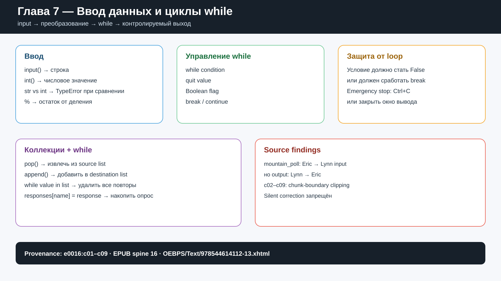
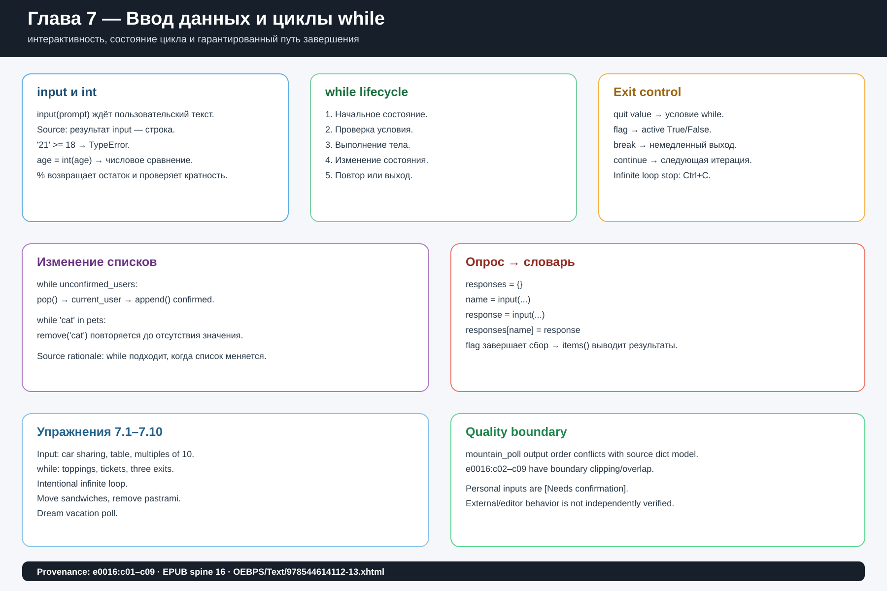

# Глава 7 — Ввод данных и циклы while

RAG-grounded заметки по главе 7 книги «Изучаем Python: программирование игр, визуализация данных, веб-приложения. 3-е изд.».

## Идентификация

- Book ID: `python-crash-course-3e-ru-2024`
- Глава: 7
- Название: «Ввод данных и циклы while»
- Slug: `input-and-while-loops`
- Source policy: `rag_only`
- External sources: запрещены
- Model memory: запрещена
- Прямой доступ к EPUB: не использовался
- Readiness contract: `BIBLIOTEKA-VSP-BOOK-READINESS v1.3`
- Chapter contract: `BIBLIOTEKA-VSP-CHAPTER-ARTIFACT-COLLECTION v1.7`
- Book readiness: `READY`
- Readiness evidence: workflow run `37485161334`; последующий delta до стартового `main` затрагивал только chapter notes/индексы.

## Provenance

- RAG chunks: `e0016:c01`–`e0016:c09`
- EPUB spine item: `16`
- EPUB locator: `OEBPS/Text/978544614112-13.xhtml`
- PDF pages: `[Not applicable]`
- Printed pages: `[Needs confirmation]`
- `e0016:c01` начинается заголовком «7. Ввод данных и циклы while».
- `e0016:c09` содержит окончание упражнения 7.10 и отдельный раздел «Резюме».
- Следующий source unit `e0017:c01` начинается главой 8 «Функции».
- Chapter boundary verified: yes
- Source SHA-256: `a1e5ce950d3f9e2e38be23191250a46313b9b7d28663319970f4897902151f6c`

## Содержимое

- [cheatsheet.md](cheatsheet.md) — интерактивный ввод, управление `while` и защита от зацикливания.
- [commands.md](commands.md) — source-confirmed функции, операторы и state-changing действия.
- [diagram.md](diagram.md) — Mermaid-потоки для ввода и циклов.
- [summary.md](summary.md) — chapter-end summary.
- [review-questions.md](review-questions.md) — упражнения 7.1–7.10.
- [review-answers.md](review-answers.md) — RAG-grounded решения и шаблоны.
- [source-findings.md](source-findings.md) — extraction issue и source code/output mismatch.
- [visual-cheatsheet.svg](visual-cheatsheet.svg) — компактный обзор.
- [visual-cheatsheet-detailed.svg](visual-cheatsheet-detailed.svg) — подробный обзор.

## Карта главы

1. `input()` и текстовая подсказка.
2. Многострочная подсказка через `+=`.
3. `input()` всегда возвращает строку по материалу главы.
4. Преобразование числового ввода через `int()`.
5. `TypeError` при сравнении строки с числом.
6. Оператор остатка `%`.
7. Цикл `while` и изменение управляющей переменной.
8. Quit value.
9. Флаг `active`.
10. `break` для немедленного выхода.
11. `continue` для перехода к следующей итерации.
12. Предотвращение бесконечных циклов.
13. Перемещение элементов между списками через `pop()` + `append()`.
14. Удаление всех вхождений значения через `while value in list`.
15. Заполнение словаря пользовательскими ответами в цикле.
16. Упражнения 7.1–7.10 и резюме.

## Краткий анализ главы

Глава делает программы интерактивными. `input()` останавливает выполнение и ждёт пользовательский текст; результат сохраняется как строка. Поэтому числовые данные необходимо явно преобразовать через `int()` перед арифметикой или сравнением с числами.

Оператор `%` используется как практический пример обработки числового ввода: остаток `0` при делении на `2` используется для определения чётности. Это связывает ввод, преобразование типа и условное ветвление в один минимальный сценарий.

Центральная тема главы — управление продолжительностью `while`. Источник показывает четыре формы: условие непосредственно в `while`, quit value, отдельный Boolean-флаг и бесконечный `while True` с `break`. `continue` не завершает цикл, а возвращает управление в его начало, пропуская оставшийся код текущей итерации.

Отдельно подчёркивается operational risk: любой `while` должен иметь достижимый путь завершения. Если управляющая переменная никогда не меняется либо exit condition недостижим, цикл становится бесконечным. Source-supported аварийная остановка — `Ctrl+C` или закрытие терминального окна.

Последняя часть использует `while` именно там, где коллекция изменяется в ходе обработки: элементы переносятся между двумя списками, все повторения конкретного значения удаляются из списка, а пользовательские ответы постепенно накапливаются в словаре.

## Основной принцип

Перед запуском `while` должны быть понятны три вещи:

`начальное состояние → условие продолжения → гарантированный путь изменения/выхода`.

Если один из этих элементов не определён, риск бесконечного цикла существенно возрастает.

## Source findings

1. **[Source code/output mismatch]** — в `mountain_poll.py` source interaction вводит Eric, затем Lynn, но показанный итоговый вывод словаря перечисляет Lynn раньше Eric, хотя ранее книга утверждает, что словари сохраняют порядок добавления.
2. **[Source extraction issue]** — `e0016:c02–c09` начинаются с overlap/clipped continuation соседнего текста.

Подробности: [source-findings.md](source-findings.md). Silent correction не выполнялся.

## Ограничения

- EPUB reflowable: PDF/printed page numbers не используются.
- Утверждение источника о запуске программ с `input()` в VS Code не проверялось внешне и сохраняется как source statement.
- Персональные ответы (машина, toppings, dream vacation и т.п.) не выдумываются.
- Поведение нечислового ввода для `int()` и обработка таких ошибок в этой главе не рассматриваются; дополнения не добавляются.
