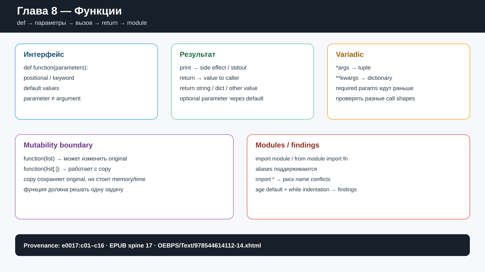

# Глава 8 — Функции

RAG-grounded заметки по главе 8 книги «Изучаем Python: программирование игр, визуализация данных, веб-приложения. 3-е изд.».

## Идентификация

- Book ID: `python-crash-course-3e-ru-2024`
- Глава: 8
- Название: «Функции»
- Slug: `functions`
- Source policy: `rag_only`
- External sources: запрещены
- Model memory: запрещена
- Прямой доступ к EPUB: не использовался
- Readiness contract: `BIBLIOTEKA-VSP-BOOK-READINESS v1.3`
- Chapter contract: `BIBLIOTEKA-VSP-CHAPTER-ARTIFACT-COLLECTION v1.7`
- Book readiness: `READY`
- Readiness evidence: workflow run `37485161334`; последующий delta до стартового `main` затрагивал только chapter notes/индексы.

## Provenance

- RAG chunks: `e0017:c01`–`e0017:c16`
- EPUB spine item: `17`
- EPUB locator: `OEBPS/Text/978544614112-14.xhtml`
- PDF pages: `[Not applicable]`
- Printed pages: `[Needs confirmation]`
- `e0017:c01` начинается заголовком «8. Функции».
- `e0017:c16` содержит упражнения 8.15–8.17 и отдельный раздел «Резюме».
- Следующий source unit `e0018:c01` начинается главой 9 «Классы».
- Chapter boundary verified: yes
- Source SHA-256: `a1e5ce950d3f9e2e38be23191250a46313b9b7d28663319970f4897902151f6c`

## Содержимое

- [cheatsheet.md](cheatsheet.md) — выбор интерфейса функции, аргументов, return и импортов.
- [commands.md](commands.md) — source-confirmed синтаксис и операции.
- [diagram.md](diagram.md) — Mermaid-карта вызова функции и модулей.
- [summary.md](summary.md) — chapter-end summary.
- [review-questions.md](review-questions.md) — упражнения 8.1–8.17.
- [review-answers.md](review-answers.md) — RAG-grounded решения и шаблоны.
- [source-findings.md](source-findings.md) — два code/text mismatch и extraction issue.
- [visual-cheatsheet.svg](visual-cheatsheet.svg) — компактный обзор.
- [visual-cheatsheet-detailed.svg](visual-cheatsheet-detailed.svg) — подробный обзор.

## Карта главы

1. Определение функции через `def`.
2. Тело функции и строка документации.
3. Параметры и аргументы.
4. Позиционные аргументы и значение порядка.
5. Именованные аргументы.
6. Значения по умолчанию.
7. Ошибки недостаточного/избыточного количества аргументов.
8. `return` и возвращаемые значения.
9. Необязательные параметры.
10. Возврат словаря.
11. Функция внутри `while`.
12. Передача списка функции.
13. Изменение списка внутри функции.
14. Передача копии списка через `[:]`.
15. Произвольный набор позиционных аргументов `*args`.
16. Произвольный набор именованных аргументов `**kwargs`.
17. Модули и разные формы `import`.
18. Псевдонимы функций и модулей.
19. Риски `from module import *`.
20. Форматирование функций и модулей.
21. Упражнения 8.1–8.17 и резюме.

## Краткий анализ главы

Глава вводит функцию как именованный блок кода, решающий одну конкретную задачу. Вызов отделяется от определения: параметры описывают данные, которые функция ожидает, а аргументы передают конкретные значения при вызове.

Для передачи данных источник показывает позиционные и именованные аргументы. Позиционные зависят от порядка; именованные связываются с параметром по имени. Значения по умолчанию позволяют опустить типичный аргумент, но параметры со значением по умолчанию должны располагаться после обязательных параметров.

Функция не обязана печатать результат: через `return` она может вернуть строку, словарь или другое значение в вызывающий код. Необязательный параметр строится через значение по умолчанию и условную проверку.

Передача списка имеет mutability boundary: функция получает доступ к самому списку и может изменять его. Если требуется сохранить исходный список, источник предлагает передать срез `list_name[:]`; одновременно отмечается, что копирование требует дополнительных времени и памяти.

Для неизвестного заранее количества аргументов используются `*toppings` и `**user_info`. Первый собирает позиционные значения в tuple, второй — именованные пары в dictionary. Обязательные параметры располагаются перед variadic-параметрами.

Функции можно вынести в модуль. Источник показывает импорт всего модуля, конкретной функции, aliases для функций/модулей и `from module import *`. Последний способ прямо не рекомендуется для больших чужих модулей из-за риска конфликтов имён.

Завершается глава требованиями к читаемости: описательные lowercase-имена функций и модулей, docstring после определения, отсутствие пробелов вокруг `=` в default/keyword arguments, ограничение длины строки, разделение функций пустыми строками и размещение imports в начале файла.

## Основной принцип

Хорошая функция имеет:

`одну задачу → ясное имя → понятный вход → предсказуемый выход → минимальные скрытые изменения состояния`.

Если функция начинает решать несколько независимых задач, источник предлагает разделить её.

## Source findings

Зафиксированы:

1. **[Source code/text mismatch]** — в `e0017:c07` код задаёт `age=''`, а пояснение называет значением по умолчанию `None`.
2. **[Source code/text mismatch]** — в `e0017:c08` строки форматирования/вывода имени извлечены вне `while`, хотя описание и показанный диалог требуют приветствия на каждой итерации.
3. **[Source extraction issue]** — `e0017:c02–c16` начинаются с overlap/clipped continuation предыдущего текста.

Подробности: [source-findings.md](source-findings.md). Никакой silent correction не выполнялся.

## Ограничения

- EPUB reflowable: PDF/printed page numbers не используются.
- Внешний PEP 8 по URL не открывался; используются только правила, приведённые в RAG главы.
- Пользовательские книги, города, альбомы, сообщения, профиль, автомобиль и выбранные программы не выдумываются.
- Точная причина finding с indentation в `e0017:c08` — source или extraction — `[Needs confirmation]`.
