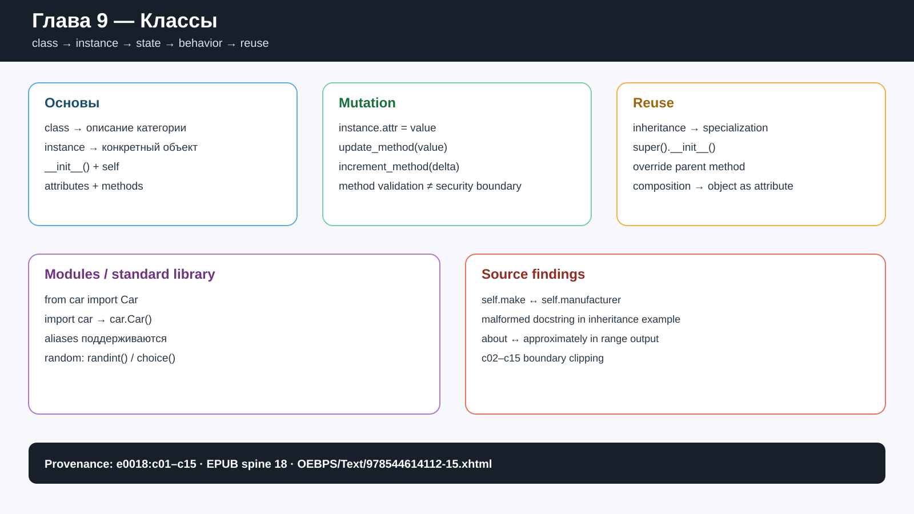
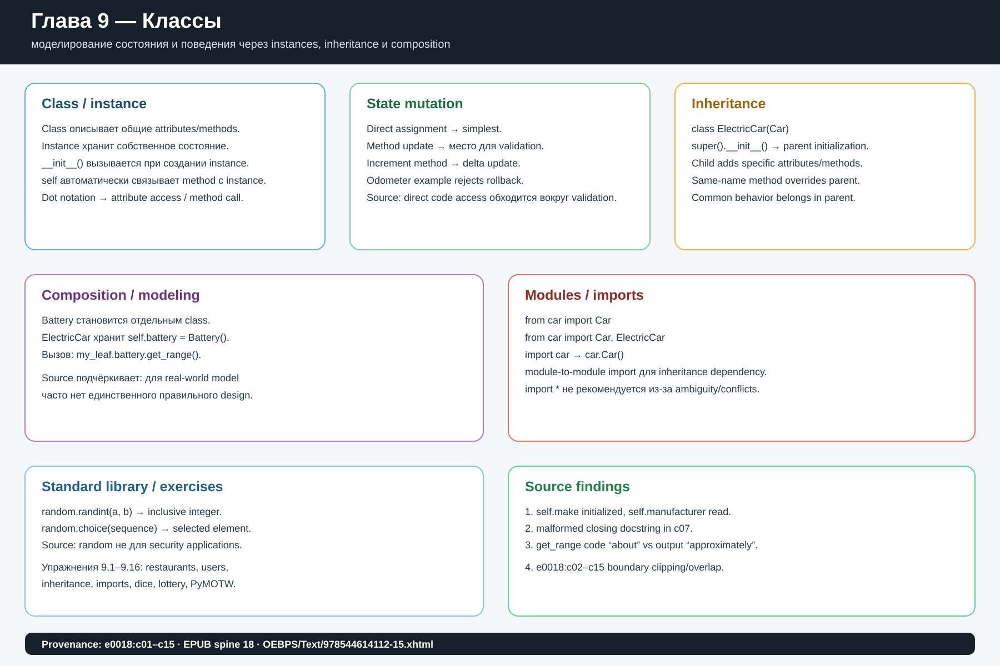

# Глава 9 — Классы

RAG-grounded заметки по главе 9 книги «Изучаем Python: программирование игр, визуализация данных, веб-приложения. 3-е изд.».

## Идентификация

- Book ID: `python-crash-course-3e-ru-2024`
- Глава: 9
- Название: «Классы»
- Slug: `classes`
- Source policy: `rag_only`
- External sources: запрещены
- Model memory: запрещена
- Прямой доступ к EPUB: не использовался
- Readiness contract: `BIBLIOTEKA-VSP-BOOK-READINESS v1.3`
- Chapter contract: `BIBLIOTEKA-VSP-CHAPTER-ARTIFACT-COLLECTION v1.7`
- Book readiness: `READY`
- Readiness evidence: workflow run `37485161334`; последующий delta до стартового `main` затрагивал только chapter notes/индексы.

## Provenance

- RAG chunks: `e0018:c01`–`e0018:c15`
- EPUB spine item: `18`
- EPUB locator: `OEBPS/Text/978544614112-15.xhtml`
- PDF pages: `[Not applicable]`
- Printed pages: `[Needs confirmation]`
- `e0018:c01` начинается заголовком «9. Классы».
- `e0018:c15` содержит упражнения 9.15–9.16, раздел «Оформление классов» и отдельный раздел «Резюме».
- Следующий source unit `e0019:c01` начинается главой 10 «Файлы и исключения».
- Chapter boundary verified: yes
- Source SHA-256: `a1e5ce950d3f9e2e38be23191250a46313b9b7d28663319970f4897902151f6c`

## Содержимое

- [cheatsheet.md](cheatsheet.md) — lifecycle экземпляра, mutation boundary, inheritance/composition/imports.
- [commands.md](commands.md) — source-confirmed конструкции и операции.
- [diagram.md](diagram.md) — Mermaid-карта класса, наследования и композиции.
- [summary.md](summary.md) — chapter-end summary.
- [review-questions.md](review-questions.md) — упражнения 9.1–9.16.
- [review-answers.md](review-answers.md) — RAG-grounded решения и шаблоны.
- [source-findings.md](source-findings.md) — code/text mismatches и extraction issue.
- [visual-cheatsheet.svg](visual-cheatsheet.svg) — компактный обзор.
- [visual-cheatsheet-detailed.svg](visual-cheatsheet-detailed.svg) — подробный обзор.

## Карта главы

1. Класс как описание категории объектов.
2. Экземпляр как конкретный объект, созданный из класса.
3. `__init__()`, `self`, attributes и methods.
4. Dot notation для атрибутов и методов.
5. Несколько экземпляров одного класса.
6. Атрибуты со значением по умолчанию.
7. Три способа изменения атрибута: напрямую, через setter-like method, через increment method.
8. Проверка допустимости mutation внутри метода.
9. Inheritance: parent/child class.
10. `super().__init__()`.
11. Атрибуты и методы child class.
12. Переопределение parent method.
13. Composition: экземпляр одного класса как атрибут другого.
14. Моделирование реального мира и отсутствие единственного правильного design.
15. Импорт одного/нескольких классов, целого module и module-to-module imports.
16. Aliases для классов и модулей.
17. Python standard library: `random.randint()`, `random.choice()`.
18. Ограничение `random`: source не рекомендует для security-sensitive applications.
19. Форматирование классов и модулей.
20. Упражнения 9.1–9.16 и резюме.

## Краткий анализ главы

Глава вводит ООП через разделение **описания** и **экземпляра**. Класс задаёт общие атрибуты и поведение, а каждый экземпляр получает собственное состояние. Метод `__init__()` автоматически вызывается при создании экземпляра; `self` связывает методы с конкретным экземпляром и даёт доступ к его атрибутам.

State mutation рассматривается последовательно. Атрибут можно изменить напрямую, через специальный метод или приращением. Source показывает, что method boundary позволяет добавить validation: `update_odometer()` отклоняет попытку уменьшить пробег. При этом глава отдельно предупреждает, что пользователь с прямым доступом к коду всё равно может изменить атрибут напрямую; такая проверка не является полноценной security boundary.

Inheritance используется для специализированного класса. `ElectricCar(Car)` наследует common behavior, а `super().__init__()` инициализирует атрибуты parent class. Child class может добавлять собственные attributes/methods или override метод родителя.

Composition вводится как альтернатива разрастанию одного класса: `Battery` становится самостоятельным объектом и сохраняется как `self.battery` внутри `ElectricCar`. Это отделяет отдельную ответственность и позволяет развивать модель аккумулятора без дальнейшего перегружения класса машины.

Модульная часть продолжает идею разделения ответственности: классы можно хранить в отдельных модулях, импортировать по одному, группами или через module namespace. `from module import *` source показывает для распознавания, но прямо не рекомендует из-за неясности и конфликтов имён.

## Основной принцип

При моделировании отделяйте:

`что объект знает → attributes`

`что объект умеет → methods`

`что является специализацией → inheritance`

`что является отдельной составной частью → composition`.

Если модель становится слишком большой, source предлагает пересмотреть распределение обязанностей между классами.

## Source findings

Зафиксированы:

1. **[Source code mismatch]** — в `e0018:c11` `__init__()` сохраняет `self.make`, а `get_descriptive_name()` использует `self.manufacturer`.
2. **[Source code/extraction mismatch]** — в `e0018:c07` docstring `Car.__init__()` закрывается двумя кавычками вместо трёх.
3. **[Source code/output mismatch]** — `Battery.get_range()` печатает `about`, а показанный output использует `approximately`.
4. **[Source extraction issue]** — `e0018:c02–c15` начинаются с overlap/clipped continuation предыдущего текста.

Подробности: [source-findings.md](source-findings.md). Silent correction не выполнялся.

## Ограничения

- EPUB reflowable: PDF/printed page numbers не используются.
- Реальные ресторанные данные, пользователи, flavours, privileges и иные персональные значения не выдумываются.
- Упражнение 9.16 требует внешнего сайта PyMOTW; в режиме `rag_only` сайт не открывался.
- Security characteristics стандартного `random` не расширяются сверх source warning.
