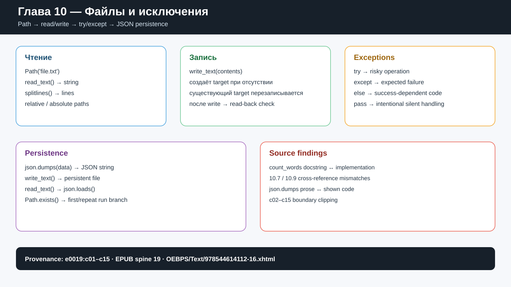
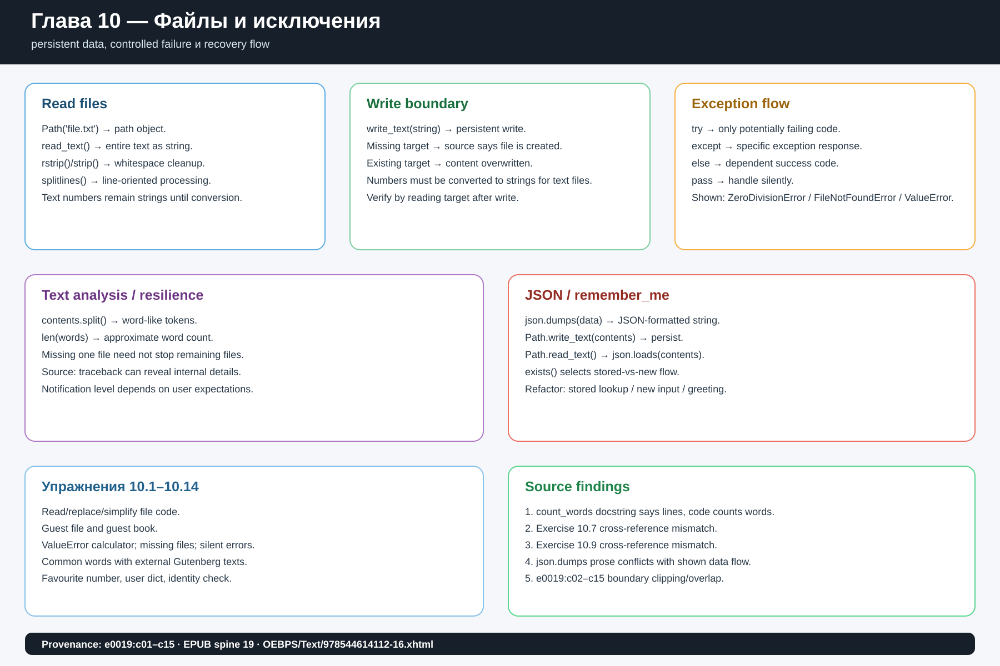

# Глава 10 — Файлы и исключения

RAG-grounded заметки по главе 10 книги «Изучаем Python: программирование игр, визуализация данных, веб-приложения. 3-е изд.».

## Идентификация

- Book ID: `python-crash-course-3e-ru-2024`
- Глава: 10
- Название: «Файлы и исключения»
- Slug: `files-and-exceptions`
- Source policy: `rag_only`
- External sources: запрещены
- Model memory: запрещена
- Прямой доступ к EPUB: не использовался
- Readiness contract: `BIBLIOTEKA-VSP-BOOK-READINESS v1.3`
- Chapter contract: `BIBLIOTEKA-VSP-CHAPTER-ARTIFACT-COLLECTION v1.7`
- Book readiness: `READY`
- Readiness evidence: workflow run `37485161334`; последующий delta до стартового `main` затрагивал только chapter notes/индексы.

## Provenance

- RAG chunks: `e0019:c01`–`e0019:c15`
- EPUB spine item: `19`
- EPUB locator: `OEBPS/Text/978544614112-16.xhtml`
- PDF pages: `[Not applicable]`
- Printed pages: `[Needs confirmation]`
- `e0019:c01` начинается заголовком «10. Файлы и исключения».
- `e0019:c15` содержит упражнения 10.11–10.14 и отдельный раздел «Резюме».
- Следующий source unit `e0020:c01` начинается главой 11 «Тестирование кода».
- Chapter boundary verified: yes
- Source SHA-256: `a1e5ce950d3f9e2e38be23191250a46313b9b7d28663319970f4897902151f6c`

## Содержимое

- [cheatsheet.md](cheatsheet.md) — чтение/запись, exception flow и persistence.
- [commands.md](commands.md) — source-confirmed операции и их risk/verification.
- [diagram.md](diagram.md) — Mermaid-потоки для файлов, исключений и JSON.
- [summary.md](summary.md) — chapter-end summary.
- [review-questions.md](review-questions.md) — упражнения 10.1–10.14.
- [review-answers.md](review-answers.md) — RAG-grounded решения и шаблоны.
- [source-findings.md](source-findings.md) — source mismatches и extraction issue.
- [visual-cheatsheet.svg](visual-cheatsheet.svg) — компактный обзор.
- [visual-cheatsheet-detailed.svg](visual-cheatsheet-detailed.svg) — подробный обзор.

## Карта главы

1. `pathlib.Path` и объект пути.
2. `read_text()` и чтение всего файла.
3. `rstrip()`, method chaining.
4. Relative и absolute paths.
5. `splitlines()` и построчная обработка.
6. Обработка содержимого файла как строк.
7. Большие файлы и ограничение объёмом памяти.
8. `write_text()` и создание/перезапись файла.
9. Исключения как объекты ошибок.
10. `try-except` для конкретного exception type.
11. `else` для кода, зависящего от успешного `try`.
12. `ZeroDivisionError`, `FileNotFoundError`, `ValueError`.
13. Обработка нескольких файлов.
14. `pass` для намеренного молчаливого пропуска exception.
15. Выбор объёма error information для пользователя.
16. JSON persistence через `json.dumps()` и `json.loads()`.
17. `Path.exists()`.
18. Refactoring и разделение обязанностей.
19. Упражнения 10.1–10.14 и резюме.

## Краткий анализ главы

Глава соединяет три связанные задачи: долговременное хранение данных, управляемую обработку ошибок и persistence пользовательского состояния.

Для файлов source переходит на `pathlib.Path`. `read_text()` загружает содержимое как строку; `splitlines()` превращает её в набор строк для цикла. Путь может быть relative или absolute. При работе с текстовыми числами источник отдельно напоминает, что прочитанное содержимое остаётся строкой до явного преобразования.

Запись выполняется через `Path.write_text()`. Ключевая operational граница: если target file уже существует, `write_text()` перезапишет его содержимое. Поэтому это не read-only операция; перед реальным применением нужно понимать target path и допустимость overwrite.

Exception handling строится вокруг минимального `try`: source предлагает помещать туда только код, способный породить ожидаемое исключение. `except` обрабатывает конкретный failure mode, а `else` содержит код, который должен выполняться только после успешного `try`. Такой подход позволяет продолжать обработку следующих элементов вместо аварийного завершения всей программы.

Source также связывает error handling с информационной безопасностью: полная traceback может раскрыть имя файла и проблемный участок кода. Однако глава не описывает полноценную threat model и не предлагает расширенных security controls.

Для persistence используется JSON: Python data → JSON string → file и обратно. `Path.exists()` позволяет выбрать между загрузкой сохранённых данных и первичным вводом. Финальный рефакторинг разделяет получение сохранённого имени, запрос нового имени и приветствие на отдельные функции.

## Основной принцип

Перед file/exception operation определить:

`какой ресурс читаем/пишем → что может отказать → какой exception ожидаем → что делать при успехе/ошибке → изменяется ли persistent state`.

Для записи отдельно проверить, допустимо ли перезаписывать target.

## Source findings

Зафиксированы:

1. **[Source documentation/code mismatch]** — `count_words()` документирован как подсчёт строк, но code использует `split()` + `len()` для приблизительного количества слов.
2. **[Source exercise-reference mismatch]** — 10.7 ссылается на код упражнения 10.5, хотя собственная формулировка продолжает сценарий сложения с `ValueError`.
3. **[Source exercise-reference mismatch]** — 10.9 ссылается на изменение `except` из 10.7, хотя scenario относится к отсутствующему файлу из 10.8.
4. **[Source prose/code mismatch]** — пояснение `json.dumps()` говорит о двух аргументах, включая file object, но показанный code вызывает `json.dumps(numbers)` и отдельно `write_text(contents)`.
5. **[Source extraction issue]** — `e0019:c02–c15` имеют boundary clipping/overlap.

Подробности: [source-findings.md](source-findings.md). Silent correction canonical RAG не выполнялся.

## Ограничения

- EPUB reflowable: PDF/printed page numbers не используются.
- Дополнительные материалы книги, Project Gutenberg и иные внешние файлы/сайты не открывались.
- Персональные данные пользователя, guest names, favourite number и profile fields не выдумываются.
- Реальные absolute paths зависят от окружения и в artifacts не подставляются.
- JSON API за пределами показанных source examples не расширяется.
