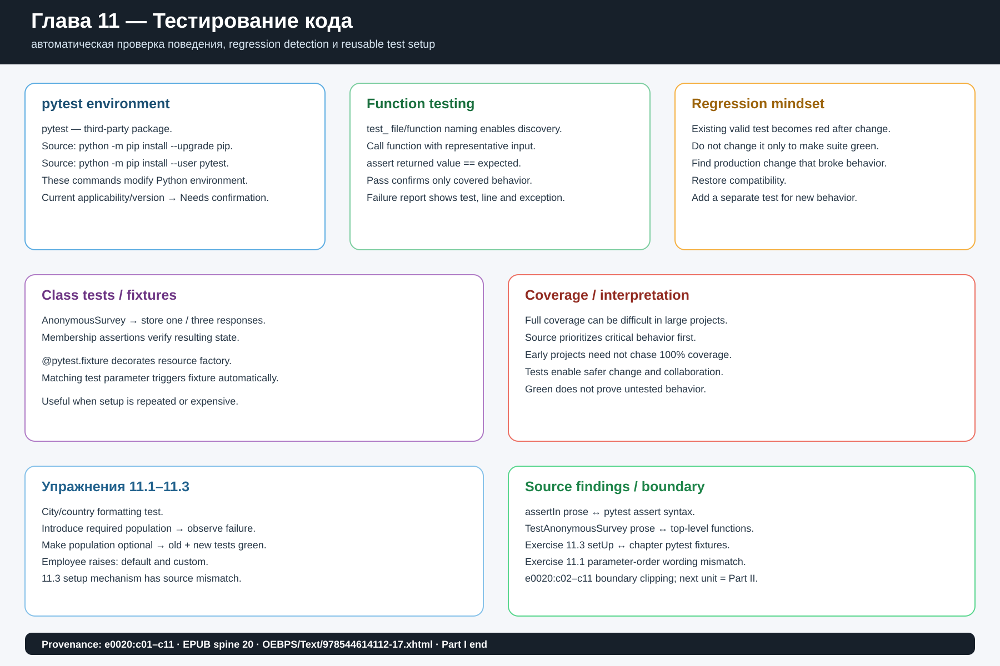

# Глава 11 — Тестирование кода

RAG-grounded заметки по главе 11 книги «Изучаем Python: программирование игр, визуализация данных, веб-приложения. 3-е изд.».

## Идентификация

- Book ID: `python-crash-course-3e-ru-2024`
- Глава: 11
- Название: «Тестирование кода»
- Slug: `testing-code`
- Source policy: `rag_only`
- External sources: запрещены
- Model memory: запрещена
- Прямой доступ к EPUB: не использовался
- Readiness contract: `BIBLIOTEKA-VSP-BOOK-READINESS v1.3`
- Chapter contract: `BIBLIOTEKA-VSP-CHAPTER-ARTIFACT-COLLECTION v1.7`
- Book readiness: `READY`
- Readiness evidence: workflow run `37485161334`; последующий delta до стартового `main` затрагивал только chapter notes/индексы.

## Provenance

- RAG chunks: `e0020:c01`–`e0020:c11`
- EPUB spine item: `20`
- EPUB locator: `OEBPS/Text/978544614112-17.xhtml`
- PDF pages: `[Not applicable]`
- Printed pages: `[Needs confirmation]`
- `e0020:c01` начинается заголовком «11. Тестирование кода».
- `e0020:c10–c11` содержат упражнение 11.3 и итоговый раздел «Резюме».
- `e0021:c01` начинается разделом «Часть II. Проекты».
- Chapter boundary verified: yes
- Part I boundary verified: yes
- Source SHA-256: `a1e5ce950d3f9e2e38be23191250a46313b9b7d28663319970f4897902151f6c`

## Содержимое

- [cheatsheet.md](cheatsheet.md) — test flow, regression mindset и fixtures.
- [commands.md](commands.md) — source-confirmed pytest/pip commands с risk classification.
- [diagram.md](diagram.md) — Mermaid-потоки test/failure/fixture.
- [summary.md](summary.md) — chapter-end summary.
- [review-questions.md](review-questions.md) — упражнения 11.1–11.3.
- [review-answers.md](review-answers.md) — RAG-grounded решения и шаблоны.
- [source-findings.md](source-findings.md) — source mismatches и extraction issue.
- [visual-cheatsheet.svg](visual-cheatsheet.svg) — компактный обзор.
- [visual-cheatsheet-detailed.svg](visual-cheatsheet-detailed.svg) — подробный обзор.

## Карта главы

1. pytest как сторонний пакет.
2. Обновление pip и установка pytest.
3. Тестирование функции.
4. Unit test и test case.
5. Full coverage и прагматичный приоритет критического поведения.
6. Имена файлов `test_*.py`.
7. Имена тестовых функций `test_*`.
8. Утверждения через `assert`.
9. Запуск `pytest` и `python -m pytest`.
10. Чтение successful/failed test output.
11. Регрессия: исправлять production code, а не корректный провалившийся тест.
12. Добавление нового теста для нового поведения.
13. Тестирование классов.
14. Assertions: equality, inequality, truthiness, membership.
15. Fixtures через `@pytest.fixture`.
16. Упражнения 11.1–11.3.
17. Завершение части I.

## Краткий анализ главы

Глава переводит проверку программ от ручного запуска к автоматизированному подтверждению поведения. Основная единица — тестовая функция, которая вызывает production code и через `assert` фиксирует ожидаемый результат.

Source подчёркивает regression mindset: если корректный тест начал падать после изменения функции, не следует менять тест только ради green status. Нужно найти изменение production code, нарушившее ожидаемое поведение. Пример `get_formatted_name()` показывает это через добавление обязательного middle name, последующий failure и восстановление обратной совместимости через optional parameter.

Имена имеют operational значение для discovery: test file начинается с `test_`, test function также начинается с `test_`. Pytest сам обнаруживает и запускает такие тесты.

Для классов source использует `AnonymousSurvey`: сначала проверяет сохранение одного ответа, затем нескольких. Повторяющийся setup выносится в fixture с `@pytest.fixture`; fixture function передаётся тесту через параметр с совпадающим именем.

Source рекомендует тестировать критические аспекты поведения и не требует полного покрытия ранних проектов без особой причины.

## Основной принцип

`ожидаемое поведение → воспроизводимый test → изменение code → повторный test → regression detected early`.

Green test подтверждает только то поведение, которое фактически покрыто написанными assertions.

## Source findings

Зафиксированы:

1. **[Source terminology/code mismatch]** — prose называет проверку `assertIn()`, но shown pytest code использует `assert 'English' in language_survey.responses`.
2. **[Source structure mismatch]** — prose говорит о добавлении метода в `TestAnonymousSurvey`, однако shown tests определены как top-level functions.
3. **[Source exercise/process mismatch]** — упражнение 11.3 требует `setUp()`, тогда как текущая глава обучает pytest fixtures; `setUp()` в source material главы не введён.
4. **[Source extraction issue]** — `e0020:c02–c11` имеют boundary clipping/overlap.

Подробности: [source-findings.md](source-findings.md).

## Ограничения

- Команды установки pytest не выполнялись.
- Актуальная версия Python/pip/pytest и применимость `--user` к текущему окружению: `[Needs confirmation]`.
- Source example versions — исторические значения книги, не current-state evidence.
- Упражнение 11.3 не переписывается молча с `setUp()` на fixture.
