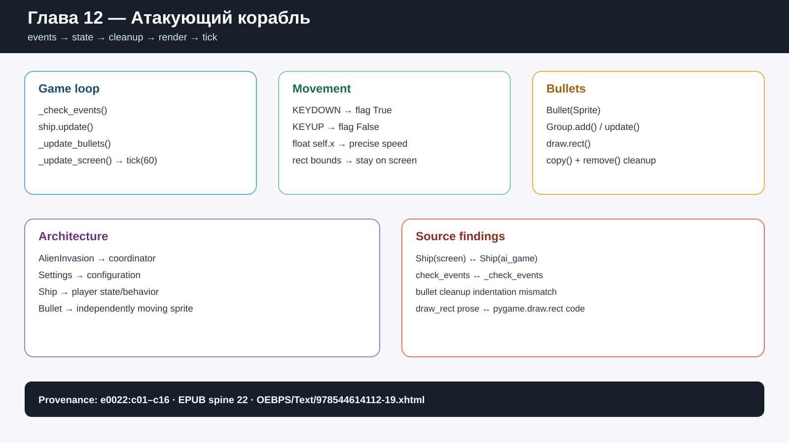
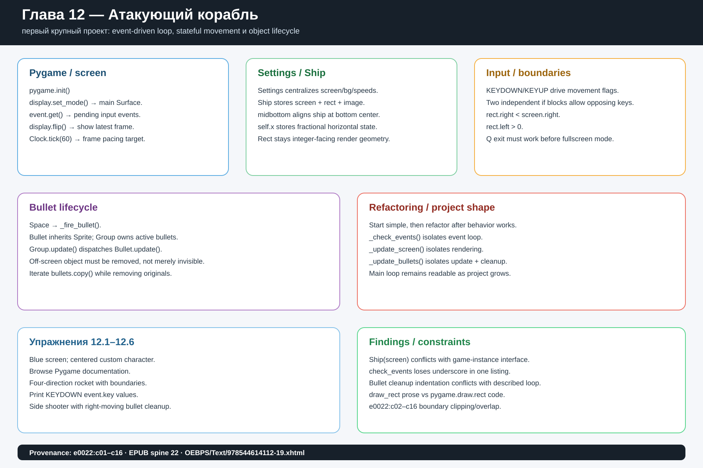

# Глава 12 — Атакующий корабль

RAG-grounded заметки по главе 12 книги «Изучаем Python: программирование игр, визуализация данных, веб-приложения. 3-е изд.».

## Идентификация

- Book ID: `python-crash-course-3e-ru-2024`
- Глава: 12
- Название: «Атакующий корабль»
- Slug: `attacking-ship`
- Source policy: `rag_only`
- External sources: запрещены
- Model memory: запрещена
- Readiness contract: `BIBLIOTEKA-VSP-BOOK-READINESS v1.3`
- Chapter contract: `BIBLIOTEKA-VSP-CHAPTER-ARTIFACT-COLLECTION v1.7`
- Book readiness: `READY`
- Readiness evidence: workflow run `37485161334`; последующие изменения до стартового `main` не затрагивали source/RAG/contracts.

## Provenance

- RAG chunks: `e0022:c01`–`e0022:c16`
- EPUB spine item: `22`
- EPUB locator: `OEBPS/Text/978544614112-19.xhtml`
- `e0021:c01` — вступление «Часть II. Проекты».
- `e0022:c01` начинается заголовком «12. Атакующий корабль».
- `e0022:c16` содержит упражнение 12.6 и «Резюме».
- `e0023:c01` начинается главой 13 «Осторожно, пришельцы!».
- Chapter boundary verified: yes
- Source SHA-256: `a1e5ce950d3f9e2e38be23191250a46313b9b7d28663319970f4897902151f6c`

## Содержимое

- [cheatsheet.md](cheatsheet.md) — архитектура игрового цикла, движение, стрельба и cleanup.
- [commands.md](commands.md) — source-confirmed команды/вызовы с risk classification.
- [diagram.md](diagram.md) — Mermaid-потоки игрового цикла и bullets lifecycle.
- [summary.md](summary.md) — chapter-end summary.
- [review-questions.md](review-questions.md) — упражнения 12.1–12.6.
- [review-answers.md](review-answers.md) — RAG-grounded шаблоны.
- [source-findings.md](source-findings.md) — source/code/extraction mismatches.
- [visual-cheatsheet.svg](visual-cheatsheet.svg) — компактный обзор.
- [visual-cheatsheet-detailed.svg](visual-cheatsheet-detailed.svg) — подробный обзор.

## Карта главы

1. Планирование игры «Инопланетное вторжение».
2. Установка Pygame.
3. Основной класс `AlienInvasion`.
4. `pygame.init()`, window surface и event loop.
5. `pygame.display.flip()`.
6. Ограничение FPS через `Clock.tick(60)`.
7. RGB background.
8. Отдельный `Settings`.
9. Изображение корабля и `Ship`.
10. Pygame `Rect` и позиционирование.
11. Регулярный рефакторинг: `_check_events()`, `_update_screen()`.
12. KEYDOWN/KEYUP и flags движения.
13. Fractional position через отдельный `self.x`.
14. Ограничение корабля границами окна.
15. Выход по `Q` и fullscreen.
16. `Bullet(Sprite)`, `pygame.sprite.Group`.
17. Выстрел по Space.
18. Cleanup объектов за экраном.
19. Ограничение числа bullets.
20. Рефакторинг `_update_bullets()`.
21. Упражнения 12.1–12.6.

## Краткий анализ

Глава переводит читателя от небольших скриптов к длительно работающему интерактивному приложению. Главная архитектурная идея — постоянный game loop: обработать input, обновить состояние объектов, перерисовать экран, ограничить частоту итераций.

Код постепенно разделяется по ответственности. `Settings` хранит конфигурацию; `Ship` отвечает за корабль; `Bullet` — за снаряд; `AlienInvasion` координирует цикл и ресурсы. По мере роста методы регулярно выносятся в helper methods.

Движение строится через состояние, а не одноразовое событие: KEYDOWN включает flag, KEYUP выключает. Позиция хранится отдельно в вещественном `self.x`, а `rect.x` используется для отображения.

Bullets показывают lifecycle объектов: создать → добавить в Group → update → draw → удалить после выхода за границу. Source отдельно объясняет, что невидимые объекты всё ещё потребляют memory/CPU, поэтому cleanup является обязательной частью цикла.

## Основной принцип

`input/events → state update → object cleanup → render → frame timing`.

Для большого проекта дополнительно:

`простая реализация → проверка → рефакторинг → следующая возможность`.

## Source findings

1. **[Source code/prose mismatch]** — `self.ship = Ship(screen)` конфликтует с сигнатурой `Ship(ai_game)` и пояснением, что передаётся instance `AlienInvasion`.
2. **[Source method-name mismatch]** — один листинг использует `def check_events(self)`, тогда как остальная глава вызывает/определяет `_check_events()`.
3. **[Source code/extraction mismatch]** — cleanup bullets и последующий render в `e0022:c15` извлечены с indentation вне `while`, хотя surrounding prose требует выполнения в каждой итерации.
4. **[Source terminology/code mismatch]** — prose упоминает `draw_rect()`, shown code использует `pygame.draw.rect()`.
5. **[Source extraction issue]** — `e0022:c02–c16` имеют boundary clipping/overlap.

## Ограничения

- Pygame не устанавливался и код не запускался.
- Актуальная совместимость Pygame/Python/current OS: `[Needs confirmation]`.
- Внешние Pygame docs и дополнительные материалы книги не открывались.
- `ship.bmp` и пользовательская графика не загружались.
