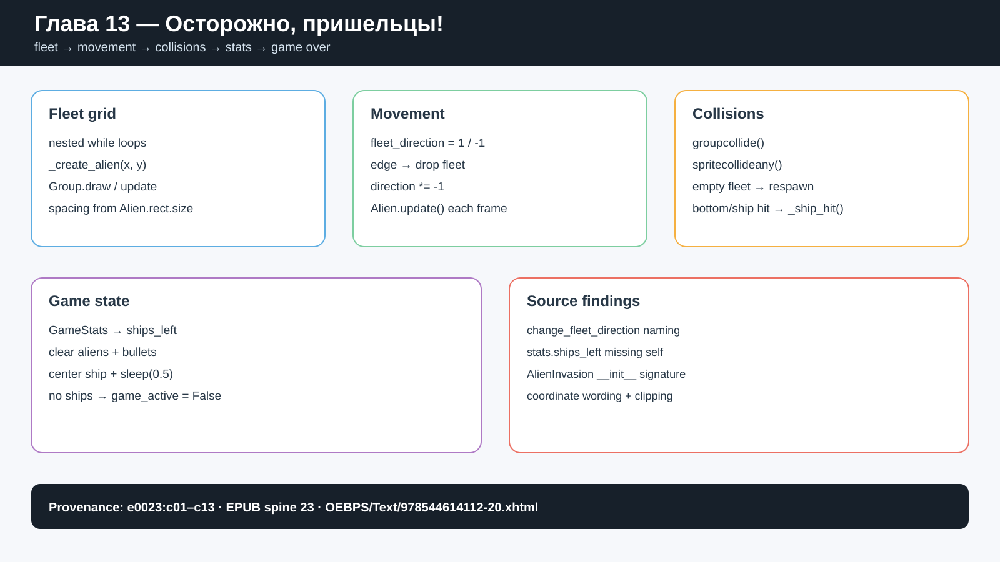
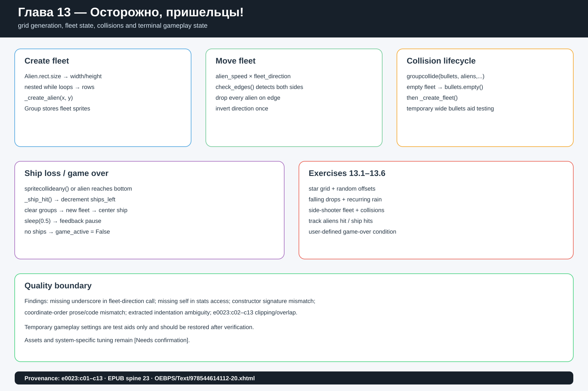

# Глава 13 — Осторожно, пришельцы!

RAG-grounded заметки по главе 13 книги «Изучаем Python: программирование игр, визуализация данных, веб-приложения. 3-е изд.».

## Идентификация

- Book ID: `python-crash-course-3e-ru-2024`
- Глава: 13
- Название: «Осторожно, пришельцы!»
- Slug: `watch-out-aliens`
- Source policy: `rag_only`
- External sources: запрещены
- Model memory: запрещена
- Readiness contract: `BIBLIOTEKA-VSP-BOOK-READINESS v1.3`
- Chapter contract: `BIBLIOTEKA-VSP-CHAPTER-ARTIFACT-COLLECTION v1.7`
- Book readiness: `READY`
- Readiness evidence: workflow run `37485161334`; последующие изменения до стартового `main` не затрагивали source/RAG/contracts.

## Provenance

- RAG chunks: `e0023:c01`–`e0023:c13`
- EPUB spine item: `23`
- EPUB locator: `OEBPS/Text/978544614112-20.xhtml`
- `e0023:c01` начинается заголовком «13. Осторожно, пришельцы!».
- `e0023:c13` содержит упражнение 13.6 и раздел «Резюме».
- `e0024:c01` начинается главой 14 «Игровой счет».
- Chapter boundary verified: yes
- Source SHA-256: `a1e5ce950d3f9e2e38be23191250a46313b9b7d28663319970f4897902151f6c`

## Содержимое

- [cheatsheet.md](cheatsheet.md) — fleet lifecycle, collision flow, game-over state.
- [commands.md](commands.md) — source-confirmed Pygame operations и state transitions.
- [diagram.md](diagram.md) — Mermaid-потоки fleet/collision/ship-loss.
- [summary.md](summary.md) — chapter-end summary.
- [review-questions.md](review-questions.md) — упражнения 13.1–13.6.
- [review-answers.md](review-answers.md) — RAG-grounded решения и шаблоны.
- [source-findings.md](source-findings.md) — source/code/extraction mismatches.
- [visual-cheatsheet.svg](visual-cheatsheet.svg) — компактный обзор.
- [visual-cheatsheet-detailed.svg](visual-cheatsheet-detailed.svg) — подробный обзор.

## Карта главы

1. Review проекта перед новой фазой.
2. `Alien(Sprite)` и первый пришелец.
3. `pygame.sprite.Group` для флота.
4. Создание ряда через `while`.
5. Refactor `_create_alien()`.
6. Вложенные `while` для fleet grid.
7. Случайное смещение элементов в упражнении.
8. `alien_speed`, `fleet_drop_speed`, `fleet_direction`.
9. Проверка достижения края через `check_edges()`.
10. Смена направления всего флота.
11. `pygame.sprite.groupcollide()`.
12. Временные test settings для ускорения проверки.
13. Пересоздание флота после уничтожения.
14. `pygame.sprite.spritecollideany()`.
15. `GameStats` и `ships_left`.
16. `_ship_hit()`, очистка групп и `sleep(0.5)`.
17. Проверка достижения нижнего края.
18. `game_active` и остановка обновлений после game over.
19. Упражнения 13.1–13.6.

## Краткий анализ

Глава развивает игру от одиночных объектов к управлению группами и состояниями системы. Fleet создаётся как вычисляемая grid: размеры `Alien.rect` используются для определения допустимого количества элементов по горизонтали и вертикали.

Движение флота основано на общем `fleet_direction`: каждый `Alien.update()` умножает горизонтальную скорость на `1` или `-1`. Если хотя бы один alien достигает края, весь fleet опускается на `fleet_drop_speed` и направление инвертируется.

Collision detection становится частью игрового lifecycle. `groupcollide()` связывает bullets и aliens и при нужных boolean flags удаляет collided objects. После уничтожения всего флота bullets очищаются и fleet создаётся заново.

Failure state игрока моделируется отдельно. `GameStats` хранит `ships_left`; столкновение с alien или достижение нижнего края вызывает одинаковую обработку. При исчерпании кораблей `game_active` становится `False`, но event handling и rendering продолжают работать.

Source также показывает pragmatic testing: временно увеличить bullet width, drop speed или уменьшить screen, чтобы быстрее проверить edge cases. После проверки настройки должны быть возвращены в нормальное состояние.

## Основной принцип

`group creation → group update → collision checks → cleanup/reset → state transition`.

Для game over:

`collision/bottom → ship loss → stats update → reset OR game_active=False`.

## Source findings

1. **[Source method-name mismatch]** — вызывается `self.change_fleet_direction()`, тогда как определён метод `_change_fleet_direction()`.
2. **[Source code mismatch]** — в `_ship_hit()` проверяется `stats.ships_left` без `self.`.
3. **[Source signature mismatch]** — один listing определяет `AlienInvasion.__init__(self, ai_game)`, тогда как остальная глава использует `__init__(self)`.
4. **[Source prose/code mismatch]** — prose говорит о передаче координат Y и X в `_create_alien()`, но shown call использует `(current_x, current_y)`.
5. **[Source extraction issue]** — `e0023:c02–c13` имеют boundary clipping/overlap.

## Ограничения

- Pygame code не запускался.
- `alien.bmp` и пользовательские assets не загружались.
- External materials книги не открывались.
- System-specific optimal speeds/settings: `[Needs confirmation]`.
