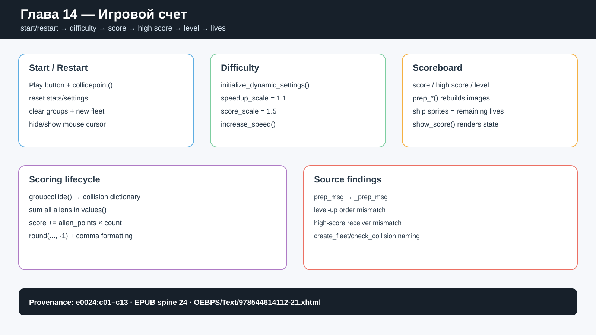
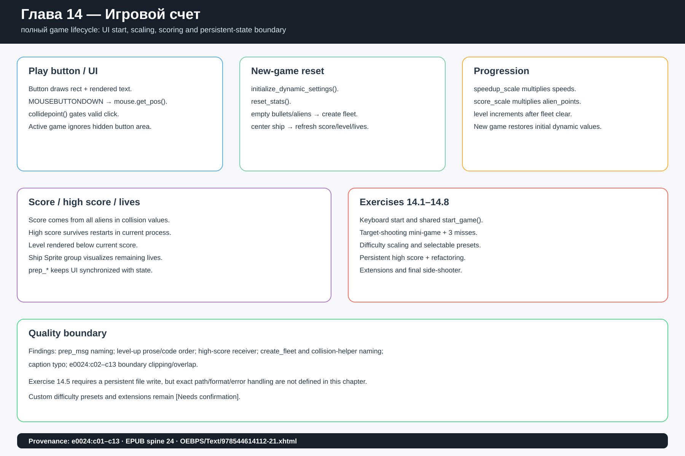

# Глава 14 — Игровой счет

RAG-grounded заметки по главе 14 книги «Изучаем Python: программирование игр, визуализация данных, веб-приложения. 3-е изд.».

## Идентификация

- Book ID: `python-crash-course-3e-ru-2024`
- Глава: 14
- Название: «Игровой счет»
- Slug: `game-score`
- Source policy: `rag_only`
- External sources: запрещены
- Model memory: запрещена
- Readiness contract: `BIBLIOTEKA-VSP-BOOK-READINESS v1.3`
- Chapter contract: `BIBLIOTEKA-VSP-CHAPTER-ARTIFACT-COLLECTION v1.7`
- Book readiness: `READY`
- Readiness evidence: workflow run `37485161334`; последующие изменения до стартового `main` не затрагивали source/RAG/contracts.

## Provenance

- RAG chunks: `e0024:c01`–`e0024:c13`
- EPUB spine item: `24`
- EPUB locator: `OEBPS/Text/978544614112-21.xhtml`
- `e0024:c01` начинается заголовком «14. Игровой счет».
- `e0024:c12–c13` содержат упражнения 14.5–14.8 и раздел «Резюме».
- `e0025:c01` начинается главой 15 «Генерирование данных».
- Chapter boundary verified: yes
- Source SHA-256: `a1e5ce950d3f9e2e38be23191250a46313b9b7d28663319970f4897902151f6c`

## Содержимое

- [cheatsheet.md](cheatsheet.md) — restart, difficulty scaling и scoreboard lifecycle.
- [commands.md](commands.md) — source-confirmed Pygame/UI/state operations.
- [diagram.md](diagram.md) — Mermaid-потоки start/restart, level-up и scoring.
- [summary.md](summary.md) — chapter-end summary.
- [review-questions.md](review-questions.md) — упражнения 14.1–14.8.
- [review-answers.md](review-answers.md) — RAG-grounded решения и границы.
- [source-findings.md](source-findings.md) — source/code/extraction mismatches.
- [visual-cheatsheet.svg](visual-cheatsheet.svg) — компактный обзор.
- [visual-cheatsheet-detailed.svg](visual-cheatsheet-detailed.svg) — подробный обзор.

## Карта главы

1. Неактивное начальное состояние игры.
2. Собственный класс `Button`.
3. `pygame.font.SysFont()` и `font.render()`.
4. Mouse click detection и `Rect.collidepoint()`.
5. Полный reset при запуске новой игры.
6. Защита скрытой Play-area от кликов во время active game.
7. Скрытие/возврат mouse cursor.
8. Static и dynamic settings.
9. `speedup_scale`, `initialize_dynamic_settings()`, `increase_speed()`.
10. Reset dynamic settings при новой игре.
11. `GameStats.score`.
12. `Scoreboard`, подготовка изображений счета.
13. Начисление очков за все collisions.
14. `score_scale` и рост стоимости alien.
15. Округление и форматирование score.
16. High score.
17. Level indicator.
18. Remaining ships как `Sprite Group`.
19. Exercises 14.1–14.8.
20. Завершение первого игрового проекта.

## Краткий анализ

Глава завершает архитектуру «Инопланетного вторжения», добавляя полноценный lifecycle игры: idle → start → active gameplay → game over → restart. Play button не просто включает `game_active`; при старте новой партии требуется сбросить статистику, dynamic settings, groups, fleet, ship position и графические представления score/level/ships.

UI input имеет собственную state boundary: область Play button существует даже когда кнопка не отображается. Поэтому mouse click должен запускать игру только при `not self.game_active`. После старта cursor скрывается, а при game over снова становится видимым.

Difficulty scaling отделяет static settings от dynamic. `initialize_dynamic_settings()` задаёт начальные скорости и направление fleet, а `increase_speed()` увеличивает значения по коэффициенту `speedup_scale`. При новой игре dynamic settings обязательно сбрасываются.

Scoring system показывает важную связь model и presentation. `GameStats` хранит score, high score и level; `Scoreboard` преобразует эти значения в renderable images. После изменения state необходимо явно вызвать соответствующий `prep_*`, иначе UI будет показывать устаревшее значение.

Collision dictionary используется для корректного начисления очков за несколько aliens, уничтоженных в одном проходе. High score не сбрасывается между партиями текущего процесса, а упражнение 14.5 предлагает сделать его persistent между запусками программы.

## Основной принцип

`state change → update model → rebuild affected UI image → render`.

Для новой партии:

`start input → reset transient stats/settings → clear groups → recreate fleet → center ship → rebuild scoreboard → activate game`.

## Source findings

1. **[Source method-name mismatch]** — `Button.__init__()` вызывает `prep_msg(msg)`, а определён метод `_prep_msg()`.
2. **[Source prose/code ordering mismatch]** — prose говорит повысить скорость перед созданием нового fleet, а shown listing вызывает `_create_fleet()` перед `increase_speed()`.
3. **[Source receiver mismatch]** — high-score block вызывает `self.check_high_score()`, хотя метод определён в `Scoreboard`.
4. **[Source method-name mismatch]** — level-up block вызывает `self.create_fleet()` вместо ранее определённого `_create_fleet()`.
5. **[Source method-name mismatch]** — один listing использует `check_bullet_alien_collisions()` без leading underscore.
6. **[Source extraction issue]** — `e0024:c02–c13` имеют boundary clipping/overlap.

## Ограничения

- Pygame code не запускался.
- Persistence implementation упражнения 14.5 в source главы не определён: путь, формат и failure handling — `[Needs confirmation]`.
- Appendix Г, на который ссылается exercise 14.6, в scope главы не загружалось.
- Конкретные difficulty presets и game extensions пользователь должен выбрать: `[Needs confirmation]`.
