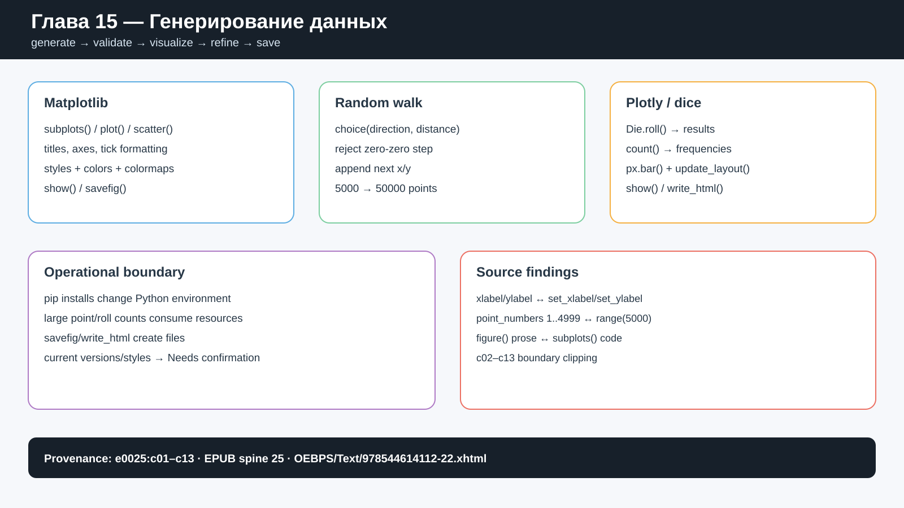
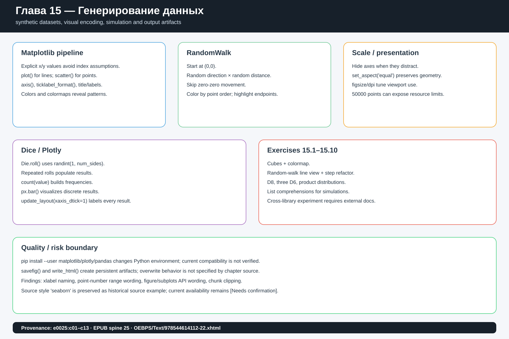

# Глава 15 — Генерирование данных

RAG-grounded заметки по главе 15 книги «Изучаем Python: программирование игр, визуализация данных, веб-приложения. 3-е изд.».

## Идентификация

- Book ID: `python-crash-course-3e-ru-2024`
- Глава: 15
- Название: «Генерирование данных»
- Slug: `generating-data`
- Source policy: `rag_only`
- External sources: запрещены
- Model memory: запрещена
- Readiness contract: `BIBLIOTEKA-VSP-BOOK-READINESS v1.3`
- Chapter contract: `BIBLIOTEKA-VSP-CHAPTER-ARTIFACT-COLLECTION v1.7`
- Book readiness: `READY`
- Readiness evidence: workflow run `37485161334`; последующие изменения до стартового `main` не затрагивали source/RAG/contracts.

## Provenance

- RAG chunks: `e0025:c01`–`e0025:c13`
- EPUB spine item: `25`
- EPUB locator: `OEBPS/Text/978544614112-22.xhtml`
- `e0025:c01` начинается заголовком «15. Генерирование данных».
- `e0025:c13` содержит упражнения 15.6–15.10 и раздел «Резюме».
- `e0026:c01` начинается главой 16 «Загрузка данных».
- Chapter boundary verified: yes
- Source SHA-256: `a1e5ce950d3f9e2e38be23191250a46313b9b7d28663319970f4897902151f6c`

## Содержимое

- [cheatsheet.md](cheatsheet.md) — Matplotlib, random walk и Plotly data pipeline.
- [commands.md](commands.md) — package/install/render/save operations с risk classification.
- [diagram.md](diagram.md) — Mermaid-потоки генерации и визуализации.
- [summary.md](summary.md) — chapter-end summary.
- [review-questions.md](review-questions.md) — упражнения 15.1–15.10.
- [review-answers.md](review-answers.md) — RAG-grounded решения и границы.
- [source-findings.md](source-findings.md) — source/prose/extraction mismatches.
- [visual-cheatsheet.svg](visual-cheatsheet.svg) — компактный обзор.
- [visual-cheatsheet-detailed.svg](visual-cheatsheet-detailed.svg) — подробный обзор.

## Карта главы

1. Data visualization и data analysis.
2. Установка Matplotlib.
3. `plt.subplots()`, `ax.plot()`, `plt.show()`.
4. Заголовки, подписи осей, tick formatting.
5. Явные X-values для корректного отображения.
6. Built-in styles.
7. `scatter()` для одной и множества точек.
8. Автоматическая генерация больших наборов данных.
9. Axis ranges, plain tick labels, colors и colormaps.
10. `savefig()`.
11. `RandomWalk`: generated coordinates.
12. `choice()`, direction/distance и zero-step rejection.
13. Visualization random walk.
14. Несколько random walks.
15. Color progression, start/end highlighting, hidden axes.
16. 50 000 points и screen sizing.
17. Plotly + pandas installation.
18. `Die` и `randint()`.
19. Simulation → results → frequencies.
20. Plotly Express `px.bar()`.
21. Two dice, mixed dice, `update_layout()`.
22. `write_html()`.
23. Exercises 15.1–15.10.

## Краткий анализ

Глава показывает полный synthetic-data pipeline: сгенерировать набор данных → проверить его структуру → визуализировать → настроить представление → сохранить результат.

В Matplotlib source начинает с минимального line plot и постепенно делает data mapping явным. Важный lesson: если X-values имеют смысл, их лучше передавать явно, иначе библиотека может выбрать индексы начиная с 0 и визуально сместить интерпретацию данных.

Scatter plots используются для больших наборов точек. Данные для 1000 квадратов создаются программно, затем style, axis range, color и colormap используются для усиления закономерностей. `savefig()` переводит visualization из интерактивного просмотра в persistent artifact.

Random walk отделяет генератор данных от visualization. `RandomWalk.fill_walk()` строит координаты последовательными случайными решениями, запрещая zero movement. Visualization затем может кодировать порядок точек цветом, выделять first/last points, скрывать axes и масштабироваться до десятков тысяч точек.

Plotly section повторяет тот же pipeline на дискретных вероятностных данных. `Die.roll()` генерирует результаты; frequencies вычисляются через count; `px.bar()` строит интерактивную диаграмму. Для нескольких dice source вычисляет min/max result на основе количества граней, чтобы код оставался адаптируемым.

## Основной принцип

`generate → validate → aggregate/transform → visualize → inspect → refine → optionally persist`.

Отдельно:

`data correctness` должна проверяться до cosmetic tuning visualization.

## Source findings

1. **[Source terminology/code mismatch]** — prose называет `xlabel()/ylabel()`, shown code использует `set_xlabel()/set_ylabel()`.
2. **[Source prose/code mismatch]** — для `point_numbers = range(rw.num_points)` prose говорит о числах от 1 до 4999, но при 5000 points выражение формирует диапазон 0..4999.
3. **[Source prose/code mismatch]** — описание screen sizing говорит о функции `figure()`, а shown examples настраивают `subplots(figsize=..., dpi=...)`.
4. **[Source extraction issue]** — `e0025:c02–c13` имеют boundary clipping/overlap.

## Ограничения

- Matplotlib/Plotly/pandas не устанавливались.
- Внешние galleries/docs Matplotlib и Plotly не открывались.
- Current package versions/API/style availability: `[Needs confirmation]`.
- `plt.style.use('seaborn')` сохранён как source example; доступность этого style в текущем окружении: `[Needs confirmation]`.
- File overwrite semantics для `savefig()` и `write_html()` source не описывает: `[Needs confirmation]`.
