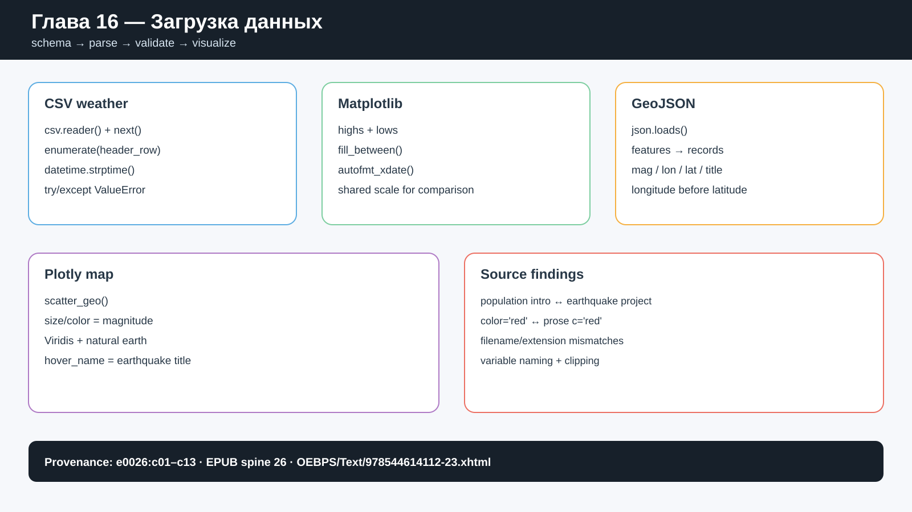
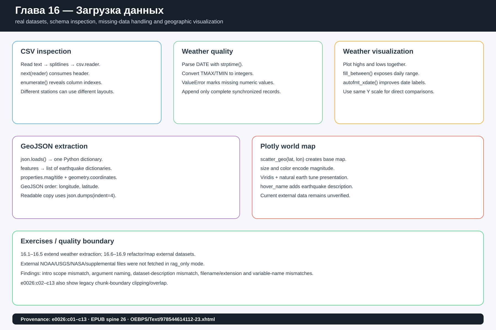

# Глава 16 — Загрузка данных

RAG-grounded заметки по главе 16 книги «Изучаем Python: программирование игр, визуализация данных, веб-приложения. 3-е изд.».

## Идентификация

- Book ID: `python-crash-course-3e-ru-2024`
- Глава: 16
- Название: «Загрузка данных»
- Slug: `downloading-data`
- Source policy: `rag_only`
- External sources: запрещены
- Model memory: запрещена
- Readiness contract: `BIBLIOTEKA-VSP-BOOK-READINESS v1.3`
- Chapter contract: `BIBLIOTEKA-VSP-CHAPTER-ARTIFACT-COLLECTION v1.7`
- Book readiness: `READY`
- Readiness evidence: workflow run `37485161334`; последующие изменения до стартового `main` не затрагивали source/RAG/contracts.

## Provenance

- RAG chunks: `e0026:c01`–`e0026:c13`
- EPUB spine item: `26`
- EPUB locator: `OEBPS/Text/978544614112-23.xhtml`
- `e0026:c01` начинается заголовком «16. Загрузка данных».
- `e0026:c13` содержит завершение упражнения 16.9 и раздел «Резюме».
- `e0027:c01` начинается главой 17 «Работа с API».
- Chapter boundary verified: yes
- Source SHA-256: `a1e5ce950d3f9e2e38be23191250a46313b9b7d28663319970f4897902151f6c`

## Содержимое

- [cheatsheet.md](cheatsheet.md) — CSV/GeoJSON extraction, validation и visualization pipeline.
- [commands.md](commands.md) — source-confirmed file/data/visualization operations.
- [diagram.md](diagram.md) — Mermaid-потоки weather и earthquake data.
- [summary.md](summary.md) — chapter-end summary.
- [review-questions.md](review-questions.md) — упражнения 16.1–16.9.
- [review-answers.md](review-answers.md) — RAG-grounded решения и границы.
- [source-findings.md](source-findings.md) — source/prose/code/extraction mismatches.
- [visual-cheatsheet.svg](visual-cheatsheet.svg) — компактный обзор.
- [visual-cheatsheet-detailed.svg](visual-cheatsheet-detailed.svg) — подробный обзор.

## Карта главы

1. Реальные datasets и два формата: CSV и GeoJSON.
2. `Path.read_text().splitlines()`.
3. `csv.reader()`, `next()`, `enumerate()`.
4. Извлечение TMAX/TMIN и преобразование `int()`.
5. Matplotlib weather plots.
6. `datetime.strptime()`.
7. Несколько datasets на одной диаграмме.
8. `fill_between()` и alpha.
9. Missing data → `ValueError` → `try-except-else`.
10. Ручное получение NOAA weather datasets.
11. Exercises 16.1–16.5.
12. GeoJSON как nested dictionaries/lists.
13. `json.loads()` и readable copy через `json.dumps(indent=4)`.
14. Извлечение `features`, `mag`, longitude, latitude, title.
15. GeoJSON coordinate order: longitude, latitude.
16. `px.scatter_geo()`.
17. Marker size/color, color scale, projection, hover text.
18. Exercises 16.6–16.9.

## Краткий анализ

Глава переводит visualization pipeline от synthetic data к внешним datasets. Главный operational lesson — сначала исследовать schema, затем извлекать нужные поля, валидировать/обрабатывать пропуски и только после этого строить visualization.

CSV section показывает schema discovery через header row. Вместо немедленного предположения об индексах source сначала выводит заголовки и их позиции через `enumerate()`. Для разных weather stations layout действительно различается: в Sitka TMAX/TMIN показаны на индексах 4/5, в Death Valley — 3/4.

Dates преобразуются из strings в `datetime`, после чего Matplotlib может использовать их как X-values. High/low series объединяются на одном plot, а `fill_between()` визуально кодирует диапазон между ними.

Missing data рассматривается как нормальная часть реальных datasets. Source показывает `ValueError` при попытке преобразовать пустую строку и переносит append операций в `else`, чтобы в synchronized lists попадали только complete records.

GeoJSON section показывает более глубокую nested structure. JSON сначала преобразуется в Python dictionary, затем `features` даёт список earthquake records. Для каждого события извлекаются magnitude, longitude, latitude и title. Source отдельно предупреждает, что GeoJSON использует порядок coordinates `longitude, latitude`.

Plotly `scatter_geo()` строит global map; size и color кодируют magnitude, projection меняет представление карты, а `hover_name` добавляет контекст к marker.

## Основной принцип

`inspect schema → locate fields → parse/convert → handle missing/invalid records → validate extracted lists → visualize → refine presentation`.

Для внешних данных дополнительно: provenance, дата и schema dataset должны быть подтверждены до сравнения результатов.

## Source findings

1. **[Source scope/prose mismatch]** — вступление упоминает GeoJSON «данных численности населения», но фактический GeoJSON-проект главы посвящён earthquake data.
2. **[Source prose/code mismatch]** — shown code использует `color='red'`, prose описывает аргумент как `c='red'`.
3. **[Source dataset-description mismatch]** — shown simple Sitka header не содержит PRCP, но prose говорит, что simple dataset содержит precipitation и temperature data.
4. **[Source filename mismatch]** — earthquake dataset назван несколькими несовместимыми вариантами: `q_1_day_m1.geojson`, `eq_1_day_m1.json`, `eq_data_1_day_m1.geojson`.
5. **[Source filename mismatch]** — code пишет `readable_eq_data.geojson`, prose предлагает открыть `readable_eq_data.json`.
6. **[Source variable-name mismatch]** — prose о `features` говорит о сохранении данных в `all_eq_data`, shown code использует `all_eq_dicts`.
7. **[Source extraction issue]** — `e0026:c02–c13` имеют boundary clipping/overlap.

## Ограничения

- Weather/earthquake/fire datasets не скачивались.
- NOAA, USGS, NASA и supplemental book sites не открывались.
- Актуальные schemas/current observations: `[Needs confirmation]`.
- Файлы `weather_data/*`, `eq_data/*`, `world_fires_1_day.csv` в текущем рабочем окружении: `[Needs confirmation]`.
- Source examples содержат historical dataset counts/dates и не являются current-state evidence.
