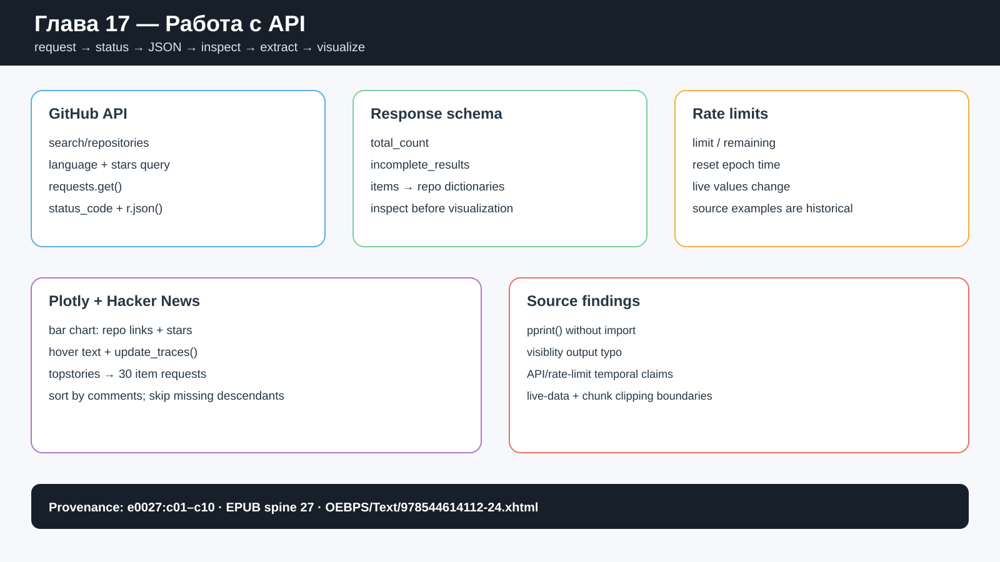
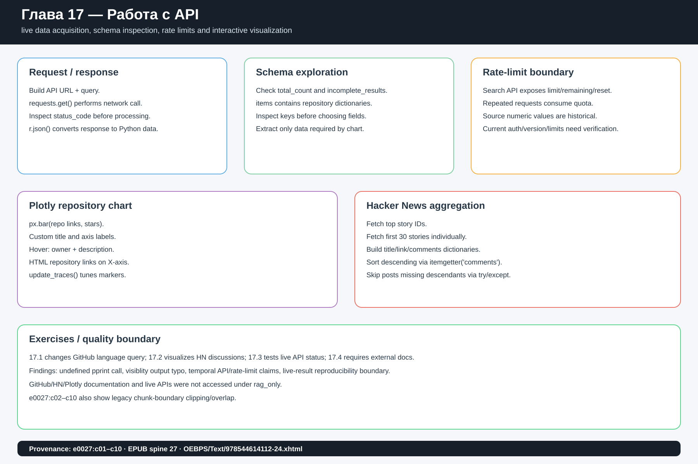

# Глава 17 — Работа с API

RAG-grounded заметки по главе 17 книги «Изучаем Python: программирование игр, визуализация данных, веб-приложения. 3-е изд.».

## Идентификация

- Book ID: `python-crash-course-3e-ru-2024`
- Глава: 17
- Название: «Работа с API»
- Slug: `working-with-apis`
- Source policy: `rag_only`
- External sources: запрещены
- Model memory: запрещена
- Readiness contract: `BIBLIOTEKA-VSP-BOOK-READINESS v1.3`
- Chapter contract: `BIBLIOTEKA-VSP-CHAPTER-ARTIFACT-COLLECTION v1.7`
- Book readiness: `READY`
- Readiness evidence: workflow run `37485161334`; последующие изменения до стартового `main` не затрагивали source/RAG/contracts.

## Provenance

- RAG chunks: `e0027:c01`–`e0027:c10`
- EPUB spine item: `27`
- EPUB locator: `OEBPS/Text/978544614112-24.xhtml`
- `e0027:c01` начинается заголовком «17. Работа с API».
- `e0027:c10` содержит упражнения 17.1–17.4 и раздел «Резюме».
- `e0028:c01` начинается главой 18 «Знакомство с Django».
- Chapter boundary verified: yes
- Source SHA-256: `a1e5ce950d3f9e2e38be23191250a46313b9b7d28663319970f4897902151f6c`

## Содержимое

- [cheatsheet.md](cheatsheet.md) — API request/response flow, rate limits, Plotly и Hacker News.
- [commands.md](commands.md) — package/network/render operations с risk classification.
- [diagram.md](diagram.md) — Mermaid-потоки GitHub API и Hacker News.
- [summary.md](summary.md) — chapter-end summary.
- [review-questions.md](review-questions.md) — упражнения 17.1–17.4.
- [review-answers.md](review-answers.md) — RAG-grounded решения и границы.
- [source-findings.md](source-findings.md) — source/code/temporal/extraction findings.
- [visual-cheatsheet.svg](visual-cheatsheet.svg) — компактный обзор.
- [visual-cheatsheet-detailed.svg](visual-cheatsheet-detailed.svg) — подробный обзор.

## Карта главы

1. Web API как интерфейс для программ.
2. Git/GitHub context.
3. GitHub repository search API.
4. Query parameters: language, sort, stars.
5. Установка `requests`.
6. `requests.get()`, headers, `status_code`, `r.json()`.
7. Исследование response dictionary.
8. `total_count`, `incomplete_results`, `items`.
9. Извлечение repository fields.
10. Rate limits.
11. Plotly bar chart для popular repositories.
12. Titles/labels/layout.
13. Custom hover text.
14. HTML links в X-axis labels.
15. `update_traces()`.
16. GitHub/Plotly documentation references.
17. Hacker News API.
18. Pretty-print JSON через `json.dumps(indent=4)`.
19. Top stories → per-item requests.
20. `itemgetter()` + `sorted()`.
21. Missing `descendants` → possible `KeyError`.
22. Exercises 17.1–17.4.

## Краткий анализ

Глава переводит data visualization от заранее скачанных файлов к автоматическому сетевому получению данных. Базовый pipeline: сформировать API request → выполнить network call → проверить status → преобразовать JSON → исследовать schema → извлечь нужные поля → визуализировать.

GitHub section показывает, что response schema сначала нужно исследовать. Source выводит top-level keys, число repository dictionaries и keys первого repository, а затем выбирает только поля, нужные для visualization: name, owner, stars, URL и description.

Отдельный operational аспект — rate limits. Source показывает endpoint `/rate_limit` и объясняет поля `limit`, `remaining`, `reset`. Эти числовые примеры относятся к моменту написания книги и не являются current-state evidence.

Plotly visualization строится по принципу progressive refinement: сначала простой `px.bar()`, затем title/labels, hover text, clickable repository labels и trace formatting.

Hacker News section показывает multi-request workflow: один call возвращает IDs top stories, затем для первых 30 IDs выполняются отдельные item calls. Результаты нормализуются в dictionaries и сортируются по количеству comments.

## Основной принцип

`request → check response → decode JSON → inspect schema → extract only required fields → visualize/aggregate`.

Для live API дополнительно:

`response content, rate limit and availability` должны считаться динамическими и проверяться в момент выполнения.

## Source findings

1. **[Source code mismatch]** — `pprint(...)` вызывается без импорта/определения в показанном `python_repos.py`; окружающий код использует `print(...)`.
2. **[Source output typo]** — в sample list repository keys показано `visiblity`.
3. **[Source temporal claim boundary]** — API version/header, unauthenticated rate-limit values, repository counts/stars и Hacker News IDs — historical source-time values, не current evidence.
4. **[Source live-data reproducibility boundary]** — outputs зависят от live GitHub/Hacker News responses и не гарантируют повторение sample output.
5. **[Source extraction issue]** — `e0027:c02–c10` имеют boundary clipping/overlap.

## Ограничения

- GitHub API и Hacker News API не вызывались.
- Plotly/GitHub/Hacker News documentation не открывалась.
- Current API versions, schemas, authentication requirements и rate limits: `[Needs confirmation]`.
- Package `requests` не устанавливался.
- Source mentions access tokens, but secret storage/handling policy is outside this chapter: `[Needs confirmation]`.
