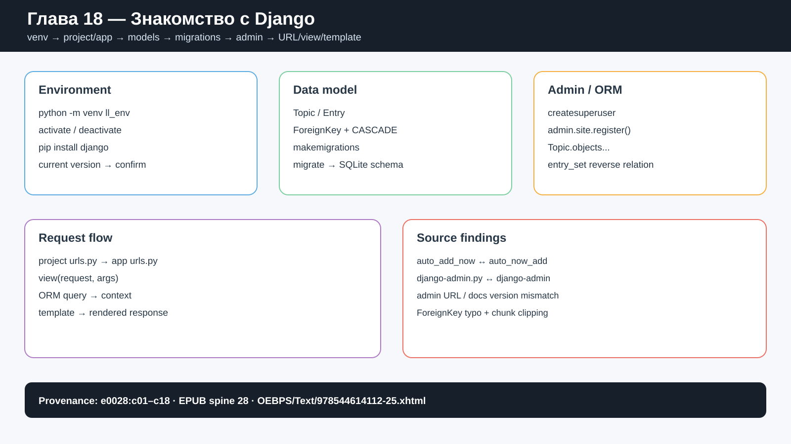
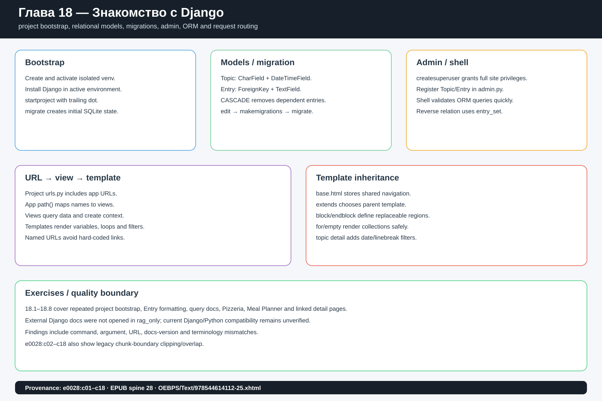

# Глава 18 — Знакомство с Django

RAG-grounded заметки по главе 18 книги «Изучаем Python: программирование игр, визуализация данных, веб-приложения. 3-е изд.».

## Идентификация

- Book ID: `python-crash-course-3e-ru-2024`
- Глава: 18
- Название: «Знакомство с Django»
- Slug: `getting-started-with-django`
- Source policy: `rag_only`
- External sources: запрещены
- Model memory: запрещена
- Readiness contract: `BIBLIOTEKA-VSP-BOOK-READINESS v1.3`
- Chapter contract: `BIBLIOTEKA-VSP-CHAPTER-ARTIFACT-COLLECTION v1.7`
- Book readiness: `READY`
- Readiness evidence: workflow run `37485161334`; последующие изменения до стартового `main` не затрагивали source/RAG/contracts.

## Provenance

- RAG chunks: `e0028:c01`–`e0028:c18`
- EPUB spine item: `28`
- EPUB locator: `OEBPS/Text/978544614112-25.xhtml`
- `e0028:c01` начинается заголовком «18. Знакомство с Django».
- `e0028:c18` содержит упражнения 18.7–18.8 и раздел «Резюме».
- `e0029:c01` начинается главой 19 «Учетные записи пользователей».
- Chapter boundary verified: yes
- Source SHA-256: `a1e5ce950d3f9e2e38be23191250a46313b9b7d28663319970f4897902151f6c`

## Содержимое

- [cheatsheet.md](cheatsheet.md) — project/app/model/migration/admin/view/template flow.
- [commands.md](commands.md) — source-confirmed Django commands с state/risk classification.
- [diagram.md](diagram.md) — Mermaid-потоки setup, ORM и request routing.
- [summary.md](summary.md) — chapter-end summary.
- [review-questions.md](review-questions.md) — упражнения 18.1–18.8.
- [review-answers.md](review-answers.md) — RAG-grounded решения и границы.
- [source-findings.md](source-findings.md) — source/code/version/extraction mismatches.
- [visual-cheatsheet.svg](visual-cheatsheet.svg) — компактный обзор.
- [visual-cheatsheet-detailed.svg](visual-cheatsheet-detailed.svg) — подробный обзор.

## Карта главы

1. Спецификация проекта Learning Log.
2. Virtual environment через `venv`.
3. Activation/deactivation.
4. Установка/версионирование Django.
5. `django-admin startproject`.
6. Initial migration и SQLite.
7. Development server.
8. `startapp learning_logs`.
9. Model `Topic`.
10. `INSTALLED_APPS`.
11. `makemigrations` → `migrate`.
12. Superuser и admin site.
13. Model `Entry`, `ForeignKey`, `TextField`, `Meta`.
14. Django shell и QuerySet.
15. Reverse relation через `entry_set`.
16. URL → view → template.
17. Template inheritance.
18. Topics list page.
19. Topic detail page.
20. Filters `date` и `linebreaks`.
21. Exercises 18.1–18.8.

## Краткий анализ

Глава вводит полноценный web-application lifecycle на Django: изолировать project environment, создать project/app structure, определить data model, мигрировать database schema, ввести seed data через admin и затем связать URL, view и template.

Model layer строится вокруг двух сущностей. `Topic` хранит имя темы и timestamp создания. `Entry` связан с `Topic` через `ForeignKey`, хранит text и timestamp. `on_delete=models.CASCADE` задаёт destructive relationship semantics: удаление Topic удаляет связанные Entry.

Migration workflow является главным operational invariant главы: после изменения models выполняются `makemigrations learning_logs` и `migrate`. Source показывает это сначала для Topic, затем повторяет для Entry.

Django shell используется как read/diagnostic layer поверх ORM: `Topic.objects.all()`, `get(id=...)`, `entry_set.all()`. Это позволяет проверять query semantics до переноса кода в views.

Presentation flow разделяется на три слоя: URL pattern выбирает view; view получает/готовит data и формирует context; template отображает context. Template inheritance выносит общие элементы в `base.html`.

Глава заканчивается dynamic topic-detail page: URL содержит integer topic id, view извлекает Topic и связанные Entry, template выводит timestamp/text и связывается со списком тем через named URL.

## Основной принцип

`specification → isolated environment → project/app skeleton → model → migration → seed/admin → query → URL → view → template`.

Для model changes:

`edit models.py → makemigrations → inspect output → migrate → verify`.

## Source findings

1. **[Source argument-name mismatch]** — prose объясняет `auto_add_now=True`, shown code использует `auto_now_add=True`.
2. **[Source command mismatch]** — exercise 18.1 предлагает `django-admin.py startproject`, основной setup использует `django-admin startproject`.
3. **[Source URL mismatch]** — один admin example использует `http://localhost/admin/`, тогда как development server ранее работает на `:8000`.
4. **[Source terminology typo]** — `ForeignKey` в shell explanation написан как `ForeighKey`.
5. **[Source documentation-version mismatch]** — exercise 18.7 ссылается на Django template docs `en/2.2`, тогда как chapter setup/examples ориентированы на Django 4.1.
6. **[Source format-description mismatch]** — filter `date:'M d, Y H:i'` описан примером полного месяца, хотя shown format token `M` и example wording не полностью согласованы.
7. **[Source extraction issue]** — `e0028:c02–c18` имеют boundary clipping/overlap.

## Ограничения

- Django не устанавливался и project commands не выполнялись.
- Current Django/Python compatibility: `[Needs confirmation]`.
- External Django docs не открывались.
- Existing port/database/filesystem state: `[Needs confirmation]`.
- Superuser credentials должны задаваться пользователем; реальные credentials не хранятся в artifacts.
